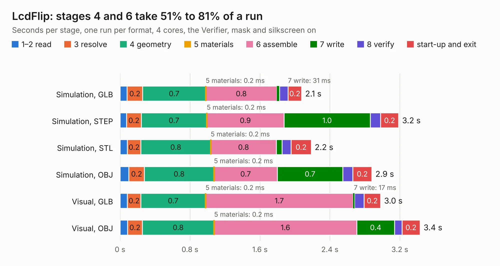

# 1032. LcdFlip

Board 1,032 of the 3,132 of [Corpus Testing](../Corpus-Testing.md), on [Corpus Page 10](../CorpusTestingPages/Corpus-Testing-10.md#1032-lcdflip).

| Mode and format | 1–2 read | 3 resolve | 4 geometry | 5 materials | 6 assemble | 7 write | 8 verify | start-up and exit | Total |
|---|---:|---:|---:|---:|---:|---:|---:|---:|---:|
| Simulation, GLB | 81&nbsp;ms | 0.2 | 0.7 | 0.2&nbsp;ms | 0.8 | 31&nbsp;ms | 97&nbsp;ms | 0.2 | 2.1 |
| Simulation, STEP | 76&nbsp;ms | 0.2 | 0.7 | 0.2&nbsp;ms | 0.9 | 1.0 | 0.1 | 0.2 | 3.2 |
| Simulation, STL | 84&nbsp;ms | 0.2 | 0.8 | 0.2&nbsp;ms | 0.8 | 65&nbsp;ms | 0.1 | 0.2 | 2.2 |
| Simulation, OBJ | 0.1 | 0.2 | 0.8 | 0.2&nbsp;ms | 0.7 | 0.7 | 0.1 | 0.2 | 2.9 |
| Visual, GLB | 84&nbsp;ms | 0.2 | 0.7 | 0.2&nbsp;ms | 1.7 | 17&nbsp;ms | 0.1 | 0.2 | 3.0 |
| Visual, OBJ | 87&nbsp;ms | 0.2 | 0.8 | 0.2&nbsp;ms | 1.6 | 0.4 | 84&nbsp;ms | 0.2 | 3.4 |

<table align="center"><tr><td valign="top">

| Board | Repo: [ghent360/prntrboardv2](https://github.com/ghent360/prntrboardv2) Board: `LcdFlip.kicad_pcb` |
|---|---|
| Folder | hardware |
| Complexity | 141&nbsp;/&nbsp;1000 (size&nbsp;106, features&nbsp;35) |
| KESE&nbsp;features | stack-up, dielectric εr and tanδ, mask and silkscreen colours |
| Tested | 9th November 2026 |
| Copper&nbsp;layers | 2 |
| File&nbsp;format | KiCad 6 (20210108) |
| Parts,&nbsp;tracks,&nbsp;vias | 4, 81, 0 |
| Triangles,&nbsp;simulation | 186,074 in 31 parts |
| Verifier | PASS in all six runs |

</td><td valign="top">

<table>
<tr><th>File type</th><th>File size</th><th>Peak memory used</th></tr>
<tr><th colspan="3" align="left">Simulation</th></tr>
<tr><td>GLB</td><td align="right">5.9&nbsp;MB</td><td align="right">196&nbsp;MB</td></tr>
<tr><td>STEP</td><td align="right">23&nbsp;MB</td><td align="right">213&nbsp;MB</td></tr>
<tr><td>STL</td><td align="right">9.3&nbsp;MB</td><td align="right">196&nbsp;MB</td></tr>
<tr><td>OBJ</td><td align="right">18&nbsp;MB</td><td align="right">193&nbsp;MB</td></tr>
<tr><th colspan="3" align="left">Visual</th></tr>
<tr><td>GLB</td><td align="right">3.4&nbsp;MB</td><td align="right">172&nbsp;MB</td></tr>
<tr><td>OBJ</td><td align="right">9.6&nbsp;MB</td><td align="right">173&nbsp;MB</td></tr>
</table>

</td></tr></table>

| Previous | Next |
|:---|---:|
| [1031. DRV-StepStick](b1031b_prntrboardv2_DRV-StepStick.md) | [1033. MP-Power](b1033b_prntrboardv2_MP-Power.md) |
