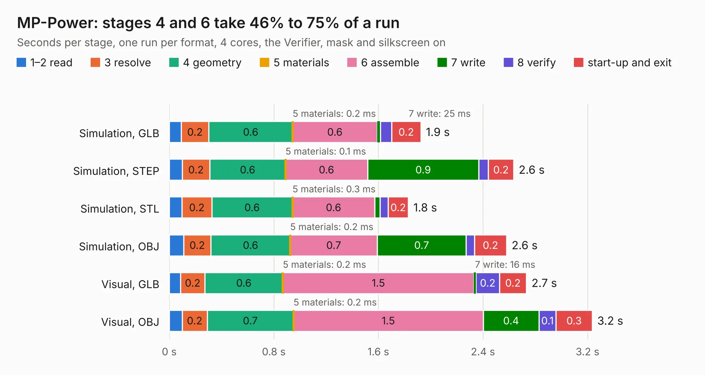

# 1032. MP-Power

Board 1,032 of the 3,124 of [Corpus Testing](../Corpus-Testing.md), on [Corpus Page 10](../CorpusTestingPages/Corpus-Testing-10.md#1032-mp-power).

| Mode and format | 1–2 read | 3 resolve | 4 geometry | 5 materials | 6 assemble | 7 write | 8 verify | start-up and exit | Total |
|---|---:|---:|---:|---:|---:|---:|---:|---:|---:|
| Simulation, GLB | 91&nbsp;ms | 0.2 | 0.6 | 0.2&nbsp;ms | 0.6 | 25&nbsp;ms | 86&nbsp;ms | 0.2 | 1.9 |
| Simulation, STEP | 0.1 | 0.2 | 0.6 | 0.1&nbsp;ms | 0.6 | 0.9 | 72&nbsp;ms | 0.2 | 2.6 |
| Simulation, STL | 97&nbsp;ms | 0.2 | 0.6 | 0.3&nbsp;ms | 0.6 | 42&nbsp;ms | 61&nbsp;ms | 0.2 | 1.8 |
| Simulation, OBJ | 0.1 | 0.2 | 0.6 | 0.2&nbsp;ms | 0.7 | 0.7 | 64&nbsp;ms | 0.2 | 2.6 |
| Visual, GLB | 86&nbsp;ms | 0.2 | 0.6 | 0.2&nbsp;ms | 1.5 | 16&nbsp;ms | 0.2 | 0.2 | 2.7 |
| Visual, OBJ | 99&nbsp;ms | 0.2 | 0.7 | 0.2&nbsp;ms | 1.5 | 0.4 | 0.1 | 0.3 | 3.2 |

<table align="center"><tr><td valign="top">

| Board | Repo: [ghent360/prntrboardv2](https://github.com/ghent360/prntrboardv2) Board: `MP-Power.kicad_pcb` |
|---|---|
| Folder | hardware |
| Complexity | 177&nbsp;/&nbsp;1000 (size&nbsp;132, features&nbsp;45) |
| KESE&nbsp;features | through vias, rounded, trapezoid or chamfered pads, filled zones |
| Tested | 9th November 2026 |
| Copper&nbsp;layers | 2 |
| File&nbsp;format | KiCad 6 (20191123) |
| Parts,&nbsp;tracks,&nbsp;vias | 12, 23, 60 |
| Triangles,&nbsp;simulation | 148,318 in 19 parts |
| Verifier | PASS in all six runs |

</td><td valign="top">

<table>
<tr><th>File type</th><th>File size</th><th>Peak memory used</th></tr>
<tr><th colspan="3" align="left">Simulation</th></tr>
<tr><td>GLB</td><td align="right">5.1&nbsp;MB</td><td align="right">202&nbsp;MB</td></tr>
<tr><td>STEP</td><td align="right">18&nbsp;MB</td><td align="right">204&nbsp;MB</td></tr>
<tr><td>STL</td><td align="right">7.4&nbsp;MB</td><td align="right">211&nbsp;MB</td></tr>
<tr><td>OBJ</td><td align="right">14&nbsp;MB</td><td align="right">199&nbsp;MB</td></tr>
<tr><th colspan="3" align="left">Visual</th></tr>
<tr><td>GLB</td><td align="right">3.4&nbsp;MB</td><td align="right">164&nbsp;MB</td></tr>
<tr><td>OBJ</td><td align="right">9.6&nbsp;MB</td><td align="right">163&nbsp;MB</td></tr>
</table>

</td></tr></table>

| Previous | Next |
|:---|---:|
| [1031. LcdFlip](b1031b_prntrboardv2_LcdFlip.md) | [1033. PrntrBoardV2](b1033b_prntrboardv2_PrntrBoardV2.md) |
