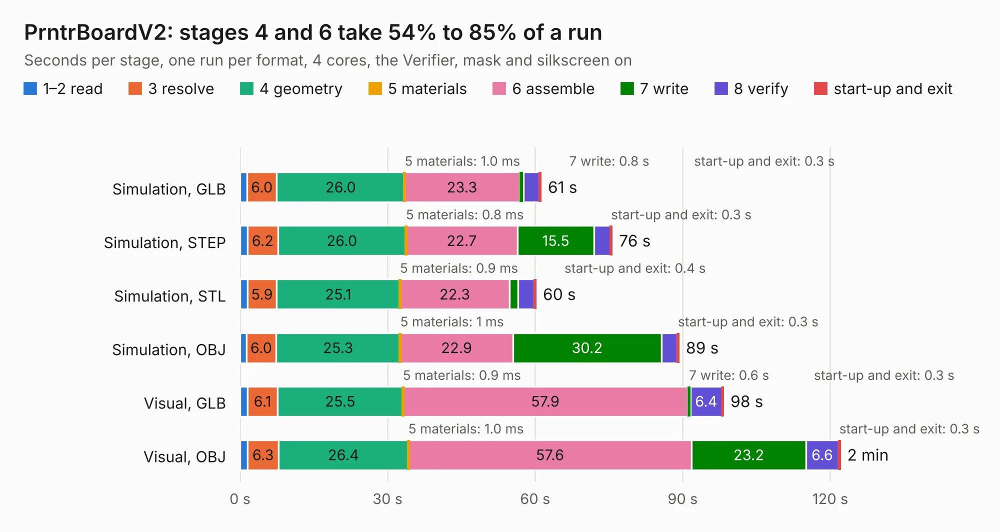

# 1032. PrntrBoardV2

Board 1,032 of the 3,120 of [Corpus Testing](../Corpus-Testing.md), on [Corpus Page 10](../CorpusTestingPages/Corpus-Testing-10.md#1032-prntrboardv2).

| Mode and format | 1–2 read | 3 resolve | 4 geometry | 5 materials | 6 assemble | 7 write | 8 verify | start-up and exit | Total |
|---|---:|---:|---:|---:|---:|---:|---:|---:|---:|
| Simulation, GLB | 1.4 | 6.0 | 26.0 | 1.0&nbsp;ms | 23.3 | 0.8 | 3.2 | 0.3 | 61.1 |
| Simulation, STEP | 1.5 | 6.2 | 26.0 | 0.8&nbsp;ms | 22.7 | 15.5 | 3.3 | 0.3 | 75.6 |
| Simulation, STL | 1.5 | 5.9 | 25.1 | 0.9&nbsp;ms | 22.3 | 1.7 | 3.3 | 0.4 | 60.1 |
| Simulation, OBJ | 1.3 | 6.0 | 25.3 | 1&nbsp;ms | 22.9 | 30.2 | 3.2 | 0.3 | 89.2 |
| Visual, GLB | 1.5 | 6.1 | 25.5 | 0.9&nbsp;ms | 57.9 | 0.6 | 6.4 | 0.3 | 98.3 |
| Visual, OBJ | 1.5 | 6.3 | 26.4 | 1.0&nbsp;ms | 57.6 | 23.2 | 6.6 | 0.3 | 122.0 |

<table align="center"><tr><td valign="top">

| Board | Repo: [ghent360/prntrboardv2](https://github.com/ghent360/prntrboardv2) Board: `PrntrBoardV2.kicad_pcb` |
|---|---|
| Folder | hardware |
| Complexity | 366&nbsp;/&nbsp;1000 (size&nbsp;261, features&nbsp;105) |
| KESE&nbsp;features | through vias, rounded, trapezoid or chamfered pads, filled zones, curved board outline, stack-up, dielectric εr and tanδ, copper finish, mask and silkscreen colours |
| Tested | 9th November 2026 |
| Copper&nbsp;layers | 2 |
| File&nbsp;format | KiCad 6 (20211014) |
| Parts,&nbsp;tracks,&nbsp;vias | 279, 3,476, 915 |
| Triangles,&nbsp;simulation | 5,407,066 in 262 parts |
| Verifier | PASS in all six runs |

</td><td valign="top">

<table>
<tr><th>File type</th><th>File size</th><th>Peak memory used</th></tr>
<tr><th colspan="3" align="left">Simulation</th></tr>
<tr><td>GLB</td><td align="right">185&nbsp;MB</td><td align="right">1.7&nbsp;GB</td></tr>
<tr><td>STEP</td><td align="right">955&nbsp;MB</td><td align="right">2.2&nbsp;GB</td></tr>
<tr><td>STL</td><td align="right">270&nbsp;MB</td><td align="right">1.6&nbsp;GB</td></tr>
<tr><td>OBJ</td><td align="right">578&nbsp;MB</td><td align="right">3.5&nbsp;GB</td></tr>
<tr><th colspan="3" align="left">Visual</th></tr>
<tr><td>GLB</td><td align="right">143&nbsp;MB</td><td align="right">2.3&nbsp;GB</td></tr>
<tr><td>OBJ</td><td align="right">456&nbsp;MB</td><td align="right">2.9&nbsp;GB</td></tr>
</table>

</td></tr></table>

| Previous | Next |
|:---|---:|
| [1031. MP-Power](b1031b_prntrboardv2_MP-Power.md) | [1033. T12_Control](b1033b_prntrboardv2_T12-Control.md) |
