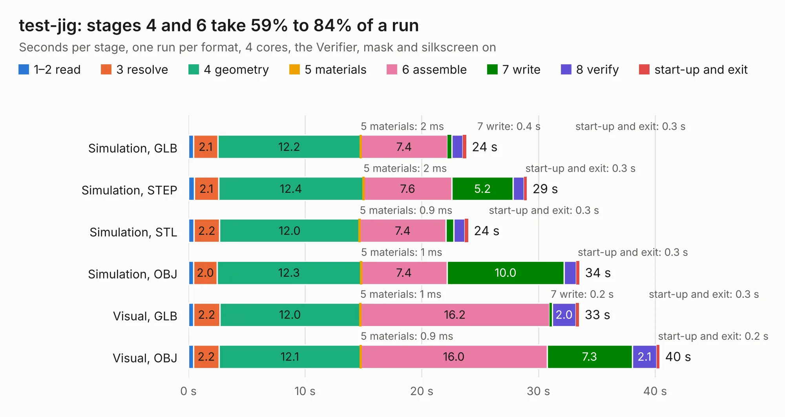

# 1033. test-jig

Board 1,033 of the 3,100 of [Corpus Testing](../Corpus-Testing.md), on [Corpus Page 10](../CorpusTestingPages/Corpus-Testing-10.md#1033-test-jig).

| Mode and format | 1–2 read | 3 resolve | 4 geometry | 5 materials | 6 assemble | 7 write | 8 verify | start-up and exit | Total |
|---|---:|---:|---:|---:|---:|---:|---:|---:|---:|
| Simulation, GLB | 0.4 | 2.1 | 12.2 | 2&nbsp;ms | 7.4 | 0.4 | 1.0 | 0.3 | 23.8 |
| Simulation, STEP | 0.5 | 2.1 | 12.4 | 2&nbsp;ms | 7.6 | 5.2 | 0.9 | 0.3 | 29.0 |
| Simulation, STL | 0.5 | 2.2 | 12.0 | 0.9&nbsp;ms | 7.4 | 0.7 | 0.9 | 0.3 | 24.0 |
| Simulation, OBJ | 0.4 | 2.0 | 12.3 | 1&nbsp;ms | 7.4 | 10.0 | 1.0 | 0.3 | 33.5 |
| Visual, GLB | 0.4 | 2.2 | 12.0 | 1&nbsp;ms | 16.2 | 0.2 | 2.0 | 0.3 | 33.5 |
| Visual, OBJ | 0.4 | 2.2 | 12.1 | 0.9&nbsp;ms | 16.0 | 7.3 | 2.1 | 0.2 | 40.4 |

<table align="center"><tr><td valign="top">

| Board | Repo: [GlasgowEmbedded/glasgow](https://github.com/GlasgowEmbedded/glasgow) Board: `test-jig.kicad_pcb` |
|---|---|
| Folder | hardware / boards / test-jig |
| Complexity | 270&nbsp;/&nbsp;1000 (size&nbsp;190, features&nbsp;80) |
| KESE&nbsp;features | through vias, custom pads, rounded, trapezoid or chamfered pads, filled zones, copper drawings, curved board outline |
| Tested | 9th November 2026 |
| Copper&nbsp;layers | 2 |
| File&nbsp;format | KiCad 5 (20171130) |
| Parts,&nbsp;tracks,&nbsp;vias | 117, 1,257, 123 |
| Triangles,&nbsp;simulation | 1,980,538 in 106 parts |
| Verifier | PASS in all six runs |

</td><td valign="top">

<table>
<tr><th>File type</th><th>File size</th><th>Peak memory used</th></tr>
<tr><th colspan="3" align="left">Simulation</th></tr>
<tr><td>GLB</td><td align="right">69&nbsp;MB</td><td align="right">722&nbsp;MB</td></tr>
<tr><td>STEP</td><td align="right">372&nbsp;MB</td><td align="right">855&nbsp;MB</td></tr>
<tr><td>STL</td><td align="right">99&nbsp;MB</td><td align="right">792&nbsp;MB</td></tr>
<tr><td>OBJ</td><td align="right">210&nbsp;MB</td><td align="right">1.4&nbsp;GB</td></tr>
<tr><th colspan="3" align="left">Visual</th></tr>
<tr><td>GLB</td><td align="right">47&nbsp;MB</td><td align="right">936&nbsp;MB</td></tr>
<tr><td>OBJ</td><td align="right">143&nbsp;MB</td><td align="right">1.0&nbsp;GB</td></tr>
</table>

</td></tr></table>

| Previous | Next |
|:---|---:|
| [1032. glasgow](b1032b_glasgow_hardware-boards-glasgow-revD1_glasgow.md) | [1034. gmm](b1034b_gmm7550-hardware_gmm.md) |
