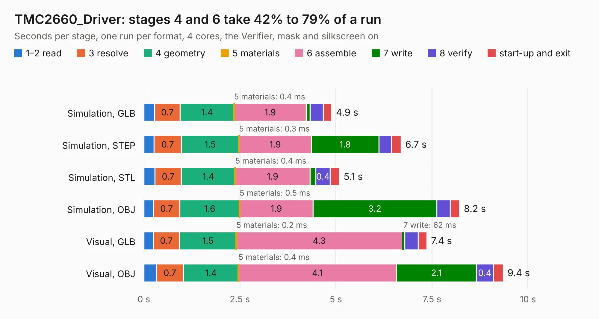

# 1033. TMC2660_Driver

Board 1,033 of the 3,117 of [Corpus Testing](../Corpus-Testing.md), on [Corpus Page 10](../CorpusTestingPages/Corpus-Testing-10.md#1033-tmc2660_driver).

| Mode and format | 1–2 read | 3 resolve | 4 geometry | 5 materials | 6 assemble | 7 write | 8 verify | start-up and exit | Total |
|---|---:|---:|---:|---:|---:|---:|---:|---:|---:|
| Simulation, GLB | 0.3 | 0.7 | 1.4 | 0.4&nbsp;ms | 1.9 | 97&nbsp;ms | 0.3 | 0.2 | 4.9 |
| Simulation, STEP | 0.3 | 0.7 | 1.5 | 0.3&nbsp;ms | 1.9 | 1.8 | 0.3 | 0.2 | 6.7 |
| Simulation, STL | 0.3 | 0.7 | 1.4 | 0.4&nbsp;ms | 1.9 | 0.2 | 0.4 | 0.2 | 5.1 |
| Simulation, OBJ | 0.3 | 0.7 | 1.6 | 0.5&nbsp;ms | 1.9 | 3.2 | 0.4 | 0.2 | 8.2 |
| Visual, GLB | 0.2 | 0.7 | 1.5 | 0.2&nbsp;ms | 4.3 | 62&nbsp;ms | 0.4 | 0.2 | 7.4 |
| Visual, OBJ | 0.3 | 0.7 | 1.4 | 0.4&nbsp;ms | 4.1 | 2.1 | 0.4 | 0.3 | 9.4 |

<table align="center"><tr><td valign="top">

| Board | Repo: [ghent360/prntrboardv2](https://github.com/ghent360/prntrboardv2) Board: `TMC2660_Driver.kicad_pcb` |
|---|---|
| Folder | hardware |
| Complexity | 283&nbsp;/&nbsp;1000 (size&nbsp;178, features&nbsp;105) |
| KESE&nbsp;features | through vias, rounded, trapezoid or chamfered pads, filled zones, curved board outline, stack-up, dielectric εr and tanδ, copper finish, mask and silkscreen colours |
| Tested | 9th November 2026 |
| Copper&nbsp;layers | 4 |
| File&nbsp;format | KiCad 6 (20210925) |
| Parts,&nbsp;tracks,&nbsp;vias | 28, 427, 105 |
| Triangles,&nbsp;simulation | 538,536 in 43 parts |
| Verifier | PASS in all six runs |

</td><td valign="top">

<table>
<tr><th>File type</th><th>File size</th><th>Peak memory used</th></tr>
<tr><th colspan="3" align="left">Simulation</th></tr>
<tr><td>GLB</td><td align="right">18&nbsp;MB</td><td align="right">307&nbsp;MB</td></tr>
<tr><td>STEP</td><td align="right">71&nbsp;MB</td><td align="right">372&nbsp;MB</td></tr>
<tr><td>STL</td><td align="right">27&nbsp;MB</td><td align="right">302&nbsp;MB</td></tr>
<tr><td>OBJ</td><td align="right">54&nbsp;MB</td><td align="right">419&nbsp;MB</td></tr>
<tr><th colspan="3" align="left">Visual</th></tr>
<tr><td>GLB</td><td align="right">12&nbsp;MB</td><td align="right">355&nbsp;MB</td></tr>
<tr><td>OBJ</td><td align="right">37&nbsp;MB</td><td align="right">353&nbsp;MB</td></tr>
</table>

</td></tr></table>

| Previous | Next |
|:---|---:|
| [1032. TMC2209_Driver](b1032b_prntrboardv2_TMC2209-Driver.md) | [1034. WiFi-Addon](b1034b_prntrboardv2_WiFi-Addon.md) |
