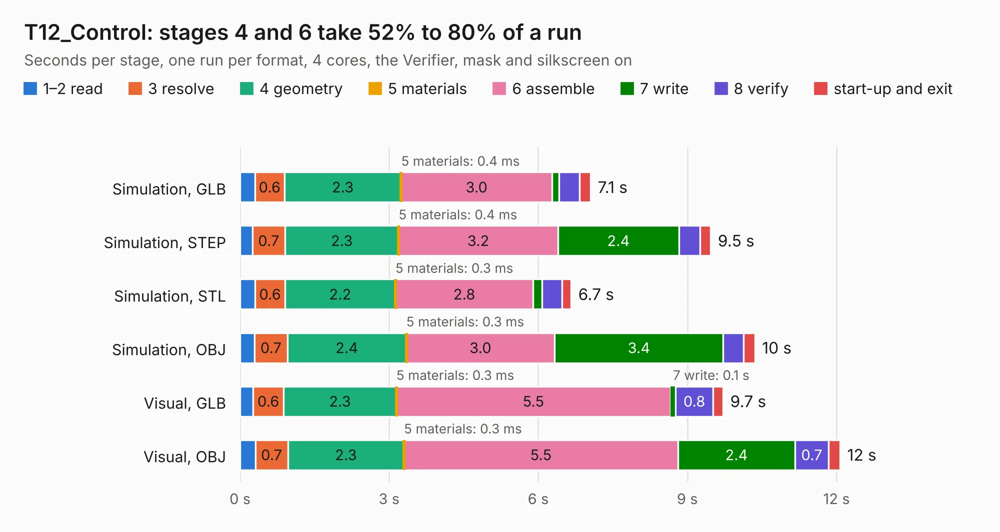

# 1034. T12_Control

Board 1,034 of the 3,127 of [Corpus Testing](../Corpus-Testing.md), on [Corpus Page 10](../CorpusTestingPages/Corpus-Testing-10.md#1034-t12_control).

| Mode and format | 1–2 read | 3 resolve | 4 geometry | 5 materials | 6 assemble | 7 write | 8 verify | start-up and exit | Total |
|---|---:|---:|---:|---:|---:|---:|---:|---:|---:|
| Simulation, GLB | 0.3 | 0.6 | 2.3 | 0.4&nbsp;ms | 3.0 | 0.1 | 0.4 | 0.2 | 7.1 |
| Simulation, STEP | 0.2 | 0.7 | 2.3 | 0.4&nbsp;ms | 3.2 | 2.4 | 0.4 | 0.2 | 9.5 |
| Simulation, STL | 0.3 | 0.6 | 2.2 | 0.3&nbsp;ms | 2.8 | 0.2 | 0.4 | 0.2 | 6.7 |
| Simulation, OBJ | 0.3 | 0.7 | 2.4 | 0.3&nbsp;ms | 3.0 | 3.4 | 0.4 | 0.2 | 10.4 |
| Visual, GLB | 0.3 | 0.6 | 2.3 | 0.3&nbsp;ms | 5.5 | 0.1 | 0.8 | 0.2 | 9.7 |
| Visual, OBJ | 0.3 | 0.7 | 2.3 | 0.3&nbsp;ms | 5.5 | 2.4 | 0.7 | 0.2 | 12.1 |

<table align="center"><tr><td valign="top">

| Board | Repo: [ghent360/prntrboardv2](https://github.com/ghent360/prntrboardv2) Board: `T12_Control.kicad_pcb` |
|---|---|
| Folder | hardware |
| Complexity | 325&nbsp;/&nbsp;1000 (size&nbsp;220, features&nbsp;105) |
| KESE&nbsp;features | through vias, rounded, trapezoid or chamfered pads, filled zones, curved board outline, stack-up, dielectric εr and tanδ, copper finish, mask and silkscreen colours |
| Tested | 9th November 2026 |
| Copper&nbsp;layers | 4 |
| File&nbsp;format | KiCad 6 (20210623) |
| Parts,&nbsp;tracks,&nbsp;vias | 52, 375, 66 |
| Triangles,&nbsp;simulation | 813,464 in 51 parts |
| Verifier | PASS in all six runs |

</td><td valign="top">

<table>
<tr><th>File type</th><th>File size</th><th>Peak memory used</th></tr>
<tr><th colspan="3" align="left">Simulation</th></tr>
<tr><td>GLB</td><td align="right">28&nbsp;MB</td><td align="right">402&nbsp;MB</td></tr>
<tr><td>STEP</td><td align="right">132&nbsp;MB</td><td align="right">464&nbsp;MB</td></tr>
<tr><td>STL</td><td align="right">41&nbsp;MB</td><td align="right">403&nbsp;MB</td></tr>
<tr><td>OBJ</td><td align="right">83&nbsp;MB</td><td align="right">588&nbsp;MB</td></tr>
<tr><th colspan="3" align="left">Visual</th></tr>
<tr><td>GLB</td><td align="right">19&nbsp;MB</td><td align="right">525&nbsp;MB</td></tr>
<tr><td>OBJ</td><td align="right">56&nbsp;MB</td><td align="right">531&nbsp;MB</td></tr>
</table>

</td></tr></table>

| Previous | Next |
|:---|---:|
| [1033. PrntrBoardV2](b1033b_prntrboardv2_PrntrBoardV2.md) | [1035. TMC2130_Driver](b1035b_prntrboardv2_TMC2130-Driver.md) |
