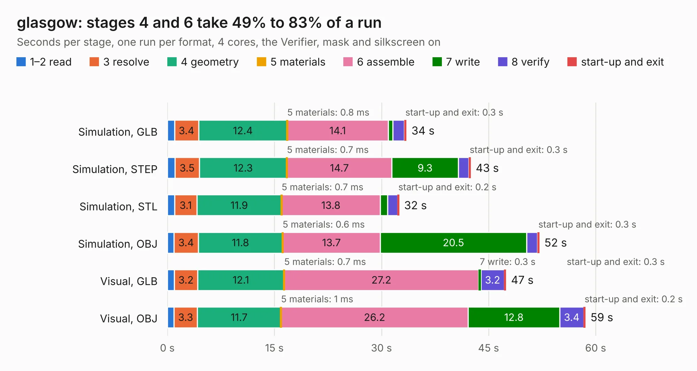

# 1035. glasgow

Board 1,035 of the 3,108 of [Corpus Testing](../Corpus-Testing.md), on [Corpus Page 10](../CorpusTestingPages/Corpus-Testing-10.md#1035-glasgow).

| Mode and format | 1–2 read | 3 resolve | 4 geometry | 5 materials | 6 assemble | 7 write | 8 verify | start-up and exit | Total |
|---|---:|---:|---:|---:|---:|---:|---:|---:|---:|
| Simulation, GLB | 1.0 | 3.4 | 12.4 | 0.8&nbsp;ms | 14.1 | 0.7 | 1.6 | 0.3 | 33.5 |
| Simulation, STEP | 1.1 | 3.5 | 12.3 | 0.7&nbsp;ms | 14.7 | 9.3 | 1.5 | 0.3 | 42.5 |
| Simulation, STL | 1.0 | 3.1 | 11.9 | 0.7&nbsp;ms | 13.8 | 1.0 | 1.4 | 0.2 | 32.5 |
| Simulation, OBJ | 0.9 | 3.4 | 11.8 | 0.6&nbsp;ms | 13.7 | 20.5 | 1.5 | 0.3 | 52.1 |
| Visual, GLB | 1.0 | 3.2 | 12.1 | 0.7&nbsp;ms | 27.2 | 0.3 | 3.2 | 0.3 | 47.5 |
| Visual, OBJ | 0.9 | 3.3 | 11.7 | 1&nbsp;ms | 26.2 | 12.8 | 3.4 | 0.2 | 58.6 |

<table align="center"><tr><td valign="top">

| Board | Repo: [GlasgowEmbedded/glasgow](https://github.com/GlasgowEmbedded/glasgow) Board: `glasgow.kicad_pcb` |
|---|---|
| Folder | hardware / boards / glasgow / revC2 |
| Complexity | 380&nbsp;/&nbsp;1000 (size&nbsp;290, features&nbsp;90) |
| KESE&nbsp;features | through vias, slotted holes, custom pads, rounded, trapezoid or chamfered pads, filled zones, copper drawings, curved board outline |
| Tested | 9th November 2026 |
| Copper&nbsp;layers | 4 |
| File&nbsp;format | KiCad 5 (20171130) |
| Parts,&nbsp;tracks,&nbsp;vias | 237, 4,737, 411 |
| Triangles,&nbsp;simulation | 3,784,492 in 241 parts |
| Verifier | PASS in all six runs |

</td><td valign="top">

<table>
<tr><th>File type</th><th>File size</th><th>Peak memory used</th></tr>
<tr><th colspan="3" align="left">Simulation</th></tr>
<tr><td>GLB</td><td align="right">128&nbsp;MB</td><td align="right">1.1&nbsp;GB</td></tr>
<tr><td>STEP</td><td align="right">524&nbsp;MB</td><td align="right">1.4&nbsp;GB</td></tr>
<tr><td>STL</td><td align="right">189&nbsp;MB</td><td align="right">1.2&nbsp;GB</td></tr>
<tr><td>OBJ</td><td align="right">397&nbsp;MB</td><td align="right">2.5&nbsp;GB</td></tr>
<tr><th colspan="3" align="left">Visual</th></tr>
<tr><td>GLB</td><td align="right">81&nbsp;MB</td><td align="right">1.6&nbsp;GB</td></tr>
<tr><td>OBJ</td><td align="right">258&nbsp;MB</td><td align="right">1.7&nbsp;GB</td></tr>
</table>

</td></tr></table>

| Previous | Next |
|:---|---:|
| [1034. glasgow](b1034b_glasgow_hardware-boards-glasgow-revC1_glasgow.md) | [1036. glasgow](b1036b_glasgow_hardware-boards-glasgow-revC3_glasgow.md) |
