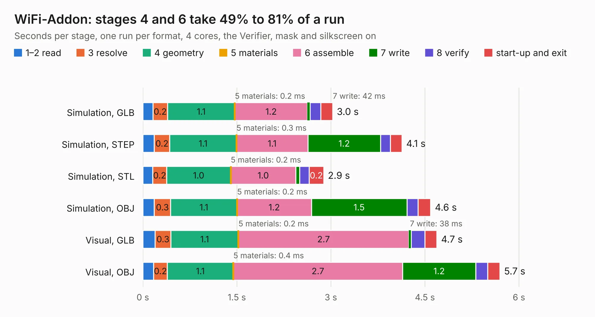

# 1035. WiFi-Addon

Board 1,035 of the 3,118 of [Corpus Testing](../Corpus-Testing.md), on [Corpus Page 10](../CorpusTestingPages/Corpus-Testing-10.md#1035-wifi-addon).

| Mode and format | 1–2 read | 3 resolve | 4 geometry | 5 materials | 6 assemble | 7 write | 8 verify | start-up and exit | Total |
|---|---:|---:|---:|---:|---:|---:|---:|---:|---:|
| Simulation, GLB | 0.2 | 0.2 | 1.1 | 0.2&nbsp;ms | 1.2 | 42&nbsp;ms | 0.2 | 0.2 | 3.0 |
| Simulation, STEP | 0.2 | 0.2 | 1.1 | 0.3&nbsp;ms | 1.1 | 1.2 | 0.2 | 0.2 | 4.1 |
| Simulation, STL | 0.2 | 0.2 | 1.0 | 0.2&nbsp;ms | 1.0 | 62&nbsp;ms | 0.2 | 0.2 | 2.9 |
| Simulation, OBJ | 0.2 | 0.3 | 1.1 | 0.2&nbsp;ms | 1.2 | 1.5 | 0.2 | 0.2 | 4.6 |
| Visual, GLB | 0.2 | 0.3 | 1.1 | 0.2&nbsp;ms | 2.7 | 38&nbsp;ms | 0.2 | 0.2 | 4.7 |
| Visual, OBJ | 0.2 | 0.2 | 1.1 | 0.4&nbsp;ms | 2.7 | 1.2 | 0.2 | 0.2 | 5.7 |

<table align="center"><tr><td valign="top">

| Board | Repo: [ghent360/prntrboardv2](https://github.com/ghent360/prntrboardv2) Board: `WiFi-Addon.kicad_pcb` |
|---|---|
| Folder | hardware |
| Complexity | 230&nbsp;/&nbsp;1000 (size&nbsp;140, features&nbsp;90) |
| KESE&nbsp;features | through vias, drill offsets, filled zones, curved board outline, stack-up, dielectric εr and tanδ, mask and silkscreen colours |
| Tested | 9th November 2026 |
| Copper&nbsp;layers | 2 |
| File&nbsp;format | KiCad 6 (20210108) |
| Parts,&nbsp;tracks,&nbsp;vias | 30, 143, 17 |
| Triangles,&nbsp;simulation | 281,736 in 42 parts |
| Verifier | PASS in all six runs |

</td><td valign="top">

<table>
<tr><th>File type</th><th>File size</th><th>Peak memory used</th></tr>
<tr><th colspan="3" align="left">Simulation</th></tr>
<tr><td>GLB</td><td align="right">9.8&nbsp;MB</td><td align="right">238&nbsp;MB</td></tr>
<tr><td>STEP</td><td align="right">49&nbsp;MB</td><td align="right">267&nbsp;MB</td></tr>
<tr><td>STL</td><td align="right">14&nbsp;MB</td><td align="right">239&nbsp;MB</td></tr>
<tr><td>OBJ</td><td align="right">28&nbsp;MB</td><td align="right">248&nbsp;MB</td></tr>
<tr><th colspan="3" align="left">Visual</th></tr>
<tr><td>GLB</td><td align="right">7.7&nbsp;MB</td><td align="right">271&nbsp;MB</td></tr>
<tr><td>OBJ</td><td align="right">23&nbsp;MB</td><td align="right">265&nbsp;MB</td></tr>
</table>

</td></tr></table>

| Previous | Next |
|:---|---:|
| [1034. TMC2660_Driver](b1034b_prntrboardv2_TMC2660-Driver.md) | [1036. XL-Power](b1036b_prntrboardv2_XL-Power.md) |
