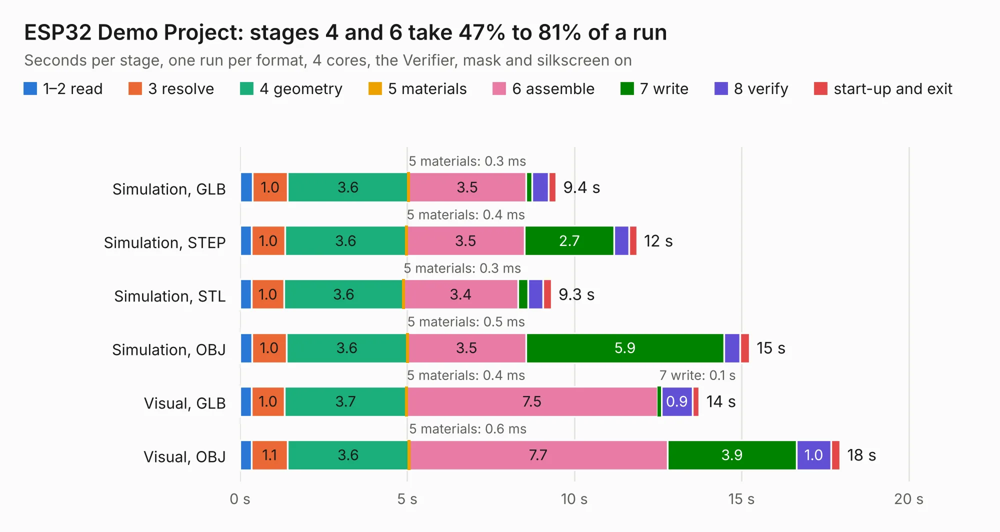

# 1036. ESP32 Demo Project

Board 1,036 of the 3,117 of [Corpus Testing](../Corpus-Testing.md), on [Corpus Page 10](../CorpusTestingPages/Corpus-Testing-10.md#1036-esp32-demo-project).

| Mode and format | 1–2 read | 3 resolve | 4 geometry | 5 materials | 6 assemble | 7 write | 8 verify | start-up and exit | Total |
|---|---:|---:|---:|---:|---:|---:|---:|---:|---:|
| Simulation, GLB | 0.4 | 1.0 | 3.6 | 0.3&nbsp;ms | 3.5 | 0.2 | 0.5 | 0.2 | 9.4 |
| Simulation, STEP | 0.3 | 1.0 | 3.6 | 0.4&nbsp;ms | 3.5 | 2.7 | 0.4 | 0.2 | 11.9 |
| Simulation, STL | 0.3 | 1.0 | 3.6 | 0.3&nbsp;ms | 3.4 | 0.3 | 0.5 | 0.2 | 9.3 |
| Simulation, OBJ | 0.4 | 1.0 | 3.6 | 0.5&nbsp;ms | 3.5 | 5.9 | 0.5 | 0.3 | 15.2 |
| Visual, GLB | 0.3 | 1.0 | 3.7 | 0.4&nbsp;ms | 7.5 | 0.1 | 0.9 | 0.2 | 13.7 |
| Visual, OBJ | 0.3 | 1.1 | 3.6 | 0.6&nbsp;ms | 7.7 | 3.9 | 1.0 | 0.3 | 17.9 |

<table align="center"><tr><td valign="top">

| Board | Repo: [gitRaksha/esp32-4layer-iot-board](https://github.com/gitRaksha/esp32-4layer-iot-board) Board: `ESP32 Demo Project.kicad_pcb` |
|---|---|
| Complexity | 305&nbsp;/&nbsp;1000 (size&nbsp;195, features&nbsp;110) |
| KESE&nbsp;features | through vias, slotted holes, rounded, trapezoid or chamfered pads, arc tracks, filled zones, curved board outline, stack-up, dielectric εr and tanδ |
| Tested | 9th November 2026 |
| Copper&nbsp;layers | 4 |
| File&nbsp;format | KiCad 9 (20241229) |
| Parts,&nbsp;tracks,&nbsp;vias | 80, 700, 123 |
| Triangles,&nbsp;simulation | 978,974 in 89 parts |
| Verifier | PASS in all six runs |

</td><td valign="top">

<table>
<tr><th>File type</th><th>File size</th><th>Peak memory used</th></tr>
<tr><th colspan="3" align="left">Simulation</th></tr>
<tr><td>GLB</td><td align="right">34&nbsp;MB</td><td align="right">442&nbsp;MB</td></tr>
<tr><td>STEP</td><td align="right">127&nbsp;MB</td><td align="right">499&nbsp;MB</td></tr>
<tr><td>STL</td><td align="right">49&nbsp;MB</td><td align="right">454&nbsp;MB</td></tr>
<tr><td>OBJ</td><td align="right">100&nbsp;MB</td><td align="right">711&nbsp;MB</td></tr>
<tr><th colspan="3" align="left">Visual</th></tr>
<tr><td>GLB</td><td align="right">21&nbsp;MB</td><td align="right">549&nbsp;MB</td></tr>
<tr><td>OBJ</td><td align="right">63&nbsp;MB</td><td align="right">538&nbsp;MB</td></tr>
</table>

</td></tr></table>

| Previous | Next |
|:---|---:|
| [1035. XL-Power](b1035b_prntrboardv2_XL-Power.md) | [1037. glasgow](b1037b_glasgow_hardware-boards-glasgow-revA_glasgow.md) |
