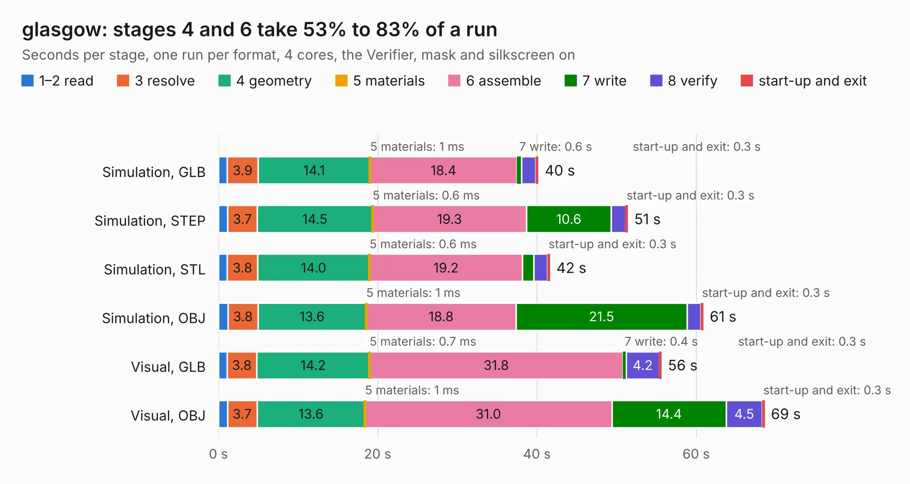

# 1037. glasgow

Board 1,037 of the 3,110 of [Corpus Testing](../Corpus-Testing.md), on [Corpus Page 10](../CorpusTestingPages/Corpus-Testing-10.md#1037-glasgow).

| Mode and format | 1–2 read | 3 resolve | 4 geometry | 5 materials | 6 assemble | 7 write | 8 verify | start-up and exit | Total |
|---|---:|---:|---:|---:|---:|---:|---:|---:|---:|
| Simulation, GLB | 1.1 | 3.9 | 14.1 | 1&nbsp;ms | 18.4 | 0.6 | 1.7 | 0.3 | 40.2 |
| Simulation, STEP | 1.2 | 3.7 | 14.5 | 0.6&nbsp;ms | 19.3 | 10.6 | 1.8 | 0.3 | 51.4 |
| Simulation, STL | 1.1 | 3.8 | 14.0 | 0.6&nbsp;ms | 19.2 | 1.4 | 1.7 | 0.3 | 41.6 |
| Simulation, OBJ | 1.2 | 3.8 | 13.6 | 1&nbsp;ms | 18.8 | 21.5 | 1.7 | 0.3 | 60.9 |
| Visual, GLB | 1.1 | 3.8 | 14.2 | 0.7&nbsp;ms | 31.8 | 0.4 | 4.2 | 0.3 | 55.6 |
| Visual, OBJ | 1.1 | 3.7 | 13.6 | 1&nbsp;ms | 31.0 | 14.4 | 4.5 | 0.3 | 68.6 |

<table align="center"><tr><td valign="top">

| Board | Repo: [GlasgowEmbedded/glasgow](https://github.com/GlasgowEmbedded/glasgow) Board: `glasgow.kicad_pcb` |
|---|---|
| Folder | hardware / boards / glasgow / revC3 |
| Complexity | 389&nbsp;/&nbsp;1000 (size&nbsp;289, features&nbsp;100) |
| KESE&nbsp;features | through vias, slotted holes, rounded, trapezoid or chamfered pads, filled zones, curved board outline, stack-up, dielectric εr and tanδ, mask and silkscreen colours |
| Tested | 9th November 2026 |
| Copper&nbsp;layers | 4 |
| File&nbsp;format | KiCad 7 (20221018) |
| Parts,&nbsp;tracks,&nbsp;vias | 238, 4,662, 409 |
| Triangles,&nbsp;simulation | 3,938,690 in 265 parts |
| Verifier | PASS in all six runs |

</td><td valign="top">

<table>
<tr><th>File type</th><th>File size</th><th>Peak memory used</th></tr>
<tr><th colspan="3" align="left">Simulation</th></tr>
<tr><td>GLB</td><td align="right">132&nbsp;MB</td><td align="right">1.2&nbsp;GB</td></tr>
<tr><td>STEP</td><td align="right">597&nbsp;MB</td><td align="right">1.5&nbsp;GB</td></tr>
<tr><td>STL</td><td align="right">197&nbsp;MB</td><td align="right">1.2&nbsp;GB</td></tr>
<tr><td>OBJ</td><td align="right">415&nbsp;MB</td><td align="right">2.6&nbsp;GB</td></tr>
<tr><th colspan="3" align="left">Visual</th></tr>
<tr><td>GLB</td><td align="right">89&nbsp;MB</td><td align="right">1.5&nbsp;GB</td></tr>
<tr><td>OBJ</td><td align="right">283&nbsp;MB</td><td align="right">1.9&nbsp;GB</td></tr>
</table>

</td></tr></table>

| Previous | Next |
|:---|---:|
| [1036. glasgow](b1036b_glasgow_hardware-boards-glasgow-revC2_glasgow.md) | [1038. glasgow](b1038b_glasgow_hardware-boards-glasgow-revD0_glasgow.md) |
