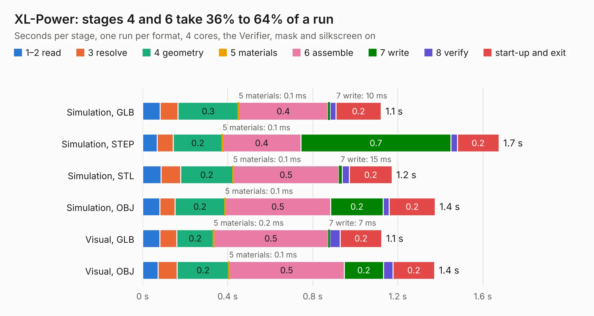

# 1039. XL-Power

Board 1,039 of the 3,125 of [Corpus Testing](../Corpus-Testing.md), on [Corpus Page 10](../CorpusTestingPages/Corpus-Testing-10.md#1039-xl-power).

| Mode and format | 1–2 read | 3 resolve | 4 geometry | 5 materials | 6 assemble | 7 write | 8 verify | start-up and exit | Total |
|---|---:|---:|---:|---:|---:|---:|---:|---:|---:|
| Simulation, GLB | 83&nbsp;ms | 83&nbsp;ms | 0.3 | 0.1&nbsp;ms | 0.4 | 10&nbsp;ms | 27&nbsp;ms | 0.2 | 1.1 |
| Simulation, STEP | 68&nbsp;ms | 76&nbsp;ms | 0.2 | 0.1&nbsp;ms | 0.4 | 0.7 | 30&nbsp;ms | 0.2 | 1.7 |
| Simulation, STL | 87&nbsp;ms | 92&nbsp;ms | 0.2 | 0.1&nbsp;ms | 0.5 | 15&nbsp;ms | 34&nbsp;ms | 0.2 | 1.2 |
| Simulation, OBJ | 81&nbsp;ms | 70&nbsp;ms | 0.2 | 0.1&nbsp;ms | 0.5 | 0.2 | 28&nbsp;ms | 0.2 | 1.4 |
| Visual, GLB | 81&nbsp;ms | 80&nbsp;ms | 0.2 | 0.2&nbsp;ms | 0.5 | 7&nbsp;ms | 49&nbsp;ms | 0.2 | 1.1 |
| Visual, OBJ | 73&nbsp;ms | 89&nbsp;ms | 0.2 | 0.1&nbsp;ms | 0.5 | 0.2 | 45&nbsp;ms | 0.2 | 1.4 |

<table align="center"><tr><td valign="top">

| Board | Repo: [ghent360/prntrboardv2](https://github.com/ghent360/prntrboardv2) Board: `XL-Power.kicad_pcb` |
|---|---|
| Folder | hardware |
| Complexity | 153&nbsp;/&nbsp;1000 (size&nbsp;108, features&nbsp;45) |
| KESE&nbsp;features | through vias, rounded, trapezoid or chamfered pads, filled zones |
| Tested | 9th November 2026 |
| Copper&nbsp;layers | 2 |
| File&nbsp;format | KiCad 6 (20191123) |
| Parts,&nbsp;tracks,&nbsp;vias | 6, 13, 20 |
| Triangles,&nbsp;simulation | 54,472 in 12 parts |
| Verifier | PASS in all six runs |

</td><td valign="top">

<table>
<tr><th>File type</th><th>File size</th><th>Peak memory used</th></tr>
<tr><th colspan="3" align="left">Simulation</th></tr>
<tr><td>GLB</td><td align="right">1.9&nbsp;MB</td><td align="right">70&nbsp;MB</td></tr>
<tr><td>STEP</td><td align="right">6.8&nbsp;MB</td><td align="right">175&nbsp;MB</td></tr>
<tr><td>STL</td><td align="right">2.7&nbsp;MB</td><td align="right">71&nbsp;MB</td></tr>
<tr><td>OBJ</td><td align="right">5.2&nbsp;MB</td><td align="right">93&nbsp;MB</td></tr>
<tr><th colspan="3" align="left">Visual</th></tr>
<tr><td>GLB</td><td align="right">1.3&nbsp;MB</td><td align="right">106&nbsp;MB</td></tr>
<tr><td>OBJ</td><td align="right">3.5&nbsp;MB</td><td align="right">108&nbsp;MB</td></tr>
</table>

</td></tr></table>

| Previous | Next |
|:---|---:|
| [1038. WiFi-Addon](b1038b_prntrboardv2_WiFi-Addon.md) | [1040. ESP32 Demo Project](b1040b_esp32-4layer-iot-board_ESP32-Demo-Project.md) |
