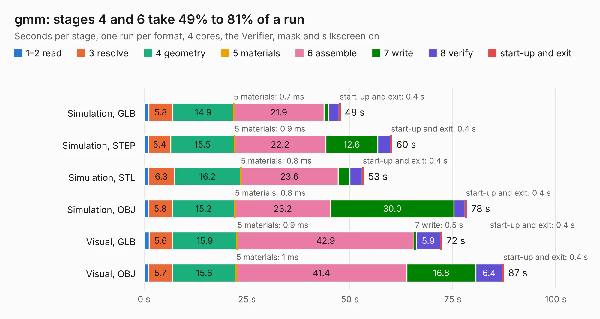

# 1040. gmm

Board 1,040 of the 3,108 of [Corpus Testing](../Corpus-Testing.md), on [Corpus Page 10](../CorpusTestingPages/Corpus-Testing-10.md#1040-gmm).

| Mode and format | 1–2 read | 3 resolve | 4 geometry | 5 materials | 6 assemble | 7 write | 8 verify | start-up and exit | Total |
|---|---:|---:|---:|---:|---:|---:|---:|---:|---:|
| Simulation, GLB | 1.2 | 5.8 | 14.9 | 0.7&nbsp;ms | 21.9 | 1.1 | 2.6 | 0.4 | 47.7 |
| Simulation, STEP | 1.1 | 5.4 | 15.5 | 0.9&nbsp;ms | 22.2 | 12.6 | 3.1 | 0.4 | 60.2 |
| Simulation, STL | 1.1 | 6.3 | 16.2 | 0.8&nbsp;ms | 23.6 | 2.9 | 3.0 | 0.4 | 53.4 |
| Simulation, OBJ | 1.1 | 5.8 | 15.2 | 0.8&nbsp;ms | 23.2 | 30.0 | 2.7 | 0.4 | 78.4 |
| Visual, GLB | 1.2 | 5.6 | 15.9 | 0.9&nbsp;ms | 42.9 | 0.5 | 5.9 | 0.4 | 72.4 |
| Visual, OBJ | 1.1 | 5.7 | 15.6 | 1&nbsp;ms | 41.4 | 16.8 | 6.4 | 0.4 | 87.4 |

<table align="center"><tr><td valign="top">

| Board | Repo: [GMM-7550/gmm7550-hardware](https://github.com/GMM-7550/gmm7550-hardware) Board: `gmm.kicad_pcb` |
|---|---|
| Folder | gmm7550.kicad |
| Complexity | 430&nbsp;/&nbsp;1000 (size&nbsp;300, features&nbsp;130) |
| KESE&nbsp;features | through vias, custom pads, rounded, trapezoid or chamfered pads, filled zones, copper drawings, curved board outline, stack-up, dielectric εr and tanδ, copper finish, mask and silkscreen colours |
| Tested | 9th November 2026 |
| Copper&nbsp;layers | 6 |
| File&nbsp;format | KiCad 7 (20221018) |
| Parts,&nbsp;tracks,&nbsp;vias | 240, 3,535, 855 |
| Triangles,&nbsp;simulation | 5,758,096 in 293 parts |
| Verifier | PASS in all six runs |

</td><td valign="top">

<table>
<tr><th>File type</th><th>File size</th><th>Peak memory used</th></tr>
<tr><th colspan="3" align="left">Simulation</th></tr>
<tr><td>GLB</td><td align="right">190&nbsp;MB</td><td align="right">1.4&nbsp;GB</td></tr>
<tr><td>STEP</td><td align="right">627&nbsp;MB</td><td align="right">2.1&nbsp;GB</td></tr>
<tr><td>STL</td><td align="right">288&nbsp;MB</td><td align="right">1.4&nbsp;GB</td></tr>
<tr><td>OBJ</td><td align="right">610&nbsp;MB</td><td align="right">3.6&nbsp;GB</td></tr>
<tr><th colspan="3" align="left">Visual</th></tr>
<tr><td>GLB</td><td align="right">105&nbsp;MB</td><td align="right">1.9&nbsp;GB</td></tr>
<tr><td>OBJ</td><td align="right">344&nbsp;MB</td><td align="right">2.3&nbsp;GB</td></tr>
</table>

</td></tr></table>

| Previous | Next |
|:---|---:|
| [1039. test-jig](b1039b_glasgow_test-jig.md) | [1041. hat-gmm7550](b1041b_gmm7550-hardware_hat-gmm7550.md) |
