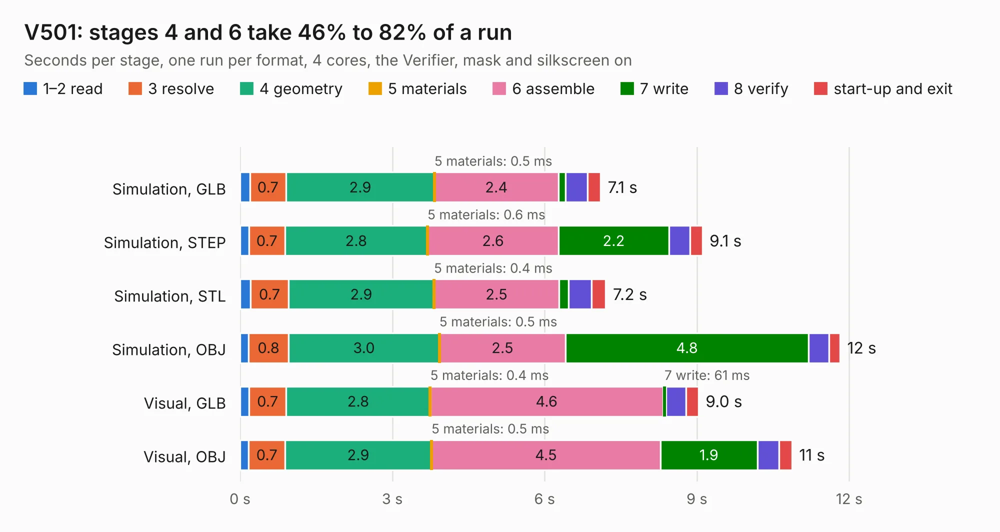

# 1041. V501

Board 1,041 of the 3,102 of [Corpus Testing](../Corpus-Testing.md), on [Corpus Page 10](../CorpusTestingPages/Corpus-Testing-10.md#1041-v501).

| Mode and format | 1–2 read | 3 resolve | 4 geometry | 5 materials | 6 assemble | 7 write | 8 verify | start-up and exit | Total |
|---|---:|---:|---:|---:|---:|---:|---:|---:|---:|
| Simulation, GLB | 0.2 | 0.7 | 2.9 | 0.5&nbsp;ms | 2.4 | 0.1 | 0.4 | 0.3 | 7.1 |
| Simulation, STEP | 0.2 | 0.7 | 2.8 | 0.6&nbsp;ms | 2.6 | 2.2 | 0.4 | 0.2 | 9.1 |
| Simulation, STL | 0.2 | 0.7 | 2.9 | 0.4&nbsp;ms | 2.5 | 0.2 | 0.4 | 0.3 | 7.2 |
| Simulation, OBJ | 0.2 | 0.8 | 3.0 | 0.5&nbsp;ms | 2.5 | 4.8 | 0.4 | 0.2 | 11.8 |
| Visual, GLB | 0.2 | 0.7 | 2.8 | 0.4&nbsp;ms | 4.6 | 61&nbsp;ms | 0.4 | 0.2 | 9.0 |
| Visual, OBJ | 0.2 | 0.7 | 2.9 | 0.5&nbsp;ms | 4.5 | 1.9 | 0.4 | 0.3 | 10.9 |

<table align="center"><tr><td valign="top">

| Board | Repo: [gmofishsauce/yarc](https://github.com/gmofishsauce/yarc) Board: `V501.kicad_pcb` |
|---|---|
| Folder | pcb / V501 |
| Complexity | 201&nbsp;/&nbsp;1000 (size&nbsp;151, features&nbsp;50) |
| KESE&nbsp;features | filled zones, stack-up, dielectric εr and tanδ |
| Tested | 9th November 2026 |
| Copper&nbsp;layers | 4 |
| File&nbsp;format | KiCad 7 (20221018) |
| Parts,&nbsp;tracks,&nbsp;vias | 10, 267, 0 |
| Triangles,&nbsp;simulation | 833,216 in 58 parts |
| Verifier | PASS in all six runs |

</td><td valign="top">

<table>
<tr><th>File type</th><th>File size</th><th>Peak memory used</th></tr>
<tr><th colspan="3" align="left">Simulation</th></tr>
<tr><td>GLB</td><td align="right">27&nbsp;MB</td><td align="right">330&nbsp;MB</td></tr>
<tr><td>STEP</td><td align="right">86&nbsp;MB</td><td align="right">406&nbsp;MB</td></tr>
<tr><td>STL</td><td align="right">42&nbsp;MB</td><td align="right">329&nbsp;MB</td></tr>
<tr><td>OBJ</td><td align="right">83&nbsp;MB</td><td align="right">597&nbsp;MB</td></tr>
<tr><th colspan="3" align="left">Visual</th></tr>
<tr><td>GLB</td><td align="right">12&nbsp;MB</td><td align="right">410&nbsp;MB</td></tr>
<tr><td>OBJ</td><td align="right">35&nbsp;MB</td><td align="right">413&nbsp;MB</td></tr>
</table>

</td></tr></table>

| Previous | Next |
|:---|---:|
| [1040. usb3-gmm7550](b1040b_gmm7550-hardware_usb3-gmm7550.md) | [1042. V502](b1042b_yarc_V502.md) |
