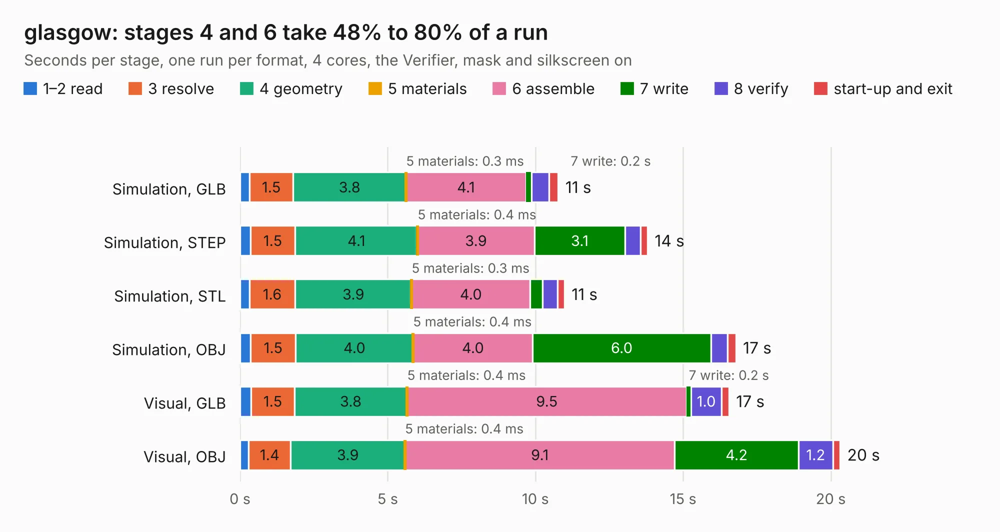

# 1042. glasgow

Board 1,042 of the 3,131 of [Corpus Testing](../Corpus-Testing.md), on [Corpus Page 10](../CorpusTestingPages/Corpus-Testing-10.md#1042-glasgow).

| Mode and format | 1–2 read | 3 resolve | 4 geometry | 5 materials | 6 assemble | 7 write | 8 verify | start-up and exit | Total |
|---|---:|---:|---:|---:|---:|---:|---:|---:|---:|
| Simulation, GLB | 0.3 | 1.5 | 3.8 | 0.3&nbsp;ms | 4.1 | 0.2 | 0.6 | 0.3 | 10.8 |
| Simulation, STEP | 0.3 | 1.5 | 4.1 | 0.4&nbsp;ms | 3.9 | 3.1 | 0.5 | 0.2 | 13.8 |
| Simulation, STL | 0.3 | 1.6 | 3.9 | 0.3&nbsp;ms | 4.0 | 0.4 | 0.5 | 0.2 | 11.0 |
| Simulation, OBJ | 0.4 | 1.5 | 4.0 | 0.4&nbsp;ms | 4.0 | 6.0 | 0.6 | 0.3 | 16.8 |
| Visual, GLB | 0.4 | 1.5 | 3.8 | 0.4&nbsp;ms | 9.5 | 0.2 | 1.0 | 0.3 | 16.6 |
| Visual, OBJ | 0.3 | 1.4 | 3.9 | 0.4&nbsp;ms | 9.1 | 4.2 | 1.2 | 0.2 | 20.3 |

<table align="center"><tr><td valign="top">

| Board | Repo: [GlasgowEmbedded/glasgow](https://github.com/GlasgowEmbedded/glasgow) Board: `glasgow.kicad_pcb` |
|---|---|
| Folder | hardware / boards / glasgow / revA |
| Complexity | 296&nbsp;/&nbsp;1000 (size&nbsp;251, features&nbsp;45) |
| KESE&nbsp;features | through vias, filled zones, curved board outline |
| Tested | 9th November 2026 |
| Copper&nbsp;layers | 4 |
| File&nbsp;format | KiCad 5 (20171130) |
| Parts,&nbsp;tracks,&nbsp;vias | 101, 1,151, 160 |
| Triangles,&nbsp;simulation | 1,236,276 in 124 parts |
| Verifier | PASS in all six runs |

</td><td valign="top">

<table>
<tr><th>File type</th><th>File size</th><th>Peak memory used</th></tr>
<tr><th colspan="3" align="left">Simulation</th></tr>
<tr><td>GLB</td><td align="right">43&nbsp;MB</td><td align="right">465&nbsp;MB</td></tr>
<tr><td>STEP</td><td align="right">155&nbsp;MB</td><td align="right">600&nbsp;MB</td></tr>
<tr><td>STL</td><td align="right">62&nbsp;MB</td><td align="right">502&nbsp;MB</td></tr>
<tr><td>OBJ</td><td align="right">127&nbsp;MB</td><td align="right">846&nbsp;MB</td></tr>
<tr><th colspan="3" align="left">Visual</th></tr>
<tr><td>GLB</td><td align="right">28&nbsp;MB</td><td align="right">600&nbsp;MB</td></tr>
<tr><td>OBJ</td><td align="right">86&nbsp;MB</td><td align="right">698&nbsp;MB</td></tr>
</table>

</td></tr></table>

| Previous | Next |
|:---|---:|
| [1041. ESP32 Demo Project](b1041b_esp32-4layer-iot-board_ESP32-Demo-Project.md) | [1043. glasgow](b1043b_glasgow_hardware-boards-glasgow-revB_glasgow.md) |
