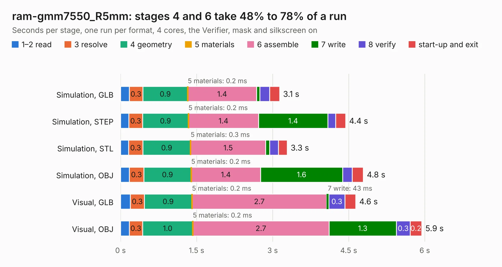

# 1042. ram-gmm7550_R5mm

Board 1,042 of the 3,105 of [Corpus Testing](../Corpus-Testing.md), on [Corpus Page 10](../CorpusTestingPages/Corpus-Testing-10.md#1042-ram-gmm7550_r5mm).

| Mode and format | 1–2 read | 3 resolve | 4 geometry | 5 materials | 6 assemble | 7 write | 8 verify | start-up and exit | Total |
|---|---:|---:|---:|---:|---:|---:|---:|---:|---:|
| Simulation, GLB | 0.2 | 0.3 | 0.9 | 0.2&nbsp;ms | 1.4 | 62&nbsp;ms | 0.2 | 0.2 | 3.1 |
| Simulation, STEP | 0.2 | 0.3 | 0.9 | 0.2&nbsp;ms | 1.4 | 1.4 | 0.2 | 0.2 | 4.4 |
| Simulation, STL | 0.2 | 0.3 | 0.9 | 0.3&nbsp;ms | 1.5 | 79&nbsp;ms | 0.2 | 0.2 | 3.3 |
| Simulation, OBJ | 0.2 | 0.3 | 0.9 | 0.2&nbsp;ms | 1.4 | 1.6 | 0.2 | 0.2 | 4.8 |
| Visual, GLB | 0.2 | 0.3 | 0.9 | 0.2&nbsp;ms | 2.7 | 43&nbsp;ms | 0.3 | 0.2 | 4.6 |
| Visual, OBJ | 0.2 | 0.3 | 1.0 | 0.2&nbsp;ms | 2.7 | 1.3 | 0.3 | 0.2 | 5.9 |

<table align="center"><tr><td valign="top">

| Board | Repo: [GMM-7550/gmm7550-hardware](https://github.com/GMM-7550/gmm7550-hardware) Board: `ram-gmm7550_R5mm.kicad_pcb` |
|---|---|
| Folder | ram-gmm7550.kicad |
| Complexity | 228&nbsp;/&nbsp;1000 (size&nbsp;143, features&nbsp;85) |
| KESE&nbsp;features | through vias, rounded, trapezoid or chamfered pads, filled zones, curved board outline, stack-up, dielectric εr and tanδ |
| Tested | 9th November 2026 |
| Copper&nbsp;layers | 2 |
| File&nbsp;format | KiCad 7 (20221018) |
| Parts,&nbsp;tracks,&nbsp;vias | 10, 280, 61 |
| Triangles,&nbsp;simulation | 313,926 in 58 parts |
| Verifier | PASS in all six runs |

</td><td valign="top">

<table>
<tr><th>File type</th><th>File size</th><th>Peak memory used</th></tr>
<tr><th colspan="3" align="left">Simulation</th></tr>
<tr><td>GLB</td><td align="right">11&nbsp;MB</td><td align="right">258&nbsp;MB</td></tr>
<tr><td>STEP</td><td align="right">46&nbsp;MB</td><td align="right">285&nbsp;MB</td></tr>
<tr><td>STL</td><td align="right">16&nbsp;MB</td><td align="right">254&nbsp;MB</td></tr>
<tr><td>OBJ</td><td align="right">31&nbsp;MB</td><td align="right">267&nbsp;MB</td></tr>
<tr><th colspan="3" align="left">Visual</th></tr>
<tr><td>GLB</td><td align="right">8.7&nbsp;MB</td><td align="right">288&nbsp;MB</td></tr>
<tr><td>OBJ</td><td align="right">26&nbsp;MB</td><td align="right">289&nbsp;MB</td></tr>
</table>

</td></tr></table>

| Previous | Next |
|:---|---:|
| [1041. ram-gmm7550](b1041b_gmm7550-hardware_ram-gmm7550.md) | [1043. usb3-gmm7550](b1043b_gmm7550-hardware_usb3-gmm7550.md) |
