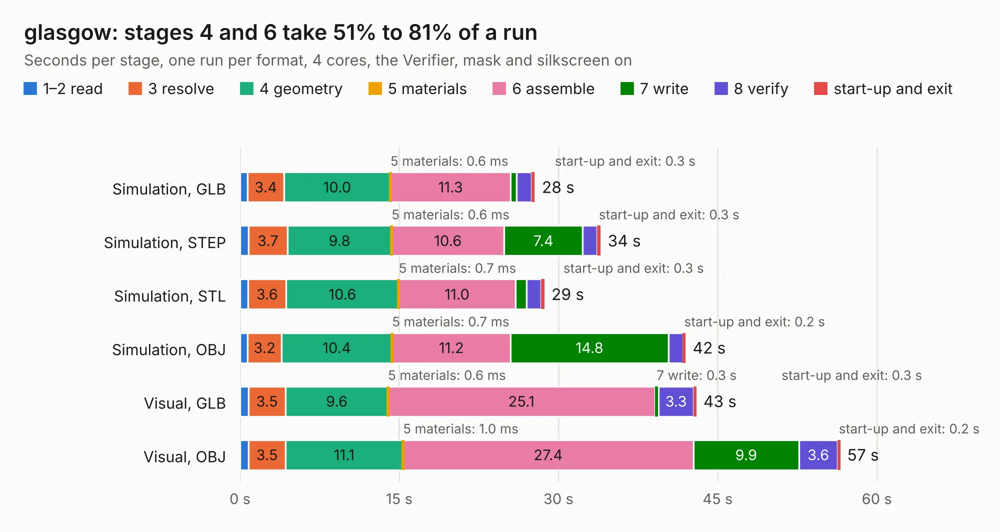

# 1043. glasgow

Board 1,043 of the 3,122 of [Corpus Testing](../Corpus-Testing.md), on [Corpus Page 10](../CorpusTestingPages/Corpus-Testing-10.md#1043-glasgow).

| Mode and format | 1–2 read | 3 resolve | 4 geometry | 5 materials | 6 assemble | 7 write | 8 verify | start-up and exit | Total |
|---|---:|---:|---:|---:|---:|---:|---:|---:|---:|
| Simulation, GLB | 0.7 | 3.4 | 10.0 | 0.6&nbsp;ms | 11.3 | 0.6 | 1.4 | 0.3 | 27.8 |
| Simulation, STEP | 0.8 | 3.7 | 9.8 | 0.6&nbsp;ms | 10.6 | 7.4 | 1.4 | 0.3 | 34.0 |
| Simulation, STL | 0.8 | 3.6 | 10.6 | 0.7&nbsp;ms | 11.0 | 1.1 | 1.3 | 0.3 | 28.7 |
| Simulation, OBJ | 0.7 | 3.2 | 10.4 | 0.7&nbsp;ms | 11.2 | 14.8 | 1.4 | 0.2 | 42.0 |
| Visual, GLB | 0.8 | 3.5 | 9.6 | 0.6&nbsp;ms | 25.1 | 0.3 | 3.3 | 0.3 | 43.0 |
| Visual, OBJ | 0.8 | 3.5 | 11.1 | 1.0&nbsp;ms | 27.4 | 9.9 | 3.6 | 0.2 | 56.5 |

<table align="center"><tr><td valign="top">

| Board | Repo: [GlasgowEmbedded/glasgow](https://github.com/GlasgowEmbedded/glasgow) Board: `glasgow.kicad_pcb` |
|---|---|
| Folder | hardware / boards / glasgow / revC1 |
| Complexity | 378&nbsp;/&nbsp;1000 (size&nbsp;288, features&nbsp;90) |
| KESE&nbsp;features | through vias, custom pads, rounded, trapezoid or chamfered pads, drill offsets, filled zones, copper drawings, curved board outline |
| Tested | 9th November 2026 |
| Copper&nbsp;layers | 4 |
| File&nbsp;format | KiCad 5 (20171130) |
| Parts,&nbsp;tracks,&nbsp;vias | 211, 4,790, 386 |
| Triangles,&nbsp;simulation | 3,515,526 in 261 parts |
| Verifier | PASS in all six runs |

</td><td valign="top">

<table>
<tr><th>File type</th><th>File size</th><th>Peak memory used</th></tr>
<tr><th colspan="3" align="left">Simulation</th></tr>
<tr><td>GLB</td><td align="right">121&nbsp;MB</td><td align="right">1.1&nbsp;GB</td></tr>
<tr><td>STEP</td><td align="right">513&nbsp;MB</td><td align="right">1.3&nbsp;GB</td></tr>
<tr><td>STL</td><td align="right">176&nbsp;MB</td><td align="right">1.1&nbsp;GB</td></tr>
<tr><td>OBJ</td><td align="right">373&nbsp;MB</td><td align="right">2.3&nbsp;GB</td></tr>
<tr><th colspan="3" align="left">Visual</th></tr>
<tr><td>GLB</td><td align="right">82&nbsp;MB</td><td align="right">1.4&nbsp;GB</td></tr>
<tr><td>OBJ</td><td align="right">257&nbsp;MB</td><td align="right">1.7&nbsp;GB</td></tr>
</table>

</td></tr></table>

| Previous | Next |
|:---|---:|
| [1042. glasgow](b1042b_glasgow_hardware-boards-glasgow-revC0_glasgow.md) | [1044. glasgow](b1044b_glasgow_hardware-boards-glasgow-revC2_glasgow.md) |
