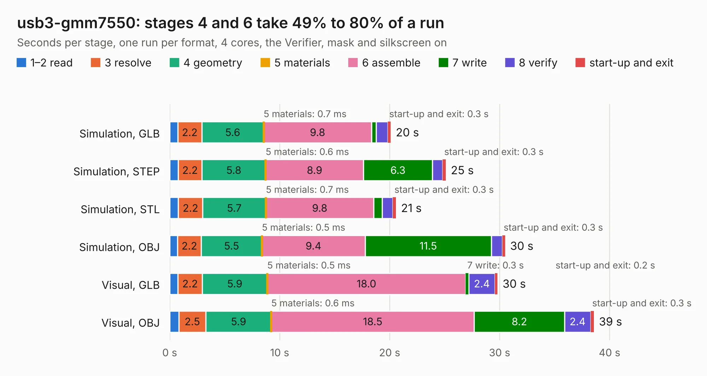

# 1044. usb3-gmm7550

Board 1,044 of the 3,109 of [Corpus Testing](../Corpus-Testing.md), on [Corpus Page 10](../CorpusTestingPages/Corpus-Testing-10.md#1044-usb3-gmm7550).

| Mode and format | 1–2 read | 3 resolve | 4 geometry | 5 materials | 6 assemble | 7 write | 8 verify | start-up and exit | Total |
|---|---:|---:|---:|---:|---:|---:|---:|---:|---:|
| Simulation, GLB | 0.7 | 2.2 | 5.6 | 0.7&nbsp;ms | 9.8 | 0.4 | 1.1 | 0.3 | 20.1 |
| Simulation, STEP | 0.8 | 2.2 | 5.8 | 0.6&nbsp;ms | 8.9 | 6.3 | 0.9 | 0.3 | 25.1 |
| Simulation, STL | 0.8 | 2.2 | 5.7 | 0.7&nbsp;ms | 9.8 | 0.8 | 1.0 | 0.3 | 20.6 |
| Simulation, OBJ | 0.7 | 2.2 | 5.5 | 0.5&nbsp;ms | 9.4 | 11.5 | 1.0 | 0.3 | 30.5 |
| Visual, GLB | 0.7 | 2.2 | 5.9 | 0.5&nbsp;ms | 18.0 | 0.3 | 2.4 | 0.2 | 29.8 |
| Visual, OBJ | 0.8 | 2.5 | 5.9 | 0.6&nbsp;ms | 18.5 | 8.2 | 2.4 | 0.3 | 38.6 |

<table align="center"><tr><td valign="top">

| Board | Repo: [GMM-7550/gmm7550-hardware](https://github.com/GMM-7550/gmm7550-hardware) Board: `usb3-gmm7550.kicad_pcb` |
|---|---|
| Folder | usb3-gmm7550.kicad |
| Complexity | 385&nbsp;/&nbsp;1000 (size&nbsp;270, features&nbsp;115) |
| KESE&nbsp;features | through vias, slotted holes, rounded, trapezoid or chamfered pads, filled zones, curved board outline, stack-up, dielectric εr and tanδ, copper finish, mask and silkscreen colours |
| Tested | 9th November 2026 |
| Copper&nbsp;layers | 4 |
| File&nbsp;format | KiCad 9 (20241229) |
| Parts,&nbsp;tracks,&nbsp;vias | 198, 2,003, 432 |
| Triangles,&nbsp;simulation | 2,449,588 in 217 parts |
| Verifier | PASS in all six runs |

</td><td valign="top">

<table>
<tr><th>File type</th><th>File size</th><th>Peak memory used</th></tr>
<tr><th colspan="3" align="left">Simulation</th></tr>
<tr><td>GLB</td><td align="right">83&nbsp;MB</td><td align="right">883&nbsp;MB</td></tr>
<tr><td>STEP</td><td align="right">319&nbsp;MB</td><td align="right">1.1&nbsp;GB</td></tr>
<tr><td>STL</td><td align="right">122&nbsp;MB</td><td align="right">866&nbsp;MB</td></tr>
<tr><td>OBJ</td><td align="right">254&nbsp;MB</td><td align="right">1.6&nbsp;GB</td></tr>
<tr><th colspan="3" align="left">Visual</th></tr>
<tr><td>GLB</td><td align="right">57&nbsp;MB</td><td align="right">1.0&nbsp;GB</td></tr>
<tr><td>OBJ</td><td align="right">179&nbsp;MB</td><td align="right">1.3&nbsp;GB</td></tr>
</table>

</td></tr></table>

| Previous | Next |
|:---|---:|
| [1043. ram-gmm7550_R5mm](b1043b_gmm7550-hardware_ram-gmm7550-R5mm.md) | [1045. V501](b1045b_yarc_V501.md) |
