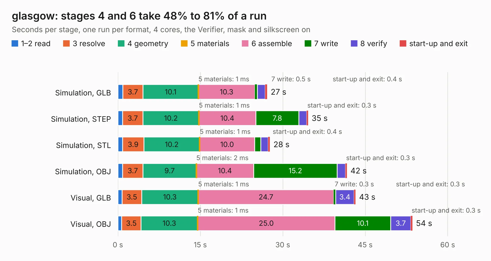

# 1045. glasgow

Board 1,045 of the 3,138 of [Corpus Testing](../Corpus-Testing.md), on [Corpus Page 10](../CorpusTestingPages/Corpus-Testing-10.md#1045-glasgow).

| Mode and format | 1–2 read | 3 resolve | 4 geometry | 5 materials | 6 assemble | 7 write | 8 verify | start-up and exit | Total |
|---|---:|---:|---:|---:|---:|---:|---:|---:|---:|
| Simulation, GLB | 0.9 | 3.7 | 10.1 | 1&nbsp;ms | 10.3 | 0.5 | 1.4 | 0.4 | 27.2 |
| Simulation, STEP | 0.8 | 3.7 | 10.2 | 1&nbsp;ms | 10.4 | 7.8 | 1.4 | 0.3 | 34.6 |
| Simulation, STL | 0.8 | 3.9 | 10.2 | 1&nbsp;ms | 10.0 | 1.1 | 1.3 | 0.4 | 27.7 |
| Simulation, OBJ | 0.9 | 3.7 | 9.7 | 2&nbsp;ms | 10.4 | 15.2 | 1.5 | 0.3 | 41.7 |
| Visual, GLB | 0.8 | 3.5 | 10.3 | 1&nbsp;ms | 24.7 | 0.3 | 3.4 | 0.3 | 43.2 |
| Visual, OBJ | 0.7 | 3.5 | 10.3 | 1&nbsp;ms | 25.0 | 10.1 | 3.7 | 0.3 | 53.6 |

<table align="center"><tr><td valign="top">

| Board | Repo: [GlasgowEmbedded/glasgow](https://github.com/GlasgowEmbedded/glasgow) Board: `glasgow.kicad_pcb` |
|---|---|
| Folder | hardware / boards / glasgow / revC0 |
| Complexity | 341&nbsp;/&nbsp;1000 (size&nbsp;286, features&nbsp;55) |
| KESE&nbsp;features | through vias, rounded, trapezoid or chamfered pads, filled zones, curved board outline |
| Tested | 9th November 2026 |
| Copper&nbsp;layers | 4 |
| File&nbsp;format | KiCad 5 (20171130) |
| Parts,&nbsp;tracks,&nbsp;vias | 187, 4,561, 325 |
| Triangles,&nbsp;simulation | 2,954,940 in 238 parts |
| Verifier | PASS in all six runs |

</td><td valign="top">

<table>
<tr><th>File type</th><th>File size</th><th>Peak memory used</th></tr>
<tr><th colspan="3" align="left">Simulation</th></tr>
<tr><td>GLB</td><td align="right">102&nbsp;MB</td><td align="right">902&nbsp;MB</td></tr>
<tr><td>STEP</td><td align="right">446&nbsp;MB</td><td align="right">1.2&nbsp;GB</td></tr>
<tr><td>STL</td><td align="right">148&nbsp;MB</td><td align="right">955&nbsp;MB</td></tr>
<tr><td>OBJ</td><td align="right">312&nbsp;MB</td><td align="right">1.9&nbsp;GB</td></tr>
<tr><th colspan="3" align="left">Visual</th></tr>
<tr><td>GLB</td><td align="right">70&nbsp;MB</td><td align="right">1.4&nbsp;GB</td></tr>
<tr><td>OBJ</td><td align="right">220&nbsp;MB</td><td align="right">1.5&nbsp;GB</td></tr>
</table>

</td></tr></table>

| Previous | Next |
|:---|---:|
| [1044. glasgow](b1044b_glasgow_hardware-boards-glasgow-revB_glasgow.md) | [1046. glasgow](b1046b_glasgow_hardware-boards-glasgow-revC1_glasgow.md) |
