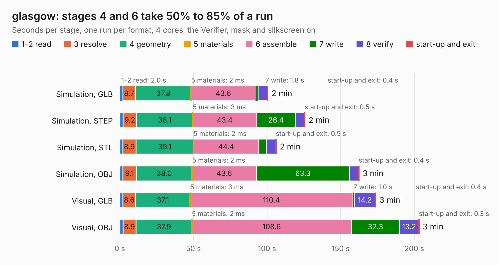

# 1045. glasgow

Board 1,045 of the 3,118 of [Corpus Testing](../Corpus-Testing.md), on [Corpus Page 10](../CorpusTestingPages/Corpus-Testing-10.md#1045-glasgow).

| Mode and format | 1–2 read | 3 resolve | 4 geometry | 5 materials | 6 assemble | 7 write | 8 verify | start-up and exit | Total |
|---|---:|---:|---:|---:|---:|---:|---:|---:|---:|
| Simulation, GLB | 2.0 | 8.7 | 37.8 | 2&nbsp;ms | 43.6 | 1.8 | 6.2 | 0.4 | 100.6 |
| Simulation, STEP | 2.2 | 9.2 | 38.1 | 3&nbsp;ms | 43.4 | 26.4 | 5.9 | 0.5 | 125.8 |
| Simulation, STL | 2.1 | 8.9 | 39.1 | 2&nbsp;ms | 44.4 | 5.0 | 6.3 | 0.5 | 106.2 |
| Simulation, OBJ | 2.1 | 9.1 | 38.0 | 2&nbsp;ms | 43.6 | 63.3 | 6.0 | 0.4 | 162.5 |
| Visual, GLB | 2.1 | 8.6 | 37.1 | 3&nbsp;ms | 110.4 | 1.0 | 14.2 | 0.4 | 173.9 |
| Visual, OBJ | 2.1 | 8.9 | 37.9 | 2&nbsp;ms | 108.6 | 32.3 | 13.2 | 0.3 | 203.3 |

<table align="center"><tr><td valign="top">

| Board | Repo: [GlasgowEmbedded/glasgow](https://github.com/GlasgowEmbedded/glasgow) Board: `glasgow.kicad_pcb` |
|---|---|
| Folder | hardware / boards / glasgow / revD1 |
| Complexity | 465&nbsp;/&nbsp;1000 (size&nbsp;325, features&nbsp;140) |
| KESE&nbsp;features | through vias, slotted holes, custom pads, rounded, trapezoid or chamfered pads, arc tracks, filled zones, copper drawings, stack-up, dielectric εr and tanδ, copper finish |
| Tested | 9th November 2026 |
| Copper&nbsp;layers | 6 |
| File&nbsp;format | KiCad 10 (20260206) |
| Parts,&nbsp;tracks,&nbsp;vias | 746, 7,211, 1,532 |
| Triangles,&nbsp;simulation | 12,015,490 in 614 parts |
| Verifier | PASS in all six runs |

</td><td valign="top">

<table>
<tr><th>File type</th><th>File size</th><th>Peak memory used</th></tr>
<tr><th colspan="3" align="left">Simulation</th></tr>
<tr><td>GLB</td><td align="right">400&nbsp;MB</td><td align="right">2.7&nbsp;GB</td></tr>
<tr><td>STEP</td><td align="right">1.6&nbsp;GB</td><td align="right">4.0&nbsp;GB</td></tr>
<tr><td>STL</td><td align="right">601&nbsp;MB</td><td align="right">2.8&nbsp;GB</td></tr>
<tr><td>OBJ</td><td align="right">1.3&nbsp;GB</td><td align="right">7.5&nbsp;GB</td></tr>
<tr><th colspan="3" align="left">Visual</th></tr>
<tr><td>GLB</td><td align="right">235&nbsp;MB</td><td align="right">3.8&nbsp;GB</td></tr>
<tr><td>OBJ</td><td align="right">776&nbsp;MB</td><td align="right">4.8&nbsp;GB</td></tr>
</table>

</td></tr></table>

| Previous | Next |
|:---|---:|
| [1044. glasgow](b1044b_glasgow_hardware-boards-glasgow-revD0_glasgow.md) | [1046. test-jig](b1046b_glasgow_test-jig.md) |
