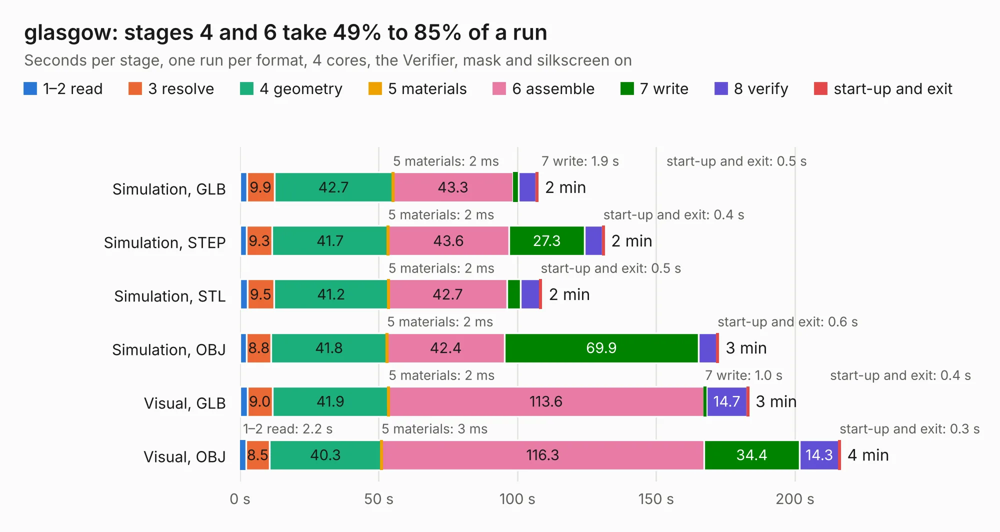

# 1046. glasgow

Board 1,046 of the 3,120 of [Corpus Testing](../Corpus-Testing.md), on [Corpus Page 10](../CorpusTestingPages/Corpus-Testing-10.md#1046-glasgow).

| Mode and format | 1–2 read | 3 resolve | 4 geometry | 5 materials | 6 assemble | 7 write | 8 verify | start-up and exit | Total |
|---|---:|---:|---:|---:|---:|---:|---:|---:|---:|
| Simulation, GLB | 2.4 | 9.9 | 42.7 | 2&nbsp;ms | 43.3 | 1.9 | 6.5 | 0.5 | 107.3 |
| Simulation, STEP | 2.3 | 9.3 | 41.7 | 2&nbsp;ms | 43.6 | 27.3 | 6.5 | 0.4 | 131.1 |
| Simulation, STL | 2.7 | 9.5 | 41.2 | 2&nbsp;ms | 42.7 | 4.8 | 7.1 | 0.5 | 108.7 |
| Simulation, OBJ | 2.4 | 8.8 | 41.8 | 2&nbsp;ms | 42.4 | 69.9 | 6.6 | 0.6 | 172.4 |
| Visual, GLB | 2.6 | 9.0 | 41.9 | 2&nbsp;ms | 113.6 | 1.0 | 14.7 | 0.4 | 183.2 |
| Visual, OBJ | 2.2 | 8.5 | 40.3 | 3&nbsp;ms | 116.3 | 34.4 | 14.3 | 0.3 | 216.2 |

<table align="center"><tr><td valign="top">

| Board | Repo: [GlasgowEmbedded/glasgow](https://github.com/GlasgowEmbedded/glasgow) Board: `glasgow.kicad_pcb` |
|---|---|
| Folder | hardware / boards / glasgow / revD0 |
| Complexity | 449&nbsp;/&nbsp;1000 (size&nbsp;324, features&nbsp;125) |
| KESE&nbsp;features | through vias, slotted holes, custom pads, rounded, trapezoid or chamfered pads, filled zones, copper drawings, stack-up, dielectric εr and tanδ, copper finish |
| Tested | 9th November 2026 |
| Copper&nbsp;layers | 6 |
| File&nbsp;format | KiCad 10 (20260206) |
| Parts,&nbsp;tracks,&nbsp;vias | 711, 7,621, 1,429 |
| Triangles,&nbsp;simulation | 11,344,886 in 599 parts |
| Verifier | PASS in all six runs |

</td><td valign="top">

<table>
<tr><th>File type</th><th>File size</th><th>Peak memory used</th></tr>
<tr><th colspan="3" align="left">Simulation</th></tr>
<tr><td>GLB</td><td align="right">378&nbsp;MB</td><td align="right">2.8&nbsp;GB</td></tr>
<tr><td>STEP</td><td align="right">1.6&nbsp;GB</td><td align="right">3.9&nbsp;GB</td></tr>
<tr><td>STL</td><td align="right">567&nbsp;MB</td><td align="right">2.7&nbsp;GB</td></tr>
<tr><td>OBJ</td><td align="right">1.2&nbsp;GB</td><td align="right">7.1&nbsp;GB</td></tr>
<tr><th colspan="3" align="left">Visual</th></tr>
<tr><td>GLB</td><td align="right">223&nbsp;MB</td><td align="right">3.6&nbsp;GB</td></tr>
<tr><td>OBJ</td><td align="right">735&nbsp;MB</td><td align="right">4.7&nbsp;GB</td></tr>
</table>

</td></tr></table>

| Previous | Next |
|:---|---:|
| [1045. glasgow](b1045b_glasgow_hardware-boards-glasgow-revC3_glasgow.md) | [1047. glasgow](b1047b_glasgow_hardware-boards-glasgow-revD1_glasgow.md) |
