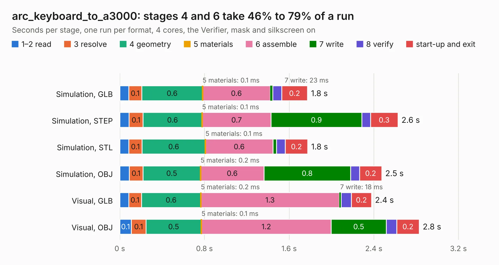

# 1046. arc_keyboard_to_a3000

Board 1,046 of the 3,100 of [Corpus Testing](../Corpus-Testing.md), on [Corpus Page 10](../CorpusTestingPages/Corpus-Testing-10.md#1046-arc_keyboard_to_a3000).

| Mode and format | 1–2 read | 3 resolve | 4 geometry | 5 materials | 6 assemble | 7 write | 8 verify | start-up and exit | Total |
|---|---:|---:|---:|---:|---:|---:|---:|---:|---:|
| Simulation, GLB | 84&nbsp;ms | 0.1 | 0.6 | 0.1&nbsp;ms | 0.6 | 23&nbsp;ms | 85&nbsp;ms | 0.2 | 1.8 |
| Simulation, STEP | 88&nbsp;ms | 0.1 | 0.6 | 0.1&nbsp;ms | 0.7 | 0.9 | 82&nbsp;ms | 0.3 | 2.6 |
| Simulation, STL | 85&nbsp;ms | 0.1 | 0.6 | 0.1&nbsp;ms | 0.6 | 34&nbsp;ms | 82&nbsp;ms | 0.2 | 1.8 |
| Simulation, OBJ | 89&nbsp;ms | 0.1 | 0.5 | 0.2&nbsp;ms | 0.6 | 0.8 | 86&nbsp;ms | 0.2 | 2.5 |
| Visual, GLB | 84&nbsp;ms | 0.1 | 0.6 | 0.2&nbsp;ms | 1.3 | 18&nbsp;ms | 97&nbsp;ms | 0.2 | 2.4 |
| Visual, OBJ | 0.1 | 0.1 | 0.5 | 0.1&nbsp;ms | 1.2 | 0.5 | 98&nbsp;ms | 0.2 | 2.8 |

<table align="center"><tr><td valign="top">

| Board | Repo: [google/myelin-acorn-electron-hardware](https://github.com/google/myelin-acorn-electron-hardware) Board: `arc_keyboard_to_a3000.kicad_pcb` |
|---|---|
| Folder | arc_keyboard_to_a3000 / pcb |
| Complexity | 104&nbsp;/&nbsp;1000 (size&nbsp;84, features&nbsp;20) |
| KESE&nbsp;features | filled zones |
| Tested | 9th November 2026 |
| Copper&nbsp;layers | 2 |
| File&nbsp;format | KiCad 5 (20171130) |
| Parts,&nbsp;tracks,&nbsp;vias | 2, 28, 0 |
| Triangles,&nbsp;simulation | 129,382 in 18 parts |
| Verifier | PASS in all six runs |

</td><td valign="top">

<table>
<tr><th>File type</th><th>File size</th><th>Peak memory used</th></tr>
<tr><th colspan="3" align="left">Simulation</th></tr>
<tr><td>GLB</td><td align="right">4.3&nbsp;MB</td><td align="right">189&nbsp;MB</td></tr>
<tr><td>STEP</td><td align="right">20&nbsp;MB</td><td align="right">198&nbsp;MB</td></tr>
<tr><td>STL</td><td align="right">6.5&nbsp;MB</td><td align="right">191&nbsp;MB</td></tr>
<tr><td>OBJ</td><td align="right">12&nbsp;MB</td><td align="right">186&nbsp;MB</td></tr>
<tr><th colspan="3" align="left">Visual</th></tr>
<tr><td>GLB</td><td align="right">3.1&nbsp;MB</td><td align="right">154&nbsp;MB</td></tr>
<tr><td>OBJ</td><td align="right">8.7&nbsp;MB</td><td align="right">153&nbsp;MB</td></tr>
</table>

</td></tr></table>

| Previous | Next |
|:---|---:|
| [1045. a3000_ram_buffer](b1045b_myelin-acorn-electron-hardware_a3000-ram-buffer.md) | [1047. arc_mouse_breakout](b1047b_myelin-acorn-electron-hardware_arc-mouse-breakout.md) |
