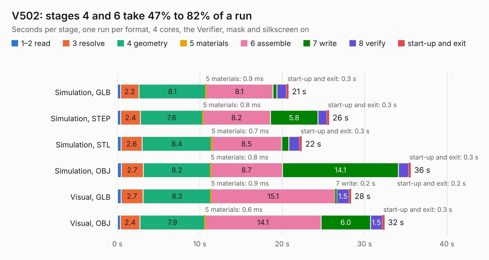

# 1046. V502

Board 1,046 of the 3,108 of [Corpus Testing](../Corpus-Testing.md), on [Corpus Page 10](../CorpusTestingPages/Corpus-Testing-10.md#1046-v502).

| Mode and format | 1–2 read | 3 resolve | 4 geometry | 5 materials | 6 assemble | 7 write | 8 verify | start-up and exit | Total |
|---|---:|---:|---:|---:|---:|---:|---:|---:|---:|
| Simulation, GLB | 0.4 | 2.2 | 8.1 | 0.9&nbsp;ms | 8.1 | 0.5 | 1.2 | 0.3 | 20.8 |
| Simulation, STEP | 0.4 | 2.4 | 7.6 | 0.8&nbsp;ms | 8.2 | 5.8 | 1.1 | 0.3 | 25.7 |
| Simulation, STL | 0.4 | 2.6 | 8.4 | 0.7&nbsp;ms | 8.5 | 0.9 | 1.3 | 0.3 | 22.4 |
| Simulation, OBJ | 0.5 | 2.7 | 8.2 | 0.8&nbsp;ms | 8.7 | 14.1 | 1.2 | 0.3 | 35.6 |
| Visual, GLB | 0.4 | 2.7 | 8.3 | 0.9&nbsp;ms | 15.1 | 0.2 | 1.5 | 0.2 | 28.4 |
| Visual, OBJ | 0.4 | 2.4 | 7.9 | 0.6&nbsp;ms | 14.1 | 6.0 | 1.5 | 0.3 | 32.4 |

<table align="center"><tr><td valign="top">

| Board | Repo: [gmofishsauce/yarc](https://github.com/gmofishsauce/yarc) Board: `V502.kicad_pcb` |
|---|---|
| Folder | pcb / V502 |
| Complexity | 254&nbsp;/&nbsp;1000 (size&nbsp;189, features&nbsp;65) |
| KESE&nbsp;features | through vias, filled zones, stack-up, dielectric εr and tanδ |
| Tested | 9th November 2026 |
| Copper&nbsp;layers | 4 |
| File&nbsp;format | KiCad 7 (20221018) |
| Parts,&nbsp;tracks,&nbsp;vias | 36, 858, 127 |
| Triangles,&nbsp;simulation | 2,989,296 in 111 parts |
| Verifier | PASS in all six runs |

</td><td valign="top">

<table>
<tr><th>File type</th><th>File size</th><th>Peak memory used</th></tr>
<tr><th colspan="3" align="left">Simulation</th></tr>
<tr><td>GLB</td><td align="right">101&nbsp;MB</td><td align="right">816&nbsp;MB</td></tr>
<tr><td>STEP</td><td align="right">316&nbsp;MB</td><td align="right">1.1&nbsp;GB</td></tr>
<tr><td>STL</td><td align="right">149&nbsp;MB</td><td align="right">821&nbsp;MB</td></tr>
<tr><td>OBJ</td><td align="right">313&nbsp;MB</td><td align="right">1.9&nbsp;GB</td></tr>
<tr><th colspan="3" align="left">Visual</th></tr>
<tr><td>GLB</td><td align="right">45&nbsp;MB</td><td align="right">1.0&nbsp;GB</td></tr>
<tr><td>OBJ</td><td align="right">140&nbsp;MB</td><td align="right">992&nbsp;MB</td></tr>
</table>

</td></tr></table>

| Previous | Next |
|:---|---:|
| [1045. V501](b1045b_yarc_V501.md) | [1047. V503](b1047b_yarc_V503.md) |
