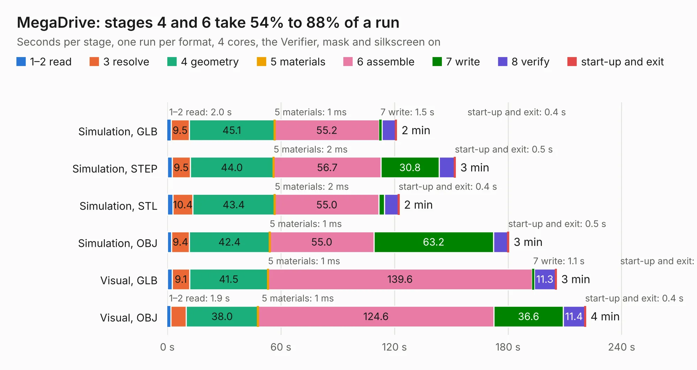

# 1049. MegaDrive

Board 1,049 of the 3,110 of [Corpus Testing](../Corpus-Testing.md), on [Corpus Page 10](../CorpusTestingPages/Corpus-Testing-10.md#1049-megadrive).

| Mode and format | 1–2 read | 3 resolve | 4 geometry | 5 materials | 6 assemble | 7 write | 8 verify | start-up and exit | Total |
|---|---:|---:|---:|---:|---:|---:|---:|---:|---:|
| Simulation, GLB | 2.0 | 9.5 | 45.1 | 1&nbsp;ms | 55.2 | 1.5 | 7.3 | 0.4 | 121.1 |
| Simulation, STEP | 2.6 | 9.5 | 44.0 | 2&nbsp;ms | 56.7 | 30.8 | 8.1 | 0.5 | 152.2 |
| Simulation, STL | 3.0 | 10.4 | 43.4 | 2&nbsp;ms | 55.0 | 3.0 | 7.2 | 0.4 | 122.4 |
| Simulation, OBJ | 2.2 | 9.4 | 42.4 | 1&nbsp;ms | 55.0 | 63.2 | 7.5 | 0.5 | 180.3 |
| Visual, GLB | 2.6 | 9.1 | 41.5 | 1&nbsp;ms | 139.6 | 1.1 | 11.3 | 0.4 | 205.5 |
| Visual, OBJ | 1.9 | 8.0 | 38.0 | 1&nbsp;ms | 124.6 | 36.6 | 11.4 | 0.4 | 220.9 |

<table align="center"><tr><td valign="top">

| Board | Repo: [goodtofufriday/Mega-Drive-model-1-schematic](https://github.com/goodtofufriday/Mega-Drive-model-1-schematic) Board: `MegaDrive.kicad_pcb` |
|---|---|
| Complexity | 354&nbsp;/&nbsp;1000 (size&nbsp;279, features&nbsp;75) |
| KESE&nbsp;features | through vias, slotted holes, rounded, trapezoid or chamfered pads, filled zones, copper text, curved board outline |
| Tested | 9th November 2026 |
| Copper&nbsp;layers | 2 |
| File&nbsp;format | KiCad 7 (20221018) |
| Parts,&nbsp;tracks,&nbsp;vias | 266, 10,876, 785 |
| Triangles,&nbsp;simulation | 7,577,304 in 344 parts |
| Verifier | PASS in all six runs |

</td><td valign="top">

<table>
<tr><th>File type</th><th>File size</th><th>Peak memory used</th></tr>
<tr><th colspan="3" align="left">Simulation</th></tr>
<tr><td>GLB</td><td align="right">257&nbsp;MB</td><td align="right">2.5&nbsp;GB</td></tr>
<tr><td>STEP</td><td align="right">1.3&nbsp;GB</td><td align="right">3.0&nbsp;GB</td></tr>
<tr><td>STL</td><td align="right">379&nbsp;MB</td><td align="right">2.5&nbsp;GB</td></tr>
<tr><td>OBJ</td><td align="right">806&nbsp;MB</td><td align="right">4.8&nbsp;GB</td></tr>
<tr><th colspan="3" align="left">Visual</th></tr>
<tr><td>GLB</td><td align="right">193&nbsp;MB</td><td align="right">3.0&nbsp;GB</td></tr>
<tr><td>OBJ</td><td align="right">622&nbsp;MB</td><td align="right">4.0&nbsp;GB</td></tr>
</table>

</td></tr></table>

| Previous | Next |
|:---|---:|
| [1048. V503](b1048b_yarc_V503.md) | [1050. flash_cartridge](b1050b_myelin-acorn-electron-hardware_32kb-flash-cartridge-pcb-mini_flash-cartridge.md) |
