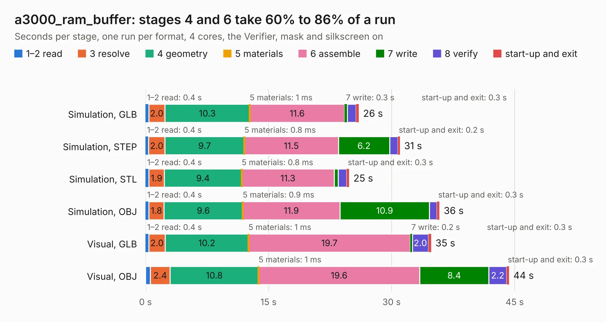

# 1051. a3000_ram_buffer

Board 1,051 of the 3,107 of [Corpus Testing](../Corpus-Testing.md), on [Corpus Page 10](../CorpusTestingPages/Corpus-Testing-10.md#1051-a3000_ram_buffer).

| Mode and format | 1–2 read | 3 resolve | 4 geometry | 5 materials | 6 assemble | 7 write | 8 verify | start-up and exit | Total |
|---|---:|---:|---:|---:|---:|---:|---:|---:|---:|
| Simulation, GLB | 0.4 | 2.0 | 10.3 | 1&nbsp;ms | 11.6 | 0.3 | 1.1 | 0.3 | 26.0 |
| Simulation, STEP | 0.4 | 2.0 | 9.7 | 0.8&nbsp;ms | 11.5 | 6.2 | 1.0 | 0.2 | 31.0 |
| Simulation, STL | 0.4 | 1.9 | 9.4 | 0.8&nbsp;ms | 11.3 | 0.5 | 1.0 | 0.3 | 24.8 |
| Simulation, OBJ | 0.4 | 1.8 | 9.6 | 0.9&nbsp;ms | 11.9 | 10.9 | 1.0 | 0.3 | 35.8 |
| Visual, GLB | 0.4 | 2.0 | 10.2 | 1&nbsp;ms | 19.7 | 0.2 | 2.0 | 0.3 | 34.8 |
| Visual, OBJ | 0.6 | 2.4 | 10.8 | 1&nbsp;ms | 19.6 | 8.4 | 2.2 | 0.3 | 44.3 |

<table align="center"><tr><td valign="top">

| Board | Repo: [google/myelin-acorn-electron-hardware](https://github.com/google/myelin-acorn-electron-hardware) Board: `a3000_ram_buffer.kicad_pcb` |
|---|---|
| Folder | a3000_ram_buffer / pcb |
| Complexity | 214&nbsp;/&nbsp;1000 (size&nbsp;169, features&nbsp;45) |
| KESE&nbsp;features | through vias, rounded, trapezoid or chamfered pads, filled zones |
| Tested | 9th November 2026 |
| Copper&nbsp;layers | 2 |
| File&nbsp;format | KiCad 5 (20171130) |
| Parts,&nbsp;tracks,&nbsp;vias | 38, 882, 28 |
| Triangles,&nbsp;simulation | 1,704,328 in 168 parts |
| Verifier | PASS in all six runs |

</td><td valign="top">

<table>
<tr><th>File type</th><th>File size</th><th>Peak memory used</th></tr>
<tr><th colspan="3" align="left">Simulation</th></tr>
<tr><td>GLB</td><td align="right">58&nbsp;MB</td><td align="right">654&nbsp;MB</td></tr>
<tr><td>STEP</td><td align="right">296&nbsp;MB</td><td align="right">815&nbsp;MB</td></tr>
<tr><td>STL</td><td align="right">85&nbsp;MB</td><td align="right">648&nbsp;MB</td></tr>
<tr><td>OBJ</td><td align="right">176&nbsp;MB</td><td align="right">1.1&nbsp;GB</td></tr>
<tr><th colspan="3" align="left">Visual</th></tr>
<tr><td>GLB</td><td align="right">45&nbsp;MB</td><td align="right">881&nbsp;MB</td></tr>
<tr><td>OBJ</td><td align="right">136&nbsp;MB</td><td align="right">962&nbsp;MB</td></tr>
</table>

</td></tr></table>

| Previous | Next |
|:---|---:|
| [1050. flash_cartridge](b1050b_myelin-acorn-electron-hardware_32kb-flash-cartridge-pcb-standard_flash-cartridge.md) | [1052. arc_keyboard_to_a3000](b1052b_myelin-acorn-electron-hardware_arc-keyboard-to-a3000.md) |
