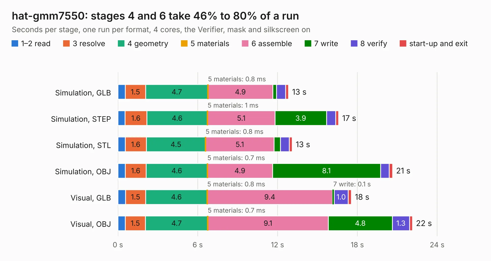

# 1052. hat-gmm7550

Board 1,052 of the 3,131 of [Corpus Testing](../Corpus-Testing.md), on [Corpus Page 10](../CorpusTestingPages/Corpus-Testing-10.md#1052-hat-gmm7550).

| Mode and format | 1–2 read | 3 resolve | 4 geometry | 5 materials | 6 assemble | 7 write | 8 verify | start-up and exit | Total |
|---|---:|---:|---:|---:|---:|---:|---:|---:|---:|
| Simulation, GLB | 0.6 | 1.5 | 4.7 | 0.8&nbsp;ms | 4.9 | 0.3 | 0.7 | 0.2 | 12.8 |
| Simulation, STEP | 0.5 | 1.6 | 4.6 | 1&nbsp;ms | 5.1 | 3.9 | 0.7 | 0.2 | 16.6 |
| Simulation, STL | 0.6 | 1.6 | 4.5 | 0.8&nbsp;ms | 5.1 | 0.5 | 0.7 | 0.2 | 13.1 |
| Simulation, OBJ | 0.6 | 1.6 | 4.6 | 0.7&nbsp;ms | 4.9 | 8.1 | 0.7 | 0.3 | 20.7 |
| Visual, GLB | 0.6 | 1.5 | 4.6 | 0.8&nbsp;ms | 9.4 | 0.1 | 1.0 | 0.2 | 17.6 |
| Visual, OBJ | 0.6 | 1.5 | 4.7 | 0.7&nbsp;ms | 9.1 | 4.8 | 1.3 | 0.2 | 22.1 |

<table align="center"><tr><td valign="top">

| Board | Repo: [GMM-7550/gmm7550-hardware](https://github.com/GMM-7550/gmm7550-hardware) Board: `hat-gmm7550.kicad_pcb` |
|---|---|
| Folder | hat-gmm7550.kicad |
| Complexity | 303&nbsp;/&nbsp;1000 (size&nbsp;198, features&nbsp;105) |
| KESE&nbsp;features | through vias, rounded, trapezoid or chamfered pads, filled zones, curved board outline, stack-up, dielectric εr and tanδ, copper finish, mask and silkscreen colours |
| Tested | 9th November 2026 |
| Copper&nbsp;layers | 4 |
| File&nbsp;format | KiCad 7 (20221018) |
| Parts,&nbsp;tracks,&nbsp;vias | 68, 891, 174 |
| Triangles,&nbsp;simulation | 1,643,322 in 158 parts |
| Verifier | PASS in all six runs |

</td><td valign="top">

<table>
<tr><th>File type</th><th>File size</th><th>Peak memory used</th></tr>
<tr><th colspan="3" align="left">Simulation</th></tr>
<tr><td>GLB</td><td align="right">55&nbsp;MB</td><td align="right">621&nbsp;MB</td></tr>
<tr><td>STEP</td><td align="right">207&nbsp;MB</td><td align="right">755&nbsp;MB</td></tr>
<tr><td>STL</td><td align="right">82&nbsp;MB</td><td align="right">592&nbsp;MB</td></tr>
<tr><td>OBJ</td><td align="right">169&nbsp;MB</td><td align="right">1.1&nbsp;GB</td></tr>
<tr><th colspan="3" align="left">Visual</th></tr>
<tr><td>GLB</td><td align="right">32&nbsp;MB</td><td align="right">674&nbsp;MB</td></tr>
<tr><td>OBJ</td><td align="right">97&nbsp;MB</td><td align="right">777&nbsp;MB</td></tr>
</table>

</td></tr></table>

| Previous | Next |
|:---|---:|
| [1051. gmm](b1051b_gmm7550-hardware_gmm.md) | [1053. ram-gmm7550](b1053b_gmm7550-hardware_ram-gmm7550.md) |
