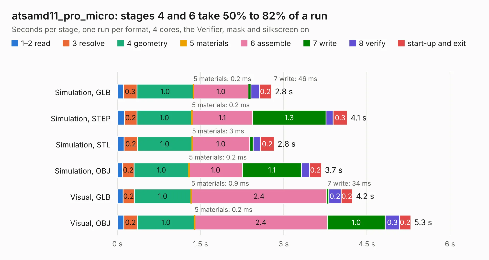

# 1055. atsamd11_pro_micro

Board 1,055 of the 3,109 of [Corpus Testing](../Corpus-Testing.md), on [Corpus Page 10](../CorpusTestingPages/Corpus-Testing-10.md#1055-atsamd11_pro_micro).

| Mode and format | 1–2 read | 3 resolve | 4 geometry | 5 materials | 6 assemble | 7 write | 8 verify | start-up and exit | Total |
|---|---:|---:|---:|---:|---:|---:|---:|---:|---:|
| Simulation, GLB | 0.1 | 0.3 | 1.0 | 0.2&nbsp;ms | 1.0 | 46&nbsp;ms | 0.2 | 0.2 | 2.8 |
| Simulation, STEP | 0.1 | 0.2 | 1.0 | 0.2&nbsp;ms | 1.1 | 1.3 | 0.1 | 0.3 | 4.1 |
| Simulation, STL | 0.1 | 0.2 | 1.0 | 3&nbsp;ms | 1.0 | 65&nbsp;ms | 0.1 | 0.2 | 2.8 |
| Simulation, OBJ | 95&nbsp;ms | 0.2 | 1.0 | 0.2&nbsp;ms | 1.0 | 1.1 | 0.1 | 0.2 | 3.7 |
| Visual, GLB | 0.1 | 0.2 | 1.0 | 0.9&nbsp;ms | 2.4 | 34&nbsp;ms | 0.2 | 0.2 | 4.2 |
| Visual, OBJ | 0.1 | 0.2 | 1.0 | 0.2&nbsp;ms | 2.4 | 1.0 | 0.3 | 0.2 | 5.3 |

<table align="center"><tr><td valign="top">

| Board | Repo: [google/myelin-acorn-electron-hardware](https://github.com/google/myelin-acorn-electron-hardware) Board: `atsamd11_pro_micro.kicad_pcb` |
|---|---|
| Folder | atsamd11_pro_micro / pcb |
| Complexity | 176&nbsp;/&nbsp;1000 (size&nbsp;131, features&nbsp;45) |
| KESE&nbsp;features | through vias, rounded, trapezoid or chamfered pads, filled zones |
| Tested | 9th November 2026 |
| Copper&nbsp;layers | 2 |
| File&nbsp;format | KiCad 4 (4) |
| Parts,&nbsp;tracks,&nbsp;vias | 10, 169, 15 |
| Triangles,&nbsp;simulation | 286,208 in 30 parts |
| Verifier | PASS in all six runs |

</td><td valign="top">

<table>
<tr><th>File type</th><th>File size</th><th>Peak memory used</th></tr>
<tr><th colspan="3" align="left">Simulation</th></tr>
<tr><td>GLB</td><td align="right">9.7&nbsp;MB</td><td align="right">234&nbsp;MB</td></tr>
<tr><td>STEP</td><td align="right">45&nbsp;MB</td><td align="right">265&nbsp;MB</td></tr>
<tr><td>STL</td><td align="right">14&nbsp;MB</td><td align="right">232&nbsp;MB</td></tr>
<tr><td>OBJ</td><td align="right">28&nbsp;MB</td><td align="right">248&nbsp;MB</td></tr>
<tr><th colspan="3" align="left">Visual</th></tr>
<tr><td>GLB</td><td align="right">7.9&nbsp;MB</td><td align="right">247&nbsp;MB</td></tr>
<tr><td>OBJ</td><td align="right">23&nbsp;MB</td><td align="right">248&nbsp;MB</td></tr>
</table>

</td></tr></table>

| Previous | Next |
|:---|---:|
| [1054. archimedes_bus_scope](b1054b_myelin-acorn-electron-hardware_archimedes-bus-scope.md) | [1056. atsamd21_usb](b1056b_myelin-acorn-electron-hardware_atsamd21-usb.md) |
