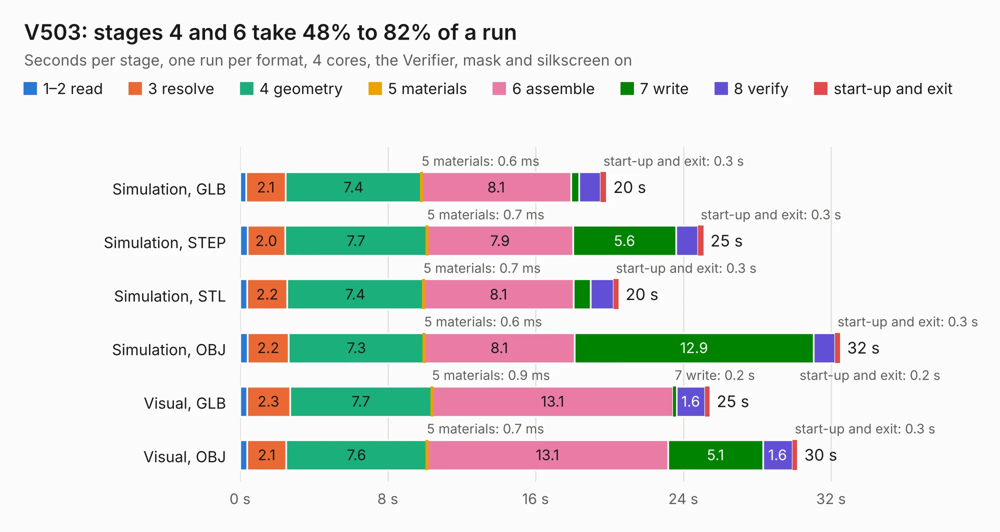

# 1056. V503

Board 1,056 of the 3,121 of [Corpus Testing](../Corpus-Testing.md), on [Corpus Page 10](../CorpusTestingPages/Corpus-Testing-10.md#1056-v503).

| Mode and format | 1–2 read | 3 resolve | 4 geometry | 5 materials | 6 assemble | 7 write | 8 verify | start-up and exit | Total |
|---|---:|---:|---:|---:|---:|---:|---:|---:|---:|
| Simulation, GLB | 0.3 | 2.1 | 7.4 | 0.6&nbsp;ms | 8.1 | 0.4 | 1.2 | 0.3 | 19.8 |
| Simulation, STEP | 0.4 | 2.0 | 7.7 | 0.7&nbsp;ms | 7.9 | 5.6 | 1.2 | 0.3 | 25.1 |
| Simulation, STL | 0.4 | 2.2 | 7.4 | 0.7&nbsp;ms | 8.1 | 0.9 | 1.2 | 0.3 | 20.5 |
| Simulation, OBJ | 0.4 | 2.2 | 7.3 | 0.6&nbsp;ms | 8.1 | 12.9 | 1.2 | 0.3 | 32.5 |
| Visual, GLB | 0.4 | 2.3 | 7.7 | 0.9&nbsp;ms | 13.1 | 0.2 | 1.6 | 0.2 | 25.4 |
| Visual, OBJ | 0.4 | 2.1 | 7.6 | 0.7&nbsp;ms | 13.1 | 5.1 | 1.6 | 0.3 | 30.2 |

<table align="center"><tr><td valign="top">

| Board | Repo: [gmofishsauce/yarc](https://github.com/gmofishsauce/yarc) Board: `V503.kicad_pcb` |
|---|---|
| Folder | pcb / V503 |
| Complexity | 248&nbsp;/&nbsp;1000 (size&nbsp;183, features&nbsp;65) |
| KESE&nbsp;features | through vias, filled zones, stack-up, dielectric εr and tanδ |
| Tested | 9th November 2026 |
| Copper&nbsp;layers | 4 |
| File&nbsp;format | KiCad 7 (20221018) |
| Parts,&nbsp;tracks,&nbsp;vias | 32, 672, 75 |
| Triangles,&nbsp;simulation | 2,602,026 in 110 parts |
| Verifier | PASS in all six runs |

</td><td valign="top">

<table>
<tr><th>File type</th><th>File size</th><th>Peak memory used</th></tr>
<tr><th colspan="3" align="left">Simulation</th></tr>
<tr><td>GLB</td><td align="right">87&nbsp;MB</td><td align="right">714&nbsp;MB</td></tr>
<tr><td>STEP</td><td align="right">272&nbsp;MB</td><td align="right">963&nbsp;MB</td></tr>
<tr><td>STL</td><td align="right">130&nbsp;MB</td><td align="right">732&nbsp;MB</td></tr>
<tr><td>OBJ</td><td align="right">271&nbsp;MB</td><td align="right">1.7&nbsp;GB</td></tr>
<tr><th colspan="3" align="left">Visual</th></tr>
<tr><td>GLB</td><td align="right">35&nbsp;MB</td><td align="right">800&nbsp;MB</td></tr>
<tr><td>OBJ</td><td align="right">109&nbsp;MB</td><td align="right">858&nbsp;MB</td></tr>
</table>

</td></tr></table>

| Previous | Next |
|:---|---:|
| [1055. V502](b1055b_yarc_V502.md) | [1057. MegaDrive](b1057b_Mega-Drive-model-1-schematic_MegaDrive.md) |
