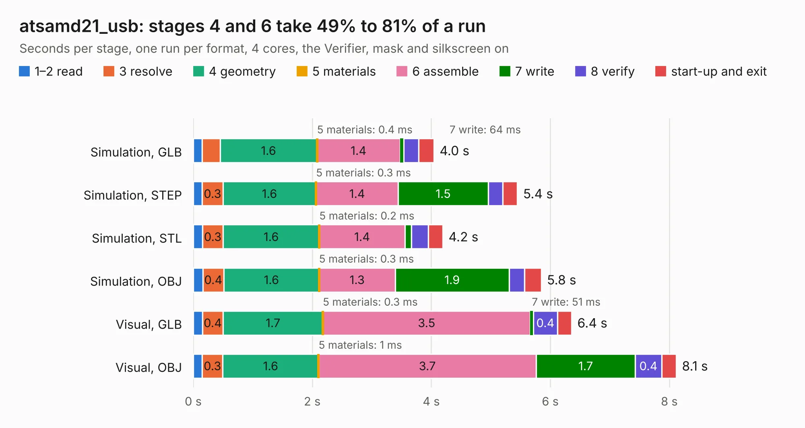

# 1057. atsamd21_usb

Board 1,057 of the 3,110 of [Corpus Testing](../Corpus-Testing.md), on [Corpus Page 10](../CorpusTestingPages/Corpus-Testing-10.md#1057-atsamd21_usb).

| Mode and format | 1–2 read | 3 resolve | 4 geometry | 5 materials | 6 assemble | 7 write | 8 verify | start-up and exit | Total |
|---|---:|---:|---:|---:|---:|---:|---:|---:|---:|
| Simulation, GLB | 0.1 | 0.3 | 1.6 | 0.4&nbsp;ms | 1.4 | 64&nbsp;ms | 0.3 | 0.3 | 4.0 |
| Simulation, STEP | 0.1 | 0.3 | 1.6 | 0.3&nbsp;ms | 1.4 | 1.5 | 0.2 | 0.2 | 5.4 |
| Simulation, STL | 0.2 | 0.3 | 1.6 | 0.2&nbsp;ms | 1.4 | 0.1 | 0.3 | 0.2 | 4.2 |
| Simulation, OBJ | 0.2 | 0.4 | 1.6 | 0.3&nbsp;ms | 1.3 | 1.9 | 0.3 | 0.3 | 5.8 |
| Visual, GLB | 0.2 | 0.4 | 1.7 | 0.3&nbsp;ms | 3.5 | 51&nbsp;ms | 0.4 | 0.2 | 6.4 |
| Visual, OBJ | 0.2 | 0.3 | 1.6 | 1&nbsp;ms | 3.7 | 1.7 | 0.4 | 0.2 | 8.1 |

<table align="center"><tr><td valign="top">

| Board | Repo: [google/myelin-acorn-electron-hardware](https://github.com/google/myelin-acorn-electron-hardware) Board: `atsamd21_usb.kicad_pcb` |
|---|---|
| Folder | atsamd21_usb_host / pcb |
| Complexity | 233&nbsp;/&nbsp;1000 (size&nbsp;188, features&nbsp;45) |
| KESE&nbsp;features | through vias, rounded, trapezoid or chamfered pads, filled zones |
| Tested | 9th November 2026 |
| Copper&nbsp;layers | 2 |
| File&nbsp;format | KiCad 4 (4) |
| Parts,&nbsp;tracks,&nbsp;vias | 20, 362, 15 |
| Triangles,&nbsp;simulation | 395,358 in 45 parts |
| Verifier | PASS in all six runs |

</td><td valign="top">

<table>
<tr><th>File type</th><th>File size</th><th>Peak memory used</th></tr>
<tr><th colspan="3" align="left">Simulation</th></tr>
<tr><td>GLB</td><td align="right">14&nbsp;MB</td><td align="right">271&nbsp;MB</td></tr>
<tr><td>STEP</td><td align="right">64&nbsp;MB</td><td align="right">300&nbsp;MB</td></tr>
<tr><td>STL</td><td align="right">20&nbsp;MB</td><td align="right">263&nbsp;MB</td></tr>
<tr><td>OBJ</td><td align="right">40&nbsp;MB</td><td align="right">308&nbsp;MB</td></tr>
<tr><th colspan="3" align="left">Visual</th></tr>
<tr><td>GLB</td><td align="right">11&nbsp;MB</td><td align="right">315&nbsp;MB</td></tr>
<tr><td>OBJ</td><td align="right">32&nbsp;MB</td><td align="right">320&nbsp;MB</td></tr>
</table>

</td></tr></table>

| Previous | Next |
|:---|---:|
| [1056. atsamd11_pro_micro](b1056b_myelin-acorn-electron-hardware_atsamd11-pro-micro.md) | [1058. bbc_128kb_sram](b1058b_myelin-acorn-electron-hardware_bbc-128kb-sram.md) |
