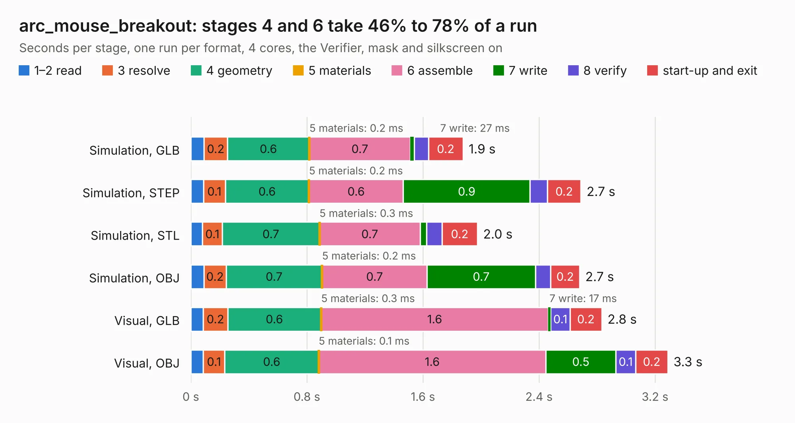

# 1059. arc_mouse_breakout

Board 1,059 of the 3,117 of [Corpus Testing](../Corpus-Testing.md), on [Corpus Page 10](../CorpusTestingPages/Corpus-Testing-10.md#1059-arc_mouse_breakout).

| Mode and format | 1–2 read | 3 resolve | 4 geometry | 5 materials | 6 assemble | 7 write | 8 verify | start-up and exit | Total |
|---|---:|---:|---:|---:|---:|---:|---:|---:|---:|
| Simulation, GLB | 91&nbsp;ms | 0.2 | 0.6 | 0.2&nbsp;ms | 0.7 | 27&nbsp;ms | 97&nbsp;ms | 0.2 | 1.9 |
| Simulation, STEP | 87&nbsp;ms | 0.1 | 0.6 | 0.2&nbsp;ms | 0.6 | 0.9 | 0.1 | 0.2 | 2.7 |
| Simulation, STL | 80&nbsp;ms | 0.1 | 0.7 | 0.3&nbsp;ms | 0.7 | 44&nbsp;ms | 0.1 | 0.2 | 2.0 |
| Simulation, OBJ | 90&nbsp;ms | 0.2 | 0.7 | 0.2&nbsp;ms | 0.7 | 0.7 | 0.1 | 0.2 | 2.7 |
| Visual, GLB | 85&nbsp;ms | 0.2 | 0.6 | 0.3&nbsp;ms | 1.6 | 17&nbsp;ms | 0.1 | 0.2 | 2.8 |
| Visual, OBJ | 86&nbsp;ms | 0.1 | 0.6 | 0.1&nbsp;ms | 1.6 | 0.5 | 0.1 | 0.2 | 3.3 |

<table align="center"><tr><td valign="top">

| Board | Repo: [google/myelin-acorn-electron-hardware](https://github.com/google/myelin-acorn-electron-hardware) Board: `arc_mouse_breakout.kicad_pcb` |
|---|---|
| Folder | arc_mouse_breakout / pcb |
| Complexity | 128&nbsp;/&nbsp;1000 (size&nbsp;93, features&nbsp;35) |
| KESE&nbsp;features | through vias, filled zones |
| Tested | 9th November 2026 |
| Copper&nbsp;layers | 2 |
| File&nbsp;format | KiCad 5 (20171130) |
| Parts,&nbsp;tracks,&nbsp;vias | 2, 43, 2 |
| Triangles,&nbsp;simulation | 181,218 in 21 parts |
| Verifier | PASS in all six runs |

</td><td valign="top">

<table>
<tr><th>File type</th><th>File size</th><th>Peak memory used</th></tr>
<tr><th colspan="3" align="left">Simulation</th></tr>
<tr><td>GLB</td><td align="right">6.1&nbsp;MB</td><td align="right">206&nbsp;MB</td></tr>
<tr><td>STEP</td><td align="right">28&nbsp;MB</td><td align="right">213&nbsp;MB</td></tr>
<tr><td>STL</td><td align="right">9.1&nbsp;MB</td><td align="right">206&nbsp;MB</td></tr>
<tr><td>OBJ</td><td align="right">18&nbsp;MB</td><td align="right">214&nbsp;MB</td></tr>
<tr><th colspan="3" align="left">Visual</th></tr>
<tr><td>GLB</td><td align="right">4.4&nbsp;MB</td><td align="right">192&nbsp;MB</td></tr>
<tr><td>OBJ</td><td align="right">12&nbsp;MB</td><td align="right">188&nbsp;MB</td></tr>
</table>

</td></tr></table>

| Previous | Next |
|:---|---:|
| [1058. arc_keyboard_to_a3000](b1058b_myelin-acorn-electron-hardware_arc-keyboard-to-a3000.md) | [1060. archimedes_bus_scope](b1060b_myelin-acorn-electron-hardware_archimedes-bus-scope.md) |
