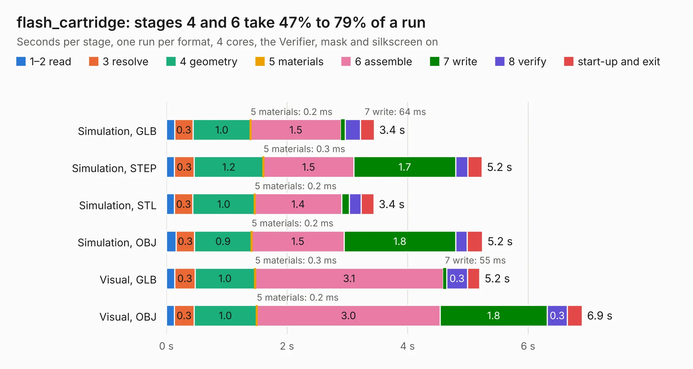

# 1060. flash_cartridge

Board 1,060 of the 3,126 of [Corpus Testing](../Corpus-Testing.md), on [Corpus Page 10](../CorpusTestingPages/Corpus-Testing-10.md#1060-flash_cartridge).

| Mode and format | 1–2 read | 3 resolve | 4 geometry | 5 materials | 6 assemble | 7 write | 8 verify | start-up and exit | Total |
|---|---:|---:|---:|---:|---:|---:|---:|---:|---:|
| Simulation, GLB | 0.1 | 0.3 | 1.0 | 0.2&nbsp;ms | 1.5 | 64&nbsp;ms | 0.3 | 0.2 | 3.4 |
| Simulation, STEP | 0.1 | 0.3 | 1.2 | 0.3&nbsp;ms | 1.5 | 1.7 | 0.2 | 0.2 | 5.2 |
| Simulation, STL | 0.1 | 0.3 | 1.0 | 0.2&nbsp;ms | 1.4 | 0.1 | 0.2 | 0.2 | 3.4 |
| Simulation, OBJ | 0.2 | 0.3 | 0.9 | 0.2&nbsp;ms | 1.5 | 1.8 | 0.2 | 0.3 | 5.2 |
| Visual, GLB | 0.1 | 0.3 | 1.0 | 0.3&nbsp;ms | 3.1 | 55&nbsp;ms | 0.3 | 0.2 | 5.2 |
| Visual, OBJ | 0.1 | 0.3 | 1.0 | 0.2&nbsp;ms | 3.0 | 1.8 | 0.3 | 0.2 | 6.9 |

<table align="center"><tr><td valign="top">

| Board | Repo: [google/myelin-acorn-electron-hardware](https://github.com/google/myelin-acorn-electron-hardware) Board: `flash_cartridge.kicad_pcb` |
|---|---|
| Folder | 32kb_flash_cartridge / pcb-standard |
| Complexity | 212&nbsp;/&nbsp;1000 (size&nbsp;177, features&nbsp;35) |
| KESE&nbsp;features | through vias, filled zones |
| Tested | 9th November 2026 |
| Copper&nbsp;layers | 2 |
| File&nbsp;format | KiCad 4 (4) |
| Parts,&nbsp;tracks,&nbsp;vias | 6, 288, 48 |
| Triangles,&nbsp;simulation | 277,490 in 41 parts |
| Verifier | PASS in all six runs |

</td><td valign="top">

<table>
<tr><th>File type</th><th>File size</th><th>Peak memory used</th></tr>
<tr><th colspan="3" align="left">Simulation</th></tr>
<tr><td>GLB</td><td align="right">9.7&nbsp;MB</td><td align="right">254&nbsp;MB</td></tr>
<tr><td>STEP</td><td align="right">51&nbsp;MB</td><td align="right">281&nbsp;MB</td></tr>
<tr><td>STL</td><td align="right">14&nbsp;MB</td><td align="right">255&nbsp;MB</td></tr>
<tr><td>OBJ</td><td align="right">28&nbsp;MB</td><td align="right">254&nbsp;MB</td></tr>
<tr><th colspan="3" align="left">Visual</th></tr>
<tr><td>GLB</td><td align="right">9.7&nbsp;MB</td><td align="right">294&nbsp;MB</td></tr>
<tr><td>OBJ</td><td align="right">29&nbsp;MB</td><td align="right">293&nbsp;MB</td></tr>
</table>

</td></tr></table>

| Previous | Next |
|:---|---:|
| [1059. flash_cartridge](b1059b_myelin-acorn-electron-hardware_32kb-flash-cartridge-pcb-mini_flash-cartridge.md) | [1061. a3000_ram_buffer](b1061b_myelin-acorn-electron-hardware_a3000-ram-buffer.md) |
