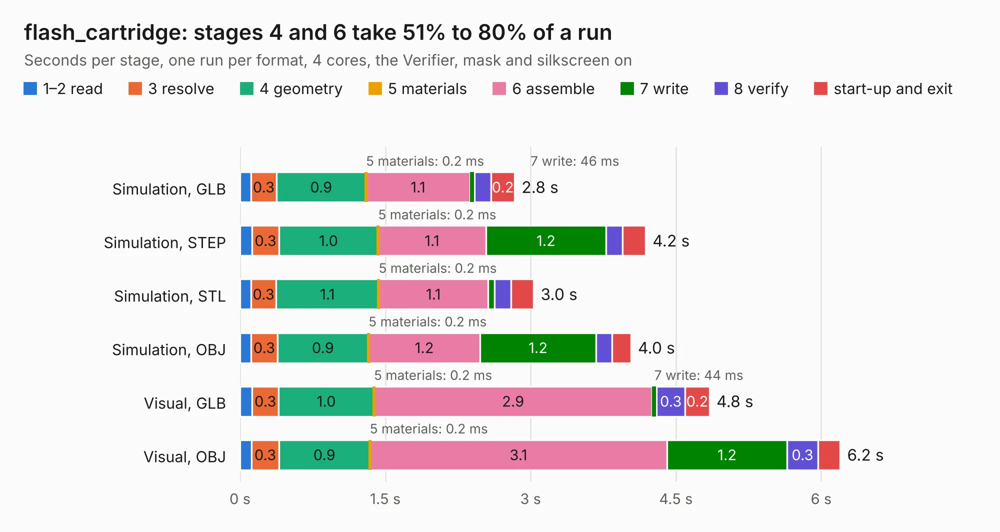

# 1061. flash_cartridge

Board 1,061 of the 3,139 of [Corpus Testing](../Corpus-Testing.md), on [Corpus Page 10](../CorpusTestingPages/Corpus-Testing-10.md#1061-flash_cartridge).

| Mode and format | 1–2 read | 3 resolve | 4 geometry | 5 materials | 6 assemble | 7 write | 8 verify | start-up and exit | Total |
|---|---:|---:|---:|---:|---:|---:|---:|---:|---:|
| Simulation, GLB | 0.1 | 0.3 | 0.9 | 0.2&nbsp;ms | 1.1 | 46&nbsp;ms | 0.2 | 0.2 | 2.8 |
| Simulation, STEP | 0.1 | 0.3 | 1.0 | 0.2&nbsp;ms | 1.1 | 1.2 | 0.2 | 0.2 | 4.2 |
| Simulation, STL | 0.1 | 0.3 | 1.1 | 0.2&nbsp;ms | 1.1 | 68&nbsp;ms | 0.2 | 0.2 | 3.0 |
| Simulation, OBJ | 0.1 | 0.3 | 0.9 | 0.2&nbsp;ms | 1.2 | 1.2 | 0.2 | 0.2 | 4.0 |
| Visual, GLB | 0.1 | 0.3 | 1.0 | 0.2&nbsp;ms | 2.9 | 44&nbsp;ms | 0.3 | 0.2 | 4.8 |
| Visual, OBJ | 0.1 | 0.3 | 0.9 | 0.2&nbsp;ms | 3.1 | 1.2 | 0.3 | 0.2 | 6.2 |

<table align="center"><tr><td valign="top">

| Board | Repo: [google/myelin-acorn-electron-hardware](https://github.com/google/myelin-acorn-electron-hardware) Board: `flash_cartridge.kicad_pcb` |
|---|---|
| Folder | 32kb_flash_cartridge / pcb-mini |
| Complexity | 221&nbsp;/&nbsp;1000 (size&nbsp;176, features&nbsp;45) |
| KESE&nbsp;features | through vias, filled zones, curved board outline |
| Tested | 9th November 2026 |
| Copper&nbsp;layers | 2 |
| File&nbsp;format | KiCad 4 (4) |
| Parts,&nbsp;tracks,&nbsp;vias | 6, 266, 46 |
| Triangles,&nbsp;simulation | 251,966 in 41 parts |
| Verifier | PASS in all six runs |

</td><td valign="top">

<table>
<tr><th>File type</th><th>File size</th><th>Peak memory used</th></tr>
<tr><th colspan="3" align="left">Simulation</th></tr>
<tr><td>GLB</td><td align="right">9.1&nbsp;MB</td><td align="right">243&nbsp;MB</td></tr>
<tr><td>STEP</td><td align="right">45&nbsp;MB</td><td align="right">264&nbsp;MB</td></tr>
<tr><td>STL</td><td align="right">13&nbsp;MB</td><td align="right">233&nbsp;MB</td></tr>
<tr><td>OBJ</td><td align="right">26&nbsp;MB</td><td align="right">234&nbsp;MB</td></tr>
<tr><th colspan="3" align="left">Visual</th></tr>
<tr><td>GLB</td><td align="right">8.7&nbsp;MB</td><td align="right">259&nbsp;MB</td></tr>
<tr><td>OBJ</td><td align="right">25&nbsp;MB</td><td align="right">259&nbsp;MB</td></tr>
</table>

</td></tr></table>

| Previous | Next |
|:---|---:|
| [1060. MegaDrive](b1060b_Mega-Drive-model-1-schematic_MegaDrive.md) | [1062. flash_cartridge](b1062b_myelin-acorn-electron-hardware_32kb-flash-cartridge-pcb-standard_flash-cartridge.md) |
