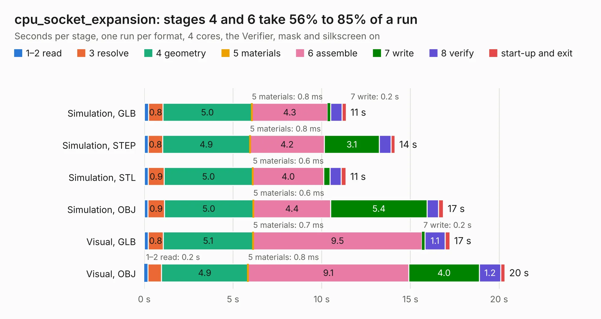

# 1061. cpu_socket_expansion

Board 1,061 of the 3,109 of [Corpus Testing](../Corpus-Testing.md), on [Corpus Page 10](../CorpusTestingPages/Corpus-Testing-10.md#1061-cpu_socket_expansion).

| Mode and format | 1–2 read | 3 resolve | 4 geometry | 5 materials | 6 assemble | 7 write | 8 verify | start-up and exit | Total |
|---|---:|---:|---:|---:|---:|---:|---:|---:|---:|
| Simulation, GLB | 0.2 | 0.8 | 5.0 | 0.8&nbsp;ms | 4.3 | 0.2 | 0.6 | 0.2 | 11.4 |
| Simulation, STEP | 0.2 | 0.8 | 4.9 | 0.8&nbsp;ms | 4.2 | 3.1 | 0.7 | 0.2 | 14.1 |
| Simulation, STL | 0.2 | 0.9 | 5.0 | 0.6&nbsp;ms | 4.0 | 0.4 | 0.6 | 0.3 | 11.4 |
| Simulation, OBJ | 0.2 | 0.9 | 5.0 | 0.6&nbsp;ms | 4.4 | 5.4 | 0.6 | 0.3 | 16.9 |
| Visual, GLB | 0.2 | 0.8 | 5.1 | 0.7&nbsp;ms | 9.5 | 0.2 | 1.1 | 0.3 | 17.2 |
| Visual, OBJ | 0.2 | 0.8 | 4.9 | 0.8&nbsp;ms | 9.1 | 4.0 | 1.2 | 0.2 | 20.3 |

<table align="center"><tr><td valign="top">

| Board | Repo: [google/myelin-acorn-electron-hardware](https://github.com/google/myelin-acorn-electron-hardware) Board: `cpu_socket_expansion.kicad_pcb` |
|---|---|
| Folder | cpu_socket_expansion / pcb |
| Complexity | 207&nbsp;/&nbsp;1000 (size&nbsp;162, features&nbsp;45) |
| KESE&nbsp;features | through vias, rounded, trapezoid or chamfered pads, filled zones |
| Tested | 9th November 2026 |
| Copper&nbsp;layers | 2 |
| File&nbsp;format | KiCad 4 (4) |
| Parts,&nbsp;tracks,&nbsp;vias | 26, 734, 27 |
| Triangles,&nbsp;simulation | 1,090,992 in 101 parts |
| Verifier | PASS in all six runs |

</td><td valign="top">

<table>
<tr><th>File type</th><th>File size</th><th>Peak memory used</th></tr>
<tr><th colspan="3" align="left">Simulation</th></tr>
<tr><td>GLB</td><td align="right">37&nbsp;MB</td><td align="right">446&nbsp;MB</td></tr>
<tr><td>STEP</td><td align="right">178&nbsp;MB</td><td align="right">557&nbsp;MB</td></tr>
<tr><td>STL</td><td align="right">55&nbsp;MB</td><td align="right">455&nbsp;MB</td></tr>
<tr><td>OBJ</td><td align="right">110&nbsp;MB</td><td align="right">756&nbsp;MB</td></tr>
<tr><th colspan="3" align="left">Visual</th></tr>
<tr><td>GLB</td><td align="right">28&nbsp;MB</td><td align="right">630&nbsp;MB</td></tr>
<tr><td>OBJ</td><td align="right">84&nbsp;MB</td><td align="right">677&nbsp;MB</td></tr>
</table>

</td></tr></table>

| Previous | Next |
|:---|---:|
| [1060. cherry_mx](b1060b_myelin-acorn-electron-hardware_cherry-mx.md) | [1062. cpu_socket_minispartan_daughterboard](b1062b_myelin-acorn-electron-hardware_cpu-socket-minispartan-daughterboard.md) |
