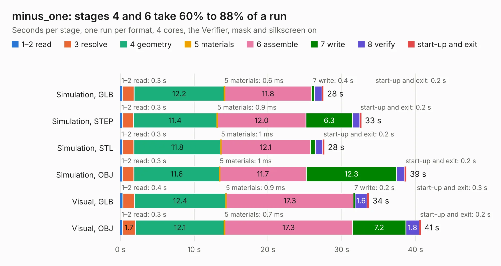

# 1063. minus_one

Board 1,063 of the 3,100 of [Corpus Testing](../Corpus-Testing.md), on [Corpus Page 10](../CorpusTestingPages/Corpus-Testing-10.md#1063-minus_one).

| Mode and format | 1–2 read | 3 resolve | 4 geometry | 5 materials | 6 assemble | 7 write | 8 verify | start-up and exit | Total |
|---|---:|---:|---:|---:|---:|---:|---:|---:|---:|
| Simulation, GLB | 0.3 | 1.6 | 12.2 | 0.6&nbsp;ms | 11.8 | 0.4 | 1.0 | 0.2 | 27.5 |
| Simulation, STEP | 0.3 | 1.5 | 11.4 | 0.9&nbsp;ms | 12.0 | 6.3 | 1.0 | 0.2 | 32.7 |
| Simulation, STL | 0.3 | 1.5 | 11.8 | 1&nbsp;ms | 12.1 | 0.6 | 1.0 | 0.2 | 27.6 |
| Simulation, OBJ | 0.3 | 1.5 | 11.6 | 1&nbsp;ms | 11.7 | 12.3 | 1.1 | 0.2 | 38.8 |
| Visual, GLB | 0.4 | 1.6 | 12.4 | 0.9&nbsp;ms | 17.3 | 0.2 | 1.6 | 0.3 | 33.7 |
| Visual, OBJ | 0.3 | 1.7 | 12.1 | 0.7&nbsp;ms | 17.3 | 7.2 | 1.8 | 0.2 | 40.7 |

<table align="center"><tr><td valign="top">

| Board | Repo: [google/myelin-acorn-electron-hardware](https://github.com/google/myelin-acorn-electron-hardware) Board: `minus_one.kicad_pcb` |
|---|---|
| Folder | minus_one / pcb |
| Complexity | 223&nbsp;/&nbsp;1000 (size&nbsp;168, features&nbsp;55) |
| KESE&nbsp;features | through vias, rounded, trapezoid or chamfered pads, filled zones, curved board outline |
| Tested | 9th November 2026 |
| Copper&nbsp;layers | 2 |
| File&nbsp;format | KiCad 4 (4) |
| Parts,&nbsp;tracks,&nbsp;vias | 15, 1,332, 97 |
| Triangles,&nbsp;simulation | 2,310,048 in 64 parts |
| Verifier | PASS in all six runs |

</td><td valign="top">

<table>
<tr><th>File type</th><th>File size</th><th>Peak memory used</th></tr>
<tr><th colspan="3" align="left">Simulation</th></tr>
<tr><td>GLB</td><td align="right">80&nbsp;MB</td><td align="right">670&nbsp;MB</td></tr>
<tr><td>STEP</td><td align="right">445&nbsp;MB</td><td align="right">935&nbsp;MB</td></tr>
<tr><td>STL</td><td align="right">116&nbsp;MB</td><td align="right">680&nbsp;MB</td></tr>
<tr><td>OBJ</td><td align="right">245&nbsp;MB</td><td align="right">1.6&nbsp;GB</td></tr>
<tr><th colspan="3" align="left">Visual</th></tr>
<tr><td>GLB</td><td align="right">44&nbsp;MB</td><td align="right">844&nbsp;MB</td></tr>
<tr><td>OBJ</td><td align="right">136&nbsp;MB</td><td align="right">974&nbsp;MB</td></tr>
</table>

</td></tr></table>

| Previous | Next |
|:---|---:|
| [1062. master_updateable_megarom](b1062b_myelin-acorn-electron-hardware_master-updateable-megarom.md) | [1064. pcf8583_daughterboard](b1064b_myelin-acorn-electron-hardware_pcf8583-daughterboard.md) |
