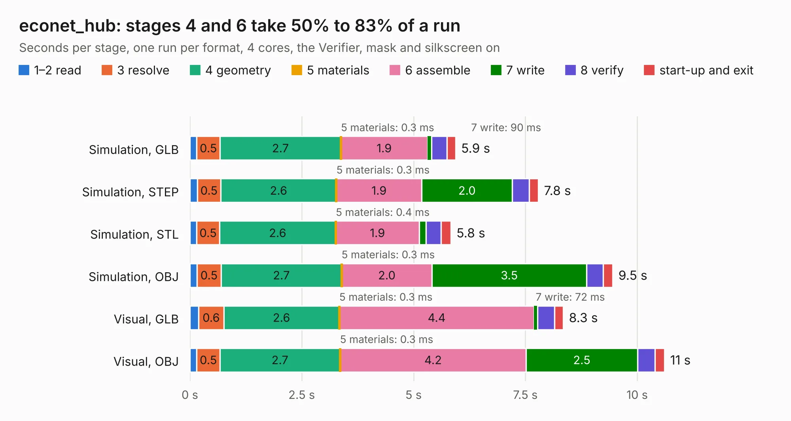

# 1064. econet_hub

Board 1,064 of the 3,109 of [Corpus Testing](../Corpus-Testing.md), on [Corpus Page 10](../CorpusTestingPages/Corpus-Testing-10.md#1064-econet_hub).

| Mode and format | 1–2 read | 3 resolve | 4 geometry | 5 materials | 6 assemble | 7 write | 8 verify | start-up and exit | Total |
|---|---:|---:|---:|---:|---:|---:|---:|---:|---:|
| Simulation, GLB | 0.2 | 0.5 | 2.7 | 0.3&nbsp;ms | 1.9 | 90&nbsp;ms | 0.3 | 0.2 | 5.9 |
| Simulation, STEP | 0.2 | 0.5 | 2.6 | 0.3&nbsp;ms | 1.9 | 2.0 | 0.4 | 0.2 | 7.8 |
| Simulation, STL | 0.2 | 0.5 | 2.6 | 0.4&nbsp;ms | 1.9 | 0.2 | 0.3 | 0.2 | 5.8 |
| Simulation, OBJ | 0.2 | 0.5 | 2.7 | 0.3&nbsp;ms | 2.0 | 3.5 | 0.4 | 0.2 | 9.5 |
| Visual, GLB | 0.2 | 0.6 | 2.6 | 0.3&nbsp;ms | 4.4 | 72&nbsp;ms | 0.4 | 0.2 | 8.3 |
| Visual, OBJ | 0.2 | 0.5 | 2.7 | 0.3&nbsp;ms | 4.2 | 2.5 | 0.4 | 0.2 | 10.6 |

<table align="center"><tr><td valign="top">

| Board | Repo: [google/myelin-acorn-electron-hardware](https://github.com/google/myelin-acorn-electron-hardware) Board: `econet_hub.kicad_pcb` |
|---|---|
| Folder | econet_hub / pcb |
| Complexity | 177&nbsp;/&nbsp;1000 (size&nbsp;142, features&nbsp;35) |
| KESE&nbsp;features | through vias, filled zones |
| Tested | 9th November 2026 |
| Copper&nbsp;layers | 2 |
| File&nbsp;format | KiCad 5 (20171130) |
| Parts,&nbsp;tracks,&nbsp;vias | 19, 216, 23 |
| Triangles,&nbsp;simulation | 639,792 in 24 parts |
| Verifier | PASS in all six runs |

</td><td valign="top">

<table>
<tr><th>File type</th><th>File size</th><th>Peak memory used</th></tr>
<tr><th colspan="3" align="left">Simulation</th></tr>
<tr><td>GLB</td><td align="right">22&nbsp;MB</td><td align="right">353&nbsp;MB</td></tr>
<tr><td>STEP</td><td align="right">104&nbsp;MB</td><td align="right">382&nbsp;MB</td></tr>
<tr><td>STL</td><td align="right">32&nbsp;MB</td><td align="right">349&nbsp;MB</td></tr>
<tr><td>OBJ</td><td align="right">64&nbsp;MB</td><td align="right">462&nbsp;MB</td></tr>
<tr><th colspan="3" align="left">Visual</th></tr>
<tr><td>GLB</td><td align="right">16&nbsp;MB</td><td align="right">451&nbsp;MB</td></tr>
<tr><td>OBJ</td><td align="right">47&nbsp;MB</td><td align="right">448&nbsp;MB</td></tr>
</table>

</td></tr></table>

| Previous | Next |
|:---|---:|
| [1063. econet_standalone](b1063b_myelin-acorn-electron-hardware_econet-standalone.md) | [1065. elk_pi_tube_direct](b1065b_myelin-acorn-electron-hardware_elk-pi-tube-direct.md) |
