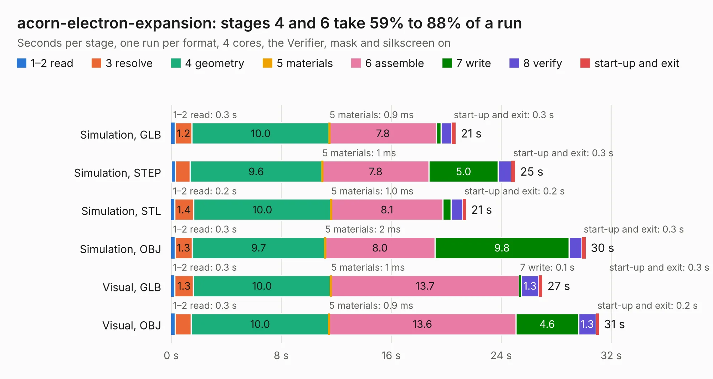

# 1065. acorn-electron-expansion

Board 1,065 of the 3,105 of [Corpus Testing](../Corpus-Testing.md), on [Corpus Page 10](../CorpusTestingPages/Corpus-Testing-10.md#1065-acorn-electron-expansion).

| Mode and format | 1–2 read | 3 resolve | 4 geometry | 5 materials | 6 assemble | 7 write | 8 verify | start-up and exit | Total |
|---|---:|---:|---:|---:|---:|---:|---:|---:|---:|
| Simulation, GLB | 0.3 | 1.2 | 10.0 | 0.9&nbsp;ms | 7.8 | 0.3 | 0.8 | 0.3 | 20.7 |
| Simulation, STEP | 0.3 | 1.1 | 9.6 | 1&nbsp;ms | 7.8 | 5.0 | 1.0 | 0.3 | 25.0 |
| Simulation, STL | 0.2 | 1.4 | 10.0 | 1.0&nbsp;ms | 8.1 | 0.6 | 0.8 | 0.2 | 21.5 |
| Simulation, OBJ | 0.3 | 1.3 | 9.7 | 2&nbsp;ms | 8.0 | 9.8 | 0.9 | 0.3 | 30.1 |
| Visual, GLB | 0.3 | 1.3 | 10.0 | 1&nbsp;ms | 13.7 | 0.1 | 1.3 | 0.3 | 27.0 |
| Visual, OBJ | 0.3 | 1.2 | 10.0 | 0.9&nbsp;ms | 13.6 | 4.6 | 1.3 | 0.2 | 31.1 |

<table align="center"><tr><td valign="top">

| Board | Repo: [google/myelin-acorn-electron-hardware](https://github.com/google/myelin-acorn-electron-hardware) Board: `acorn-electron-expansion.kicad_pcb` |
|---|---|
| Folder | expansion_minispartan_breakout / pcb |
| Complexity | 204&nbsp;/&nbsp;1000 (size&nbsp;159, features&nbsp;45) |
| KESE&nbsp;features | through vias, filled zones, curved board outline |
| Tested | 9th November 2026 |
| Copper&nbsp;layers | 2 |
| File&nbsp;format | KiCad 4 (4) |
| Parts,&nbsp;tracks,&nbsp;vias | 21, 682, 34 |
| Triangles,&nbsp;simulation | 1,840,834 in 125 parts |
| Verifier | PASS in all six runs |

</td><td valign="top">

<table>
<tr><th>File type</th><th>File size</th><th>Peak memory used</th></tr>
<tr><th colspan="3" align="left">Simulation</th></tr>
<tr><td>GLB</td><td align="right">64&nbsp;MB</td><td align="right">717&nbsp;MB</td></tr>
<tr><td>STEP</td><td align="right">357&nbsp;MB</td><td align="right">793&nbsp;MB</td></tr>
<tr><td>STL</td><td align="right">92&nbsp;MB</td><td align="right">697&nbsp;MB</td></tr>
<tr><td>OBJ</td><td align="right">195&nbsp;MB</td><td align="right">1.3&nbsp;GB</td></tr>
<tr><th colspan="3" align="left">Visual</th></tr>
<tr><td>GLB</td><td align="right">34&nbsp;MB</td><td align="right">687&nbsp;MB</td></tr>
<tr><td>OBJ</td><td align="right">101&nbsp;MB</td><td align="right">739&nbsp;MB</td></tr>
</table>

</td></tr></table>

| Previous | Next |
|:---|---:|
| [1064. elk_pi_tube_direct](b1064b_myelin-acorn-electron-hardware_elk-pi-tube-direct.md) | [1066. fx2_tube_cartridge_adapter](b1066b_myelin-acorn-electron-hardware_fx2-tube-cartridge-adapter.md) |
