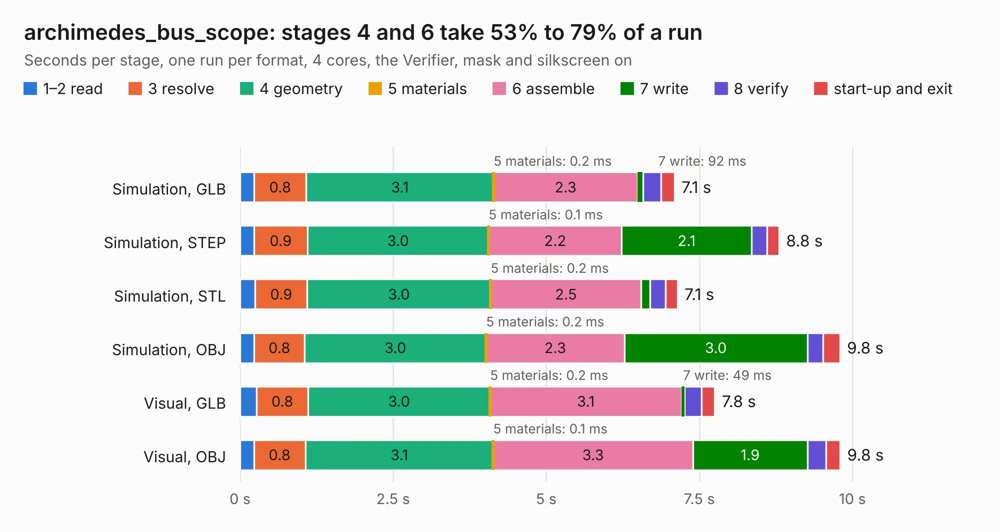

# 1066. archimedes_bus_scope

Board 1,066 of the 3,138 of [Corpus Testing](../Corpus-Testing.md), on [Corpus Page 10](../CorpusTestingPages/Corpus-Testing-10.md#1066-archimedes_bus_scope).

| Mode and format | 1–2 read | 3 resolve | 4 geometry | 5 materials | 6 assemble | 7 write | 8 verify | start-up and exit | Total |
|---|---:|---:|---:|---:|---:|---:|---:|---:|---:|
| Simulation, GLB | 0.2 | 0.8 | 3.1 | 0.2&nbsp;ms | 2.3 | 92&nbsp;ms | 0.3 | 0.2 | 7.1 |
| Simulation, STEP | 0.2 | 0.9 | 3.0 | 0.1&nbsp;ms | 2.2 | 2.1 | 0.3 | 0.2 | 8.8 |
| Simulation, STL | 0.2 | 0.9 | 3.0 | 0.2&nbsp;ms | 2.5 | 0.1 | 0.3 | 0.2 | 7.1 |
| Simulation, OBJ | 0.2 | 0.8 | 3.0 | 0.2&nbsp;ms | 2.3 | 3.0 | 0.3 | 0.3 | 9.8 |
| Visual, GLB | 0.3 | 0.8 | 3.0 | 0.2&nbsp;ms | 3.1 | 49&nbsp;ms | 0.3 | 0.2 | 7.8 |
| Visual, OBJ | 0.2 | 0.8 | 3.1 | 0.1&nbsp;ms | 3.3 | 1.9 | 0.3 | 0.2 | 9.8 |

<table align="center"><tr><td valign="top">

| Board | Repo: [google/myelin-acorn-electron-hardware](https://github.com/google/myelin-acorn-electron-hardware) Board: `archimedes_bus_scope.kicad_pcb` |
|---|---|
| Folder | archimedes_bus_scope / pcb |
| Complexity | 243&nbsp;/&nbsp;1000 (size&nbsp;198, features&nbsp;45) |
| KESE&nbsp;features | through vias, rounded, trapezoid or chamfered pads, filled zones |
| Tested | 9th November 2026 |
| Copper&nbsp;layers | 4 |
| File&nbsp;format | KiCad 5 (20171130) |
| Parts,&nbsp;tracks,&nbsp;vias | 6, 141, 41 |
| Triangles,&nbsp;simulation | 571,910 in 23 parts |
| Verifier | PASS in all six runs |

</td><td valign="top">

<table>
<tr><th>File type</th><th>File size</th><th>Peak memory used</th></tr>
<tr><th colspan="3" align="left">Simulation</th></tr>
<tr><td>GLB</td><td align="right">20&nbsp;MB</td><td align="right">346&nbsp;MB</td></tr>
<tr><td>STEP</td><td align="right">96&nbsp;MB</td><td align="right">421&nbsp;MB</td></tr>
<tr><td>STL</td><td align="right">29&nbsp;MB</td><td align="right">345&nbsp;MB</td></tr>
<tr><td>OBJ</td><td align="right">58&nbsp;MB</td><td align="right">391&nbsp;MB</td></tr>
<tr><th colspan="3" align="left">Visual</th></tr>
<tr><td>GLB</td><td align="right">12&nbsp;MB</td><td align="right">375&nbsp;MB</td></tr>
<tr><td>OBJ</td><td align="right">34&nbsp;MB</td><td align="right">372&nbsp;MB</td></tr>
</table>

</td></tr></table>

| Previous | Next |
|:---|---:|
| [1065. arc_mouse_breakout](b1065b_myelin-acorn-electron-hardware_arc-mouse-breakout.md) | [1067. atsamd11_pro_micro](b1067b_myelin-acorn-electron-hardware_atsamd11-pro-micro.md) |
