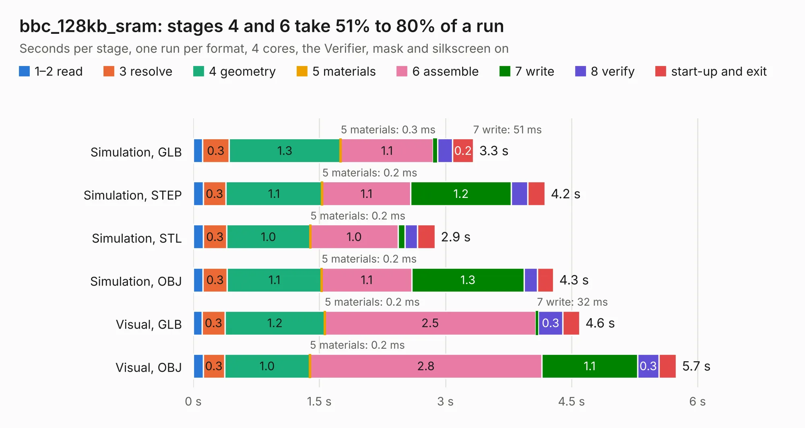

# 1067. bbc_128kb_sram

Board 1,067 of the 3,125 of [Corpus Testing](../Corpus-Testing.md), on [Corpus Page 10](../CorpusTestingPages/Corpus-Testing-10.md#1067-bbc_128kb_sram).

| Mode and format | 1–2 read | 3 resolve | 4 geometry | 5 materials | 6 assemble | 7 write | 8 verify | start-up and exit | Total |
|---|---:|---:|---:|---:|---:|---:|---:|---:|---:|
| Simulation, GLB | 0.1 | 0.3 | 1.3 | 0.3&nbsp;ms | 1.1 | 51&nbsp;ms | 0.2 | 0.2 | 3.3 |
| Simulation, STEP | 0.1 | 0.3 | 1.1 | 0.2&nbsp;ms | 1.1 | 1.2 | 0.2 | 0.2 | 4.2 |
| Simulation, STL | 0.1 | 0.3 | 1.0 | 0.2&nbsp;ms | 1.0 | 82&nbsp;ms | 0.1 | 0.2 | 2.9 |
| Simulation, OBJ | 0.1 | 0.3 | 1.1 | 0.2&nbsp;ms | 1.1 | 1.3 | 0.2 | 0.2 | 4.3 |
| Visual, GLB | 0.1 | 0.3 | 1.2 | 0.2&nbsp;ms | 2.5 | 32&nbsp;ms | 0.3 | 0.2 | 4.6 |
| Visual, OBJ | 0.1 | 0.3 | 1.0 | 0.2&nbsp;ms | 2.8 | 1.1 | 0.3 | 0.2 | 5.7 |

<table align="center"><tr><td valign="top">

| Board | Repo: [google/myelin-acorn-electron-hardware](https://github.com/google/myelin-acorn-electron-hardware) Board: `bbc_128kb_sram.kicad_pcb` |
|---|---|
| Folder | bbc_128kb_sram / pcb |
| Complexity | 169&nbsp;/&nbsp;1000 (size&nbsp;134, features&nbsp;35) |
| KESE&nbsp;features | through vias, filled zones |
| Tested | 9th November 2026 |
| Copper&nbsp;layers | 2 |
| File&nbsp;format | KiCad 4 (4) |
| Parts,&nbsp;tracks,&nbsp;vias | 9, 225, 20 |
| Triangles,&nbsp;simulation | 326,668 in 52 parts |
| Verifier | PASS in all six runs |

</td><td valign="top">

<table>
<tr><th>File type</th><th>File size</th><th>Peak memory used</th></tr>
<tr><th colspan="3" align="left">Simulation</th></tr>
<tr><td>GLB</td><td align="right">11&nbsp;MB</td><td align="right">268&nbsp;MB</td></tr>
<tr><td>STEP</td><td align="right">51&nbsp;MB</td><td align="right">281&nbsp;MB</td></tr>
<tr><td>STL</td><td align="right">16&nbsp;MB</td><td align="right">255&nbsp;MB</td></tr>
<tr><td>OBJ</td><td align="right">33&nbsp;MB</td><td align="right">269&nbsp;MB</td></tr>
<tr><th colspan="3" align="left">Visual</th></tr>
<tr><td>GLB</td><td align="right">8.6&nbsp;MB</td><td align="right">284&nbsp;MB</td></tr>
<tr><td>OBJ</td><td align="right">25&nbsp;MB</td><td align="right">284&nbsp;MB</td></tr>
</table>

</td></tr></table>

| Previous | Next |
|:---|---:|
| [1066. atsamd21_usb](b1066b_myelin-acorn-electron-hardware_atsamd21-usb.md) | [1068. bbc_power](b1068b_myelin-acorn-electron-hardware_bbc-power.md) |
