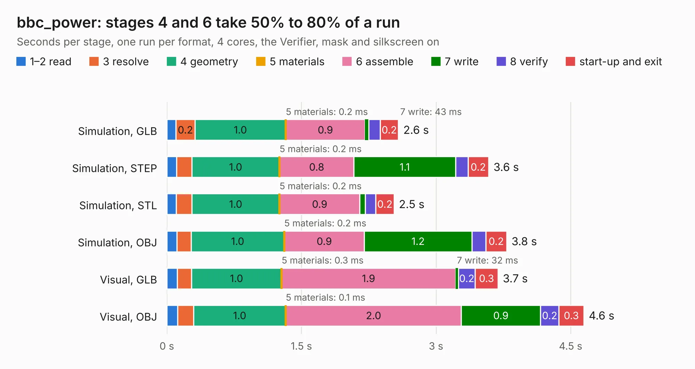

# 1068. bbc_power

Board 1,068 of the 3,125 of [Corpus Testing](../Corpus-Testing.md), on [Corpus Page 10](../CorpusTestingPages/Corpus-Testing-10.md#1068-bbc_power).

| Mode and format | 1–2 read | 3 resolve | 4 geometry | 5 materials | 6 assemble | 7 write | 8 verify | start-up and exit | Total |
|---|---:|---:|---:|---:|---:|---:|---:|---:|---:|
| Simulation, GLB | 0.1 | 0.2 | 1.0 | 0.2&nbsp;ms | 0.9 | 43&nbsp;ms | 0.1 | 0.2 | 2.6 |
| Simulation, STEP | 0.1 | 0.2 | 1.0 | 0.2&nbsp;ms | 0.8 | 1.1 | 0.1 | 0.2 | 3.6 |
| Simulation, STL | 0.1 | 0.2 | 1.0 | 0.2&nbsp;ms | 0.9 | 61&nbsp;ms | 0.1 | 0.2 | 2.5 |
| Simulation, OBJ | 0.1 | 0.2 | 1.0 | 0.2&nbsp;ms | 0.9 | 1.2 | 0.2 | 0.2 | 3.8 |
| Visual, GLB | 0.1 | 0.2 | 1.0 | 0.3&nbsp;ms | 1.9 | 32&nbsp;ms | 0.2 | 0.3 | 3.7 |
| Visual, OBJ | 0.1 | 0.2 | 1.0 | 0.1&nbsp;ms | 2.0 | 0.9 | 0.2 | 0.3 | 4.6 |

<table align="center"><tr><td valign="top">

| Board | Repo: [google/myelin-acorn-electron-hardware](https://github.com/google/myelin-acorn-electron-hardware) Board: `bbc_power.kicad_pcb` |
|---|---|
| Folder | bbc_power_distribution / pcb |
| Complexity | 143&nbsp;/&nbsp;1000 (size&nbsp;108, features&nbsp;35) |
| KESE&nbsp;features | through vias, filled zones |
| Tested | 9th November 2026 |
| Copper&nbsp;layers | 2 |
| File&nbsp;format | KiCad 4 (4) |
| Parts,&nbsp;tracks,&nbsp;vias | 11, 43, 2 |
| Triangles,&nbsp;simulation | 249,304 in 18 parts |
| Verifier | PASS in all six runs |

</td><td valign="top">

<table>
<tr><th>File type</th><th>File size</th><th>Peak memory used</th></tr>
<tr><th colspan="3" align="left">Simulation</th></tr>
<tr><td>GLB</td><td align="right">8.3&nbsp;MB</td><td align="right">233&nbsp;MB</td></tr>
<tr><td>STEP</td><td align="right">39&nbsp;MB</td><td align="right">237&nbsp;MB</td></tr>
<tr><td>STL</td><td align="right">12&nbsp;MB</td><td align="right">222&nbsp;MB</td></tr>
<tr><td>OBJ</td><td align="right">25&nbsp;MB</td><td align="right">227&nbsp;MB</td></tr>
<tr><th colspan="3" align="left">Visual</th></tr>
<tr><td>GLB</td><td align="right">6.0&nbsp;MB</td><td align="right">234&nbsp;MB</td></tr>
<tr><td>OBJ</td><td align="right">17&nbsp;MB</td><td align="right">234&nbsp;MB</td></tr>
</table>

</td></tr></table>

| Previous | Next |
|:---|---:|
| [1067. bbc_128kb_sram](b1067b_myelin-acorn-electron-hardware_bbc-128kb-sram.md) | [1069. bga_in_two_layers](b1069b_myelin-acorn-electron-hardware_bga-in-two-layers.md) |
