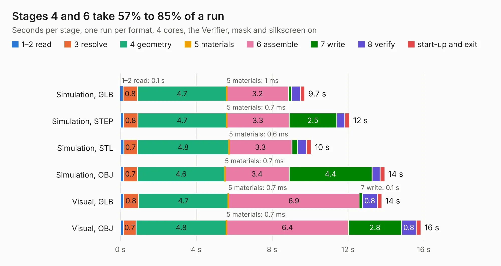

# 1070. cpu_socket_minispartan_daughterboard

Board 1,070 of the 3,119 of [Corpus Testing](../Corpus-Testing.md), on [Corpus Page 10](../CorpusTestingPages/Corpus-Testing-10.md#1070-cpu_socket_minispartan_daughterboard).

| Mode and format | 1–2 read | 3 resolve | 4 geometry | 5 materials | 6 assemble | 7 write | 8 verify | start-up and exit | Total |
|---|---:|---:|---:|---:|---:|---:|---:|---:|---:|
| Simulation, GLB | 0.1 | 0.8 | 4.7 | 1&nbsp;ms | 3.2 | 0.2 | 0.5 | 0.2 | 9.7 |
| Simulation, STEP | 0.2 | 0.8 | 4.7 | 0.7&nbsp;ms | 3.3 | 2.5 | 0.4 | 0.3 | 12.1 |
| Simulation, STL | 0.2 | 0.7 | 4.8 | 0.6&nbsp;ms | 3.3 | 0.3 | 0.5 | 0.2 | 10.1 |
| Simulation, OBJ | 0.2 | 0.7 | 4.6 | 0.7&nbsp;ms | 3.4 | 4.4 | 0.4 | 0.2 | 13.9 |
| Visual, GLB | 0.2 | 0.8 | 4.7 | 0.7&nbsp;ms | 6.9 | 0.1 | 0.8 | 0.2 | 13.8 |
| Visual, OBJ | 0.2 | 0.7 | 4.8 | 0.7&nbsp;ms | 6.4 | 2.8 | 0.8 | 0.3 | 15.8 |

<table align="center"><tr><td valign="top">

| Board | Repo: [google/myelin-acorn-electron-hardware](https://github.com/google/myelin-acorn-electron-hardware) Board: `cpu_socket_minispartan_daughterboard.kicad_pcb` |
|---|---|
| Folder | cpu_socket_minispartan_daughterboard / pcb |
| Complexity | 163&nbsp;/&nbsp;1000 (size&nbsp;128, features&nbsp;35) |
| KESE&nbsp;features | through vias, filled zones |
| Tested | 9th November 2026 |
| Copper&nbsp;layers | 2 |
| File&nbsp;format | KiCad 4 (4) |
| Parts,&nbsp;tracks,&nbsp;vias | 5, 272, 1 |
| Triangles,&nbsp;simulation | 1,079,078 in 85 parts |
| Verifier | PASS in all six runs |

</td><td valign="top">

<table>
<tr><th>File type</th><th>File size</th><th>Peak memory used</th></tr>
<tr><th colspan="3" align="left">Simulation</th></tr>
<tr><td>GLB</td><td align="right">35&nbsp;MB</td><td align="right">445&nbsp;MB</td></tr>
<tr><td>STEP</td><td align="right">149&nbsp;MB</td><td align="right">540&nbsp;MB</td></tr>
<tr><td>STL</td><td align="right">54&nbsp;MB</td><td align="right">432&nbsp;MB</td></tr>
<tr><td>OBJ</td><td align="right">108&nbsp;MB</td><td align="right">739&nbsp;MB</td></tr>
<tr><th colspan="3" align="left">Visual</th></tr>
<tr><td>GLB</td><td align="right">21&nbsp;MB</td><td align="right">574&nbsp;MB</td></tr>
<tr><td>OBJ</td><td align="right">64&nbsp;MB</td><td align="right">598&nbsp;MB</td></tr>
</table>

</td></tr></table>

| Previous | Next |
|:---|---:|
| [1069. cpu_socket_expansion](b1069b_myelin-acorn-electron-hardware_cpu-socket-expansion.md) | [1071. econet_standalone](b1071b_myelin-acorn-electron-hardware_econet-standalone.md) |
