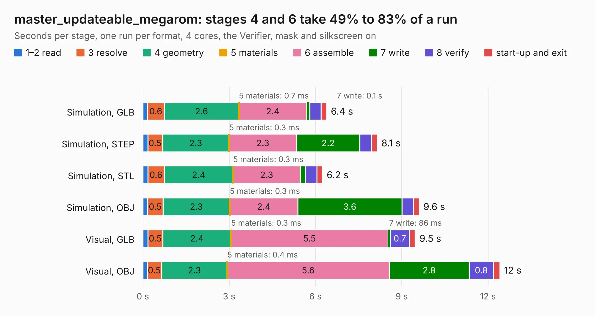

# 1070. master_updateable_megarom

Board 1,070 of the 3,112 of [Corpus Testing](../Corpus-Testing.md), on [Corpus Page 10](../CorpusTestingPages/Corpus-Testing-10.md#1070-master_updateable_megarom).

| Mode and format | 1–2 read | 3 resolve | 4 geometry | 5 materials | 6 assemble | 7 write | 8 verify | start-up and exit | Total |
|---|---:|---:|---:|---:|---:|---:|---:|---:|---:|
| Simulation, GLB | 0.2 | 0.6 | 2.6 | 0.7&nbsp;ms | 2.4 | 0.1 | 0.4 | 0.2 | 6.4 |
| Simulation, STEP | 0.2 | 0.5 | 2.3 | 0.3&nbsp;ms | 2.3 | 2.2 | 0.4 | 0.2 | 8.1 |
| Simulation, STL | 0.2 | 0.6 | 2.4 | 0.3&nbsp;ms | 2.3 | 0.2 | 0.4 | 0.2 | 6.2 |
| Simulation, OBJ | 0.2 | 0.5 | 2.3 | 0.3&nbsp;ms | 2.4 | 3.6 | 0.4 | 0.2 | 9.6 |
| Visual, GLB | 0.2 | 0.5 | 2.4 | 0.3&nbsp;ms | 5.5 | 86&nbsp;ms | 0.7 | 0.2 | 9.5 |
| Visual, OBJ | 0.2 | 0.5 | 2.3 | 0.4&nbsp;ms | 5.6 | 2.8 | 0.8 | 0.2 | 12.4 |

<table align="center"><tr><td valign="top">

| Board | Repo: [google/myelin-acorn-electron-hardware](https://github.com/google/myelin-acorn-electron-hardware) Board: `master_updateable_megarom.kicad_pcb` |
|---|---|
| Folder | master_updateable_megarom / pcb |
| Complexity | 243&nbsp;/&nbsp;1000 (size&nbsp;198, features&nbsp;45) |
| KESE&nbsp;features | through vias, rounded, trapezoid or chamfered pads, filled zones |
| Tested | 9th November 2026 |
| Copper&nbsp;layers | 2 |
| File&nbsp;format | KiCad 4 (4) |
| Parts,&nbsp;tracks,&nbsp;vias | 15, 648, 78 |
| Triangles,&nbsp;simulation | 647,566 in 71 parts |
| Verifier | PASS in all six runs |

</td><td valign="top">

<table>
<tr><th>File type</th><th>File size</th><th>Peak memory used</th></tr>
<tr><th colspan="3" align="left">Simulation</th></tr>
<tr><td>GLB</td><td align="right">22&nbsp;MB</td><td align="right">378&nbsp;MB</td></tr>
<tr><td>STEP</td><td align="right">105&nbsp;MB</td><td align="right">429&nbsp;MB</td></tr>
<tr><td>STL</td><td align="right">32&nbsp;MB</td><td align="right">372&nbsp;MB</td></tr>
<tr><td>OBJ</td><td align="right">65&nbsp;MB</td><td align="right">463&nbsp;MB</td></tr>
<tr><th colspan="3" align="left">Visual</th></tr>
<tr><td>GLB</td><td align="right">18&nbsp;MB</td><td align="right">500&nbsp;MB</td></tr>
<tr><td>OBJ</td><td align="right">55&nbsp;MB</td><td align="right">471&nbsp;MB</td></tr>
</table>

</td></tr></table>

| Previous | Next |
|:---|---:|
| [1069. fx2_tube_cartridge_adapter](b1069b_myelin-acorn-electron-hardware_fx2-tube-cartridge-adapter.md) | [1071. minus_one](b1071b_myelin-acorn-electron-hardware_minus-one.md) |
