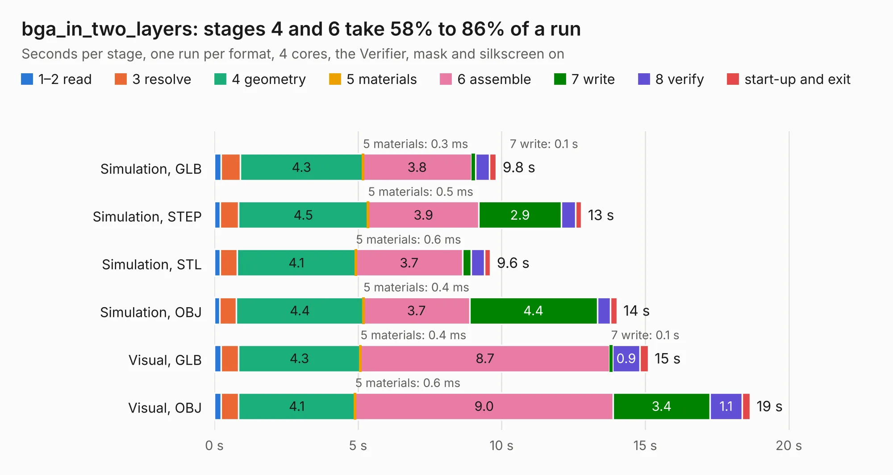

# 1071. bga_in_two_layers

Board 1,071 of the 3,139 of [Corpus Testing](../Corpus-Testing.md), on [Corpus Page 10](../CorpusTestingPages/Corpus-Testing-10.md#1071-bga_in_two_layers).

| Mode and format | 1–2 read | 3 resolve | 4 geometry | 5 materials | 6 assemble | 7 write | 8 verify | start-up and exit | Total |
|---|---:|---:|---:|---:|---:|---:|---:|---:|---:|
| Simulation, GLB | 0.2 | 0.7 | 4.3 | 0.3&nbsp;ms | 3.8 | 0.1 | 0.5 | 0.2 | 9.8 |
| Simulation, STEP | 0.2 | 0.6 | 4.5 | 0.5&nbsp;ms | 3.9 | 2.9 | 0.5 | 0.2 | 12.8 |
| Simulation, STL | 0.2 | 0.6 | 4.1 | 0.6&nbsp;ms | 3.7 | 0.3 | 0.5 | 0.2 | 9.6 |
| Simulation, OBJ | 0.2 | 0.6 | 4.4 | 0.4&nbsp;ms | 3.7 | 4.4 | 0.5 | 0.2 | 14.0 |
| Visual, GLB | 0.2 | 0.6 | 4.3 | 0.4&nbsp;ms | 8.7 | 0.1 | 0.9 | 0.3 | 15.1 |
| Visual, OBJ | 0.2 | 0.6 | 4.1 | 0.6&nbsp;ms | 9.0 | 3.4 | 1.1 | 0.3 | 18.7 |

<table align="center"><tr><td valign="top">

| Board | Repo: [google/myelin-acorn-electron-hardware](https://github.com/google/myelin-acorn-electron-hardware) Board: `bga_in_two_layers.kicad_pcb` |
|---|---|
| Folder | bga_in_two_layers / pcb |
| Complexity | 255&nbsp;/&nbsp;1000 (size&nbsp;220, features&nbsp;35) |
| KESE&nbsp;features | through vias, filled zones |
| Tested | 9th November 2026 |
| Copper&nbsp;layers | 2 |
| File&nbsp;format | KiCad 4 (4) |
| Parts,&nbsp;tracks,&nbsp;vias | 24, 1,108, 43 |
| Triangles,&nbsp;simulation | 982,312 in 116 parts |
| Verifier | PASS in all six runs |

</td><td valign="top">

<table>
<tr><th>File type</th><th>File size</th><th>Peak memory used</th></tr>
<tr><th colspan="3" align="left">Simulation</th></tr>
<tr><td>GLB</td><td align="right">33&nbsp;MB</td><td align="right">419&nbsp;MB</td></tr>
<tr><td>STEP</td><td align="right">160&nbsp;MB</td><td align="right">524&nbsp;MB</td></tr>
<tr><td>STL</td><td align="right">49&nbsp;MB</td><td align="right">423&nbsp;MB</td></tr>
<tr><td>OBJ</td><td align="right">98&nbsp;MB</td><td align="right">667&nbsp;MB</td></tr>
<tr><th colspan="3" align="left">Visual</th></tr>
<tr><td>GLB</td><td align="right">23&nbsp;MB</td><td align="right">588&nbsp;MB</td></tr>
<tr><td>OBJ</td><td align="right">71&nbsp;MB</td><td align="right">618&nbsp;MB</td></tr>
</table>

</td></tr></table>

| Previous | Next |
|:---|---:|
| [1070. bbc_power](b1070b_myelin-acorn-electron-hardware_bbc-power.md) | [1072. cherry_mx](b1072b_myelin-acorn-electron-hardware_cherry-mx.md) |
