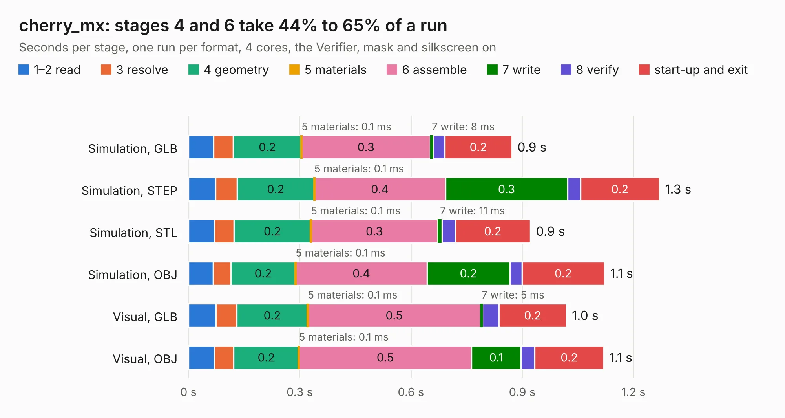

# 1072. cherry_mx

Board 1,072 of the 3,139 of [Corpus Testing](../Corpus-Testing.md), on [Corpus Page 10](../CorpusTestingPages/Corpus-Testing-10.md#1072-cherry_mx).

| Mode and format | 1–2 read | 3 resolve | 4 geometry | 5 materials | 6 assemble | 7 write | 8 verify | start-up and exit | Total |
|---|---:|---:|---:|---:|---:|---:|---:|---:|---:|
| Simulation, GLB | 68&nbsp;ms | 52&nbsp;ms | 0.2 | 0.1&nbsp;ms | 0.3 | 8&nbsp;ms | 31&nbsp;ms | 0.2 | 0.9 |
| Simulation, STEP | 74&nbsp;ms | 58&nbsp;ms | 0.2 | 0.1&nbsp;ms | 0.4 | 0.3 | 34&nbsp;ms | 0.2 | 1.3 |
| Simulation, STL | 69&nbsp;ms | 53&nbsp;ms | 0.2 | 0.1&nbsp;ms | 0.3 | 11&nbsp;ms | 36&nbsp;ms | 0.2 | 0.9 |
| Simulation, OBJ | 67&nbsp;ms | 47&nbsp;ms | 0.2 | 0.1&nbsp;ms | 0.4 | 0.2 | 33&nbsp;ms | 0.2 | 1.1 |
| Visual, GLB | 74&nbsp;ms | 57&nbsp;ms | 0.2 | 0.1&nbsp;ms | 0.5 | 5&nbsp;ms | 44&nbsp;ms | 0.2 | 1.0 |
| Visual, OBJ | 70&nbsp;ms | 52&nbsp;ms | 0.2 | 0.1&nbsp;ms | 0.5 | 0.1 | 37&nbsp;ms | 0.2 | 1.1 |

<table align="center"><tr><td valign="top">

| Board | Repo: [google/myelin-acorn-electron-hardware](https://github.com/google/myelin-acorn-electron-hardware) Board: `cherry_mx.kicad_pcb` |
|---|---|
| Folder | cherry_mx_keyswitch_tester / pcb |
| Complexity | 87&nbsp;/&nbsp;1000 (size&nbsp;87, features&nbsp;0) |
| Tested | 9th November 2026 |
| Copper&nbsp;layers | 2 |
| File&nbsp;format | KiCad 4 (4) |
| Parts,&nbsp;tracks,&nbsp;vias | 4, 24, 0 |
| Triangles,&nbsp;simulation | 47,042 in 16 parts |
| Verifier | PASS in all six runs |

</td><td valign="top">

<table>
<tr><th>File type</th><th>File size</th><th>Peak memory used</th></tr>
<tr><th colspan="3" align="left">Simulation</th></tr>
<tr><td>GLB</td><td align="right">1.6&nbsp;MB</td><td align="right">66&nbsp;MB</td></tr>
<tr><td>STEP</td><td align="right">5.6&nbsp;MB</td><td align="right">71&nbsp;MB</td></tr>
<tr><td>STL</td><td align="right">2.4&nbsp;MB</td><td align="right">66&nbsp;MB</td></tr>
<tr><td>OBJ</td><td align="right">4.4&nbsp;MB</td><td align="right">77&nbsp;MB</td></tr>
<tr><th colspan="3" align="left">Visual</th></tr>
<tr><td>GLB</td><td align="right">1000&nbsp;kB</td><td align="right">99&nbsp;MB</td></tr>
<tr><td>OBJ</td><td align="right">2.7&nbsp;MB</td><td align="right">90&nbsp;MB</td></tr>
</table>

</td></tr></table>

| Previous | Next |
|:---|---:|
| [1071. bga_in_two_layers](b1071b_myelin-acorn-electron-hardware_bga-in-two-layers.md) | [1073. cpu_socket_expansion](b1073b_myelin-acorn-electron-hardware_cpu-socket-expansion.md) |
