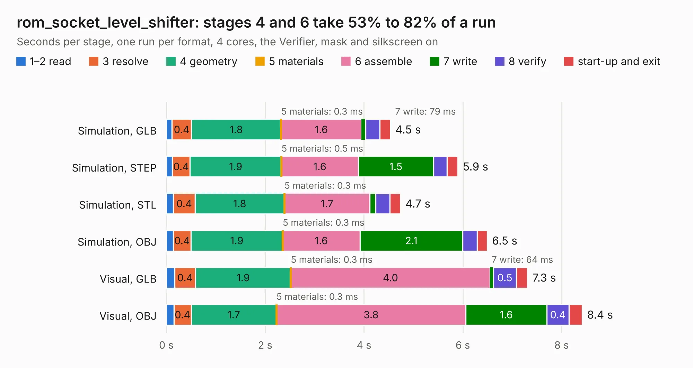

# 1072. rom_socket_level_shifter

Board 1,072 of the 3,106 of [Corpus Testing](../Corpus-Testing.md), on [Corpus Page 10](../CorpusTestingPages/Corpus-Testing-10.md#1072-rom_socket_level_shifter).

| Mode and format | 1–2 read | 3 resolve | 4 geometry | 5 materials | 6 assemble | 7 write | 8 verify | start-up and exit | Total |
|---|---:|---:|---:|---:|---:|---:|---:|---:|---:|
| Simulation, GLB | 0.1 | 0.4 | 1.8 | 0.3&nbsp;ms | 1.6 | 79&nbsp;ms | 0.3 | 0.2 | 4.5 |
| Simulation, STEP | 0.1 | 0.4 | 1.9 | 0.5&nbsp;ms | 1.6 | 1.5 | 0.3 | 0.2 | 5.9 |
| Simulation, STL | 0.1 | 0.4 | 1.8 | 0.3&nbsp;ms | 1.7 | 0.1 | 0.3 | 0.2 | 4.7 |
| Simulation, OBJ | 0.1 | 0.4 | 1.9 | 0.3&nbsp;ms | 1.6 | 2.1 | 0.3 | 0.2 | 6.5 |
| Visual, GLB | 0.2 | 0.4 | 1.9 | 0.3&nbsp;ms | 4.0 | 64&nbsp;ms | 0.5 | 0.2 | 7.3 |
| Visual, OBJ | 0.2 | 0.4 | 1.7 | 0.3&nbsp;ms | 3.8 | 1.6 | 0.4 | 0.3 | 8.4 |

<table align="center"><tr><td valign="top">

| Board | Repo: [google/myelin-acorn-electron-hardware](https://github.com/google/myelin-acorn-electron-hardware) Board: `rom_socket_level_shifter.kicad_pcb` |
|---|---|
| Folder | rom_socket_level_shifter / pcb |
| Complexity | 194&nbsp;/&nbsp;1000 (size&nbsp;149, features&nbsp;45) |
| KESE&nbsp;features | through vias, rounded, trapezoid or chamfered pads, filled zones |
| Tested | 9th November 2026 |
| Copper&nbsp;layers | 2 |
| File&nbsp;format | KiCad 4 (4) |
| Parts,&nbsp;tracks,&nbsp;vias | 13, 463, 34 |
| Triangles,&nbsp;simulation | 479,746 in 64 parts |
| Verifier | PASS in all six runs |

</td><td valign="top">

<table>
<tr><th>File type</th><th>File size</th><th>Peak memory used</th></tr>
<tr><th colspan="3" align="left">Simulation</th></tr>
<tr><td>GLB</td><td align="right">16&nbsp;MB</td><td align="right">277&nbsp;MB</td></tr>
<tr><td>STEP</td><td align="right">76&nbsp;MB</td><td align="right">341&nbsp;MB</td></tr>
<tr><td>STL</td><td align="right">24&nbsp;MB</td><td align="right">278&nbsp;MB</td></tr>
<tr><td>OBJ</td><td align="right">48&nbsp;MB</td><td align="right">361&nbsp;MB</td></tr>
<tr><th colspan="3" align="left">Visual</th></tr>
<tr><td>GLB</td><td align="right">13&nbsp;MB</td><td align="right">357&nbsp;MB</td></tr>
<tr><td>OBJ</td><td align="right">38&nbsp;MB</td><td align="right">350&nbsp;MB</td></tr>
</table>

</td></tr></table>

| Previous | Next |
|:---|---:|
| [1071. post_box_usb](b1071b_myelin-acorn-electron-hardware_post-box-usb.md) | [1073. bbc_1mhz_serial_sd](b1073b_myelin-acorn-electron-hardware_bbc-1mhz-serial-sd.md) |
