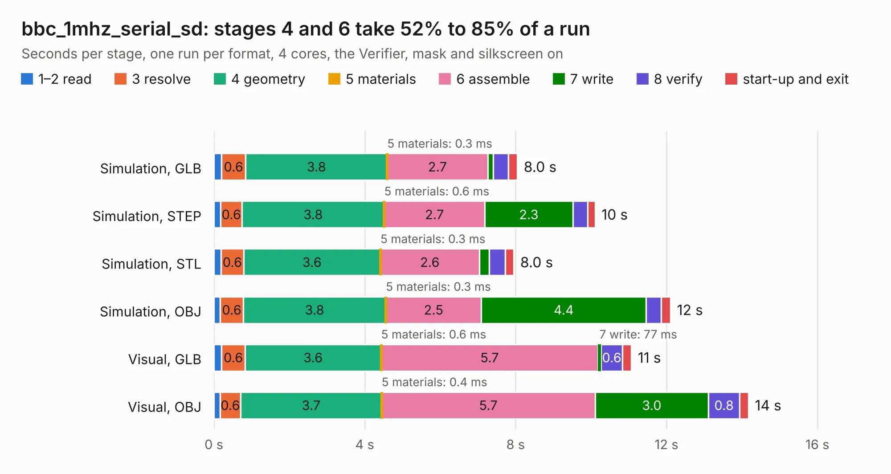

# 1073. bbc_1mhz_serial_sd

Board 1,073 of the 3,106 of [Corpus Testing](../Corpus-Testing.md), on [Corpus Page 10](../CorpusTestingPages/Corpus-Testing-10.md#1073-bbc_1mhz_serial_sd).

| Mode and format | 1–2 read | 3 resolve | 4 geometry | 5 materials | 6 assemble | 7 write | 8 verify | start-up and exit | Total |
|---|---:|---:|---:|---:|---:|---:|---:|---:|---:|
| Simulation, GLB | 0.2 | 0.6 | 3.8 | 0.3&nbsp;ms | 2.7 | 0.1 | 0.4 | 0.2 | 8.0 |
| Simulation, STEP | 0.2 | 0.6 | 3.8 | 0.6&nbsp;ms | 2.7 | 2.3 | 0.4 | 0.2 | 10.1 |
| Simulation, STL | 0.2 | 0.6 | 3.6 | 0.3&nbsp;ms | 2.6 | 0.3 | 0.4 | 0.2 | 8.0 |
| Simulation, OBJ | 0.2 | 0.6 | 3.8 | 0.3&nbsp;ms | 2.5 | 4.4 | 0.4 | 0.3 | 12.1 |
| Visual, GLB | 0.2 | 0.6 | 3.6 | 0.6&nbsp;ms | 5.7 | 77&nbsp;ms | 0.6 | 0.2 | 11.1 |
| Visual, OBJ | 0.2 | 0.6 | 3.7 | 0.4&nbsp;ms | 5.7 | 3.0 | 0.8 | 0.2 | 14.2 |

<table align="center"><tr><td valign="top">

| Board | Repo: [google/myelin-acorn-electron-hardware](https://github.com/google/myelin-acorn-electron-hardware) Board: `bbc_1mhz_serial_sd.kicad_pcb` |
|---|---|
| Folder | serial_sd_adapter / bbc_1mhz_bus_pcb |
| Complexity | 189&nbsp;/&nbsp;1000 (size&nbsp;144, features&nbsp;45) |
| KESE&nbsp;features | through vias, rounded, trapezoid or chamfered pads, filled zones |
| Tested | 9th November 2026 |
| Copper&nbsp;layers | 2 |
| File&nbsp;format | KiCad 4 (4) |
| Parts,&nbsp;tracks,&nbsp;vias | 13, 361, 19 |
| Triangles,&nbsp;simulation | 754,086 in 55 parts |
| Verifier | PASS in all six runs |

</td><td valign="top">

<table>
<tr><th>File type</th><th>File size</th><th>Peak memory used</th></tr>
<tr><th colspan="3" align="left">Simulation</th></tr>
<tr><td>GLB</td><td align="right">26&nbsp;MB</td><td align="right">362&nbsp;MB</td></tr>
<tr><td>STEP</td><td align="right">138&nbsp;MB</td><td align="right">422&nbsp;MB</td></tr>
<tr><td>STL</td><td align="right">38&nbsp;MB</td><td align="right">359&nbsp;MB</td></tr>
<tr><td>OBJ</td><td align="right">77&nbsp;MB</td><td align="right">545&nbsp;MB</td></tr>
<tr><th colspan="3" align="left">Visual</th></tr>
<tr><td>GLB</td><td align="right">18&nbsp;MB</td><td align="right">435&nbsp;MB</td></tr>
<tr><td>OBJ</td><td align="right">54&nbsp;MB</td><td align="right">464&nbsp;MB</td></tr>
</table>

</td></tr></table>

| Previous | Next |
|:---|---:|
| [1072. rom_socket_level_shifter](b1072b_myelin-acorn-electron-hardware_rom-socket-level-shifter.md) | [1074. standalone_programmer](b1074b_myelin-acorn-electron-hardware_standalone-programmer.md) |
