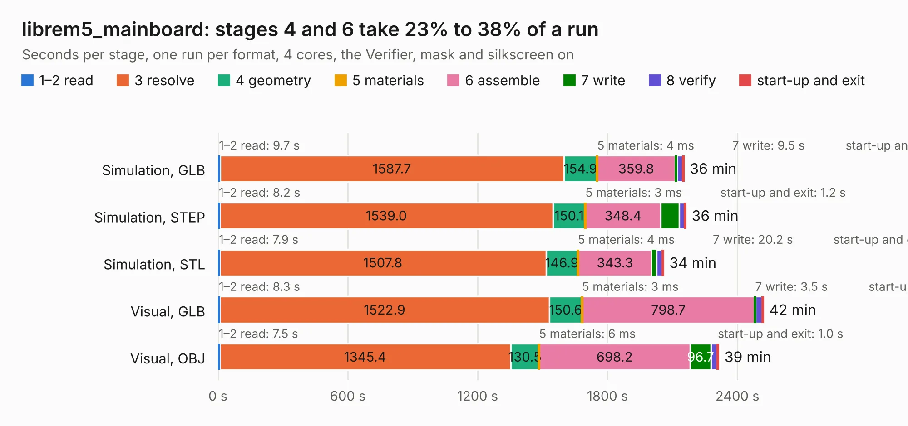

# 1074. librem5_mainboard

Board 1,074 of the 3,101 of [Corpus Testing](../Corpus-Testing.md), on [Corpus Page 10](../CorpusTestingPages/Corpus-Testing-10.md#1074-librem5_mainboard).

| Mode and format | 1–2 read | 3 resolve | 4 geometry | 5 materials | 6 assemble | 7 write | 8 verify | start-up and exit | Total |
|---|---:|---:|---:|---:|---:|---:|---:|---:|---:|
| Simulation, GLB | 9.7 | 1587.7 | 154.9 | 4&nbsp;ms | 359.8 | 9.5 | 26.9 | 1.4 | 2149.9 |
| Simulation, STEP | 8.2 | 1539.0 | 150.1 | 3&nbsp;ms | 348.4 | 85.7 | 26.2 | 1.2 | 2158.9 |
| Simulation, STL | 7.9 | 1507.8 | 146.9 | 4&nbsp;ms | 343.3 | 20.2 | 27.7 | 1.4 | 2055.2 |
| Simulation, OBJ |  |  |  |  |  |  |  |  | exceeded 11 GB on a 16 GB machine (stopped there, not a KESE failure); it will be run again on a machine with more memory |
| Visual, GLB | 8.3 | 1522.9 | 150.6 | 3&nbsp;ms | 798.7 | 3.5 | 32.1 | 0.9 | 2517.0 |
| Visual, OBJ | 7.5 | 1345.4 | 130.5 | 6&nbsp;ms | 698.2 | 96.7 | 30.9 | 1.0 | 2310.2 |

<table align="center"><tr><td valign="top">

| Board | Repo: [gralco/l5-schematic](https://github.com/gralco/l5-schematic) Board: `librem5_mainboard.kicad_pcb` |
|---|---|
| Folder | CAD / PADS / librem5_mainboard / librem5_mainboard_kicad_conversion |
| Complexity | 536&nbsp;/&nbsp;1000 (size&nbsp;371, features&nbsp;165) |
| KESE&nbsp;features | through vias, padstacks, slotted holes, drill offsets, arc tracks, filled zones, copper drawings, copper text, curved board outline, stack-up, dielectric εr and tanδ, mask and silkscreen colours |
| Tested | 9th November 2026 to 10th November 2026 |
| Copper&nbsp;layers | 10 |
| File&nbsp;format | KiCad 10 (20260206) |
| Parts,&nbsp;tracks,&nbsp;vias | 1,161, 23,746, 5,044 |
| Triangles,&nbsp;simulation | 42,957,272 in 866 parts |
| Verifier | Simulation, GLB: Verifier FAIL Simulation, STEP: Verifier FAIL Simulation, STL: Verifier FAIL Simulation, OBJ: exceeded 11 GB on a 16 GB machine (stopped there, not a KESE failure); it will be run again on a machine with more memory |
| Bad&nbsp;design | Bad design according to KESE: copper of two nets on top of each other in the file, a short KiCad's DRC reports; GND and `4G_POWER_KEY` vias about 0.01 mm apart in 238 places, the first at (149.77, 116.06) mm (left so by the conversion from PADS). KESE models what the file says, so the Verifier rightly finds the two nets' solids overlapping |
| Run&nbsp;again | Visual, OBJ: failed in the corpus run, run again with the memory cap raised from 11 GB to 14.5 GB, and passed |

</td><td valign="top">

<table>
<tr><th>File type</th><th>File size</th><th>Peak memory used</th></tr>
<tr><th colspan="3" align="left">Simulation</th></tr>
<tr><td>GLB</td><td align="right">1.4&nbsp;GB</td><td align="right">9.2&nbsp;GB</td></tr>
<tr><td>STEP</td><td align="right">4.5&nbsp;GB</td><td align="right">11&nbsp;GB</td></tr>
<tr><td>STL</td><td align="right">2.1&nbsp;GB</td><td align="right">9.2&nbsp;GB</td></tr>
<tr><td>OBJ</td><td align="right">–</td><td align="right">11&nbsp;GB</td></tr>
<tr><th colspan="3" align="left">Visual</th></tr>
<tr><td>GLB</td><td align="right">655&nbsp;MB</td><td align="right">11&nbsp;GB</td></tr>
<tr><td>OBJ</td><td align="right">2.2&nbsp;GB</td><td align="right">14&nbsp;GB</td></tr>
</table>

</td></tr></table>

| Previous | Next |
|:---|---:|
| [1073. librem5_usb-c_fpc](b1073b_l5-schematic_librem5-usb-c-fpc.md) | [1075. amalthea](b1075b_amalthea-hardware_amalthea.md) |
