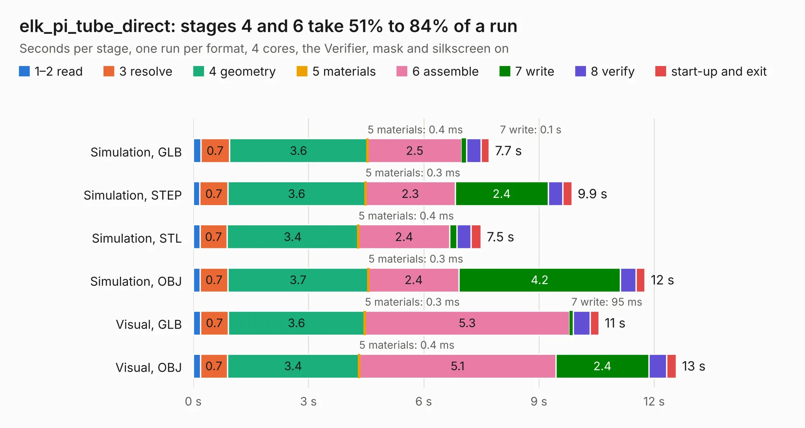

# 1075. elk_pi_tube_direct

Board 1,075 of the 3,127 of [Corpus Testing](../Corpus-Testing.md), on [Corpus Page 10](../CorpusTestingPages/Corpus-Testing-10.md#1075-elk_pi_tube_direct).

| Mode and format | 1–2 read | 3 resolve | 4 geometry | 5 materials | 6 assemble | 7 write | 8 verify | start-up and exit | Total |
|---|---:|---:|---:|---:|---:|---:|---:|---:|---:|
| Simulation, GLB | 0.2 | 0.7 | 3.6 | 0.4&nbsp;ms | 2.5 | 0.1 | 0.4 | 0.2 | 7.7 |
| Simulation, STEP | 0.2 | 0.7 | 3.6 | 0.3&nbsp;ms | 2.3 | 2.4 | 0.4 | 0.2 | 9.9 |
| Simulation, STL | 0.2 | 0.7 | 3.4 | 0.4&nbsp;ms | 2.4 | 0.2 | 0.4 | 0.3 | 7.5 |
| Simulation, OBJ | 0.2 | 0.7 | 3.7 | 0.3&nbsp;ms | 2.4 | 4.2 | 0.4 | 0.2 | 11.8 |
| Visual, GLB | 0.2 | 0.7 | 3.6 | 0.3&nbsp;ms | 5.3 | 95&nbsp;ms | 0.4 | 0.2 | 10.6 |
| Visual, OBJ | 0.2 | 0.7 | 3.4 | 0.4&nbsp;ms | 5.1 | 2.4 | 0.5 | 0.3 | 12.6 |

<table align="center"><tr><td valign="top">

| Board | Repo: [google/myelin-acorn-electron-hardware](https://github.com/google/myelin-acorn-electron-hardware) Board: `elk_pi_tube_direct.kicad_pcb` |
|---|---|
| Folder | elk_pi_tube_direct / pcb |
| Complexity | 185&nbsp;/&nbsp;1000 (size&nbsp;140, features&nbsp;45) |
| KESE&nbsp;features | through vias, filled zones, curved board outline |
| Tested | 9th November 2026 |
| Copper&nbsp;layers | 2 |
| File&nbsp;format | KiCad 5 (20171130) |
| Parts,&nbsp;tracks,&nbsp;vias | 10, 289, 29 |
| Triangles,&nbsp;simulation | 731,816 in 57 parts |
| Verifier | PASS in all six runs |

</td><td valign="top">

<table>
<tr><th>File type</th><th>File size</th><th>Peak memory used</th></tr>
<tr><th colspan="3" align="left">Simulation</th></tr>
<tr><td>GLB</td><td align="right">26&nbsp;MB</td><td align="right">344&nbsp;MB</td></tr>
<tr><td>STEP</td><td align="right">140&nbsp;MB</td><td align="right">398&nbsp;MB</td></tr>
<tr><td>STL</td><td align="right">37&nbsp;MB</td><td align="right">338&nbsp;MB</td></tr>
<tr><td>OBJ</td><td align="right">75&nbsp;MB</td><td align="right">519&nbsp;MB</td></tr>
<tr><th colspan="3" align="left">Visual</th></tr>
<tr><td>GLB</td><td align="right">14&nbsp;MB</td><td align="right">373&nbsp;MB</td></tr>
<tr><td>OBJ</td><td align="right">43&nbsp;MB</td><td align="right">367&nbsp;MB</td></tr>
</table>

</td></tr></table>

| Previous | Next |
|:---|---:|
| [1074. econet_hub](b1074b_myelin-acorn-electron-hardware_econet-hub.md) | [1076. acorn-electron-expansion](b1076b_myelin-acorn-electron-hardware_acorn-electron-expansion.md) |
