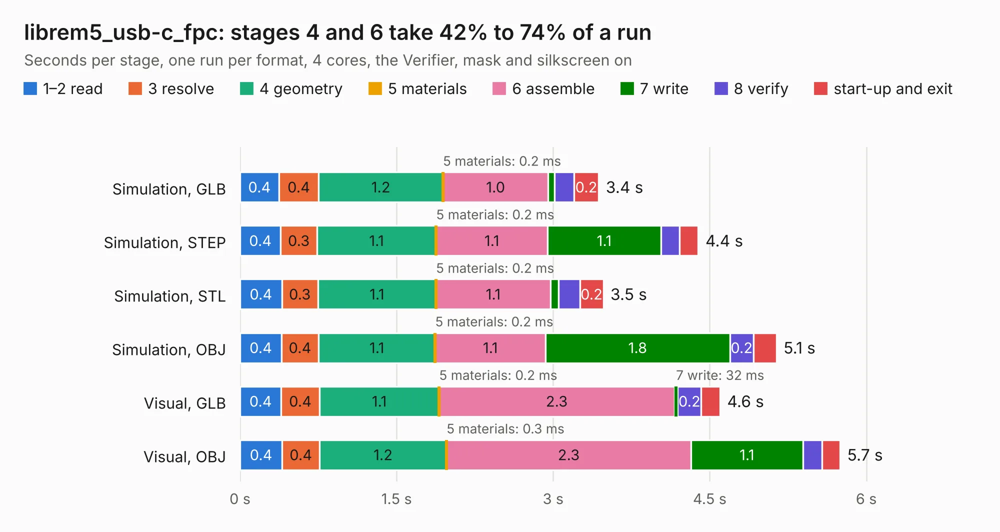

# 1076. librem5_usb-c_fpc

Board 1,076 of the 3,104 of [Corpus Testing](../Corpus-Testing.md), on [Corpus Page 10](../CorpusTestingPages/Corpus-Testing-10.md#1076-librem5_usb-c_fpc).

| Mode and format | 1–2 read | 3 resolve | 4 geometry | 5 materials | 6 assemble | 7 write | 8 verify | start-up and exit | Total |
|---|---:|---:|---:|---:|---:|---:|---:|---:|---:|
| Simulation, GLB | 0.4 | 0.4 | 1.2 | 0.2&nbsp;ms | 1.0 | 59&nbsp;ms | 0.2 | 0.2 | 3.4 |
| Simulation, STEP | 0.4 | 0.3 | 1.1 | 0.2&nbsp;ms | 1.1 | 1.1 | 0.2 | 0.2 | 4.4 |
| Simulation, STL | 0.4 | 0.3 | 1.1 | 0.2&nbsp;ms | 1.1 | 80&nbsp;ms | 0.2 | 0.2 | 3.5 |
| Simulation, OBJ | 0.4 | 0.4 | 1.1 | 0.2&nbsp;ms | 1.1 | 1.8 | 0.2 | 0.2 | 5.1 |
| Visual, GLB | 0.4 | 0.4 | 1.1 | 0.2&nbsp;ms | 2.3 | 32&nbsp;ms | 0.2 | 0.2 | 4.6 |
| Visual, OBJ | 0.4 | 0.4 | 1.2 | 0.3&nbsp;ms | 2.3 | 1.1 | 0.2 | 0.2 | 5.7 |

<table align="center"><tr><td valign="top">

| Board | Repo: [gralco/l5-schematic](https://github.com/gralco/l5-schematic) Board: `librem5_usb-c_fpc.kicad_pcb` |
|---|---|
| Folder | CAD / KiCad / librem5_usb-c_fpc |
| Complexity | 203&nbsp;/&nbsp;1000 (size&nbsp;148, features&nbsp;55) |
| KESE&nbsp;features | through vias, filled zones, copper drawings, curved board outline |
| Tested | 9th November 2026 |
| Copper&nbsp;layers | 4 |
| File&nbsp;format | KiCad 9 (20241229) |
| Parts,&nbsp;tracks,&nbsp;vias | 2, 240, 96 |
| Triangles,&nbsp;simulation | 367,218 in 38 parts |
| Verifier | PASS in all six runs |

</td><td valign="top">

<table>
<tr><th>File type</th><th>File size</th><th>Peak memory used</th></tr>
<tr><th colspan="3" align="left">Simulation</th></tr>
<tr><td>GLB</td><td align="right">13&nbsp;MB</td><td align="right">271&nbsp;MB</td></tr>
<tr><td>STEP</td><td align="right">39&nbsp;MB</td><td align="right">289&nbsp;MB</td></tr>
<tr><td>STL</td><td align="right">18&nbsp;MB</td><td align="right">266&nbsp;MB</td></tr>
<tr><td>OBJ</td><td align="right">37&nbsp;MB</td><td align="right">278&nbsp;MB</td></tr>
<tr><th colspan="3" align="left">Visual</th></tr>
<tr><td>GLB</td><td align="right">7.5&nbsp;MB</td><td align="right">254&nbsp;MB</td></tr>
<tr><td>OBJ</td><td align="right">22&nbsp;MB</td><td align="right">247&nbsp;MB</td></tr>
</table>

</td></tr></table>

| Previous | Next |
|:---|---:|
| [1075. librem5_usb-c_board](b1075b_l5-schematic_librem5-usb-c-board.md) | [1077. librem5_mainboard](b1077b_l5-schematic_CAD-PADS-librem5-mainboard-librem5-mainboard-kicad-conversion_librem5-mainboard.md) |
