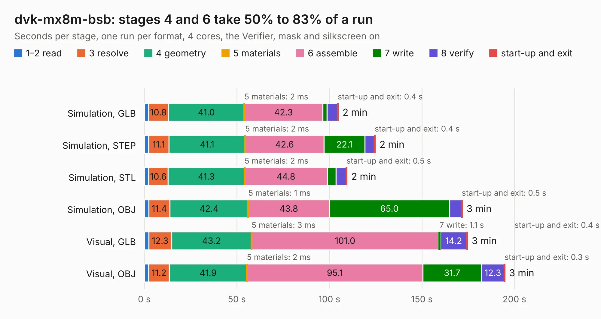

# 1077. dvk-mx8m-bsb

Board 1,077 of the 3,111 of [Corpus Testing](../Corpus-Testing.md), on [Corpus Page 10](../CorpusTestingPages/Corpus-Testing-10.md#1077-dvk-mx8m-bsb).

| Mode and format | 1–2 read | 3 resolve | 4 geometry | 5 materials | 6 assemble | 7 write | 8 verify | start-up and exit | Total |
|---|---:|---:|---:|---:|---:|---:|---:|---:|---:|
| Simulation, GLB | 2.2 | 10.8 | 41.0 | 2&nbsp;ms | 42.3 | 2.3 | 5.6 | 0.4 | 104.8 |
| Simulation, STEP | 2.3 | 11.1 | 41.1 | 2&nbsp;ms | 42.6 | 22.1 | 5.1 | 0.4 | 124.8 |
| Simulation, STL | 2.3 | 10.6 | 41.3 | 2&nbsp;ms | 44.8 | 4.6 | 5.5 | 0.5 | 109.5 |
| Simulation, OBJ | 2.4 | 11.4 | 42.4 | 1&nbsp;ms | 43.8 | 65.0 | 6.4 | 0.5 | 171.8 |
| Visual, GLB | 2.4 | 12.3 | 43.2 | 3&nbsp;ms | 101.0 | 1.1 | 14.2 | 0.4 | 174.6 |
| Visual, OBJ | 2.4 | 11.2 | 41.9 | 2&nbsp;ms | 95.1 | 31.7 | 12.3 | 0.3 | 194.8 |

<table align="center"><tr><td valign="top">

| Board | Repo: [gralco/dvk-mx8m-bsb](https://github.com/gralco/dvk-mx8m-bsb) Board: `dvk-mx8m-bsb.kicad_pcb` |
|---|---|
| Complexity | 407&nbsp;/&nbsp;1000 (size&nbsp;317, features&nbsp;90) |
| KESE&nbsp;features | through vias, slotted holes, custom pads, rounded, trapezoid or chamfered pads, filled zones, copper text, curved board outline |
| Tested | 9th November 2026 |
| Copper&nbsp;layers | 6 |
| File&nbsp;format | KiCad 5 (20171130) |
| Parts,&nbsp;tracks,&nbsp;vias | 651, 17,587, 1,474 |
| Triangles,&nbsp;simulation | 11,609,834 in 629 parts |
| Verifier | PASS in all six runs |

</td><td valign="top">

<table>
<tr><th>File type</th><th>File size</th><th>Peak memory used</th></tr>
<tr><th colspan="3" align="left">Simulation</th></tr>
<tr><td>GLB</td><td align="right">403&nbsp;MB</td><td align="right">2.7&nbsp;GB</td></tr>
<tr><td>STEP</td><td align="right">1.6&nbsp;GB</td><td align="right">3.7&nbsp;GB</td></tr>
<tr><td>STL</td><td align="right">581&nbsp;MB</td><td align="right">2.9&nbsp;GB</td></tr>
<tr><td>OBJ</td><td align="right">1.3&nbsp;GB</td><td align="right">7.4&nbsp;GB</td></tr>
<tr><th colspan="3" align="left">Visual</th></tr>
<tr><td>GLB</td><td align="right">236&nbsp;MB</td><td align="right">3.6&nbsp;GB</td></tr>
<tr><td>OBJ</td><td align="right">764&nbsp;MB</td><td align="right">4.9&nbsp;GB</td></tr>
</table>

</td></tr></table>

| Previous | Next |
|:---|---:|
| [1076. xc9500xl_44_breakout](b1076b_myelin-acorn-electron-hardware_xc9500xl-44-breakout.md) | [1078. librem5_mainboard](b1078b_l5-schematic_CAD-KiCad-librem5-mainboard_librem5-mainboard.md) |
