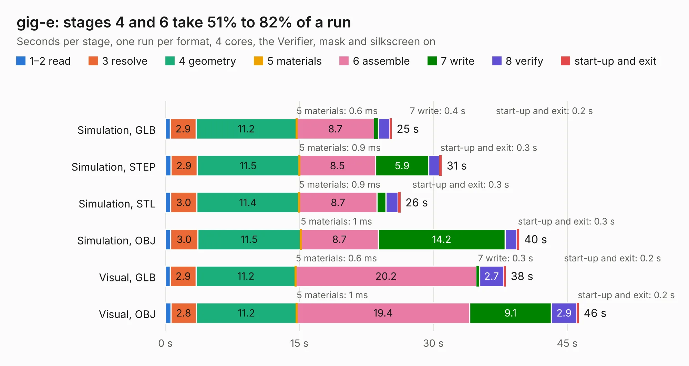

# 1078. gig-e

Board 1,078 of the 3,101 of [Corpus Testing](../Corpus-Testing.md), on [Corpus Page 10](../CorpusTestingPages/Corpus-Testing-10.md#1078-gig-e).

| Mode and format | 1–2 read | 3 resolve | 4 geometry | 5 materials | 6 assemble | 7 write | 8 verify | start-up and exit | Total |
|---|---:|---:|---:|---:|---:|---:|---:|---:|---:|
| Simulation, GLB | 0.6 | 2.9 | 11.2 | 0.6&nbsp;ms | 8.7 | 0.4 | 1.3 | 0.2 | 25.3 |
| Simulation, STEP | 0.6 | 2.9 | 11.5 | 0.9&nbsp;ms | 8.5 | 5.9 | 1.2 | 0.3 | 30.9 |
| Simulation, STL | 0.6 | 3.0 | 11.4 | 0.9&nbsp;ms | 8.7 | 1.0 | 1.3 | 0.3 | 26.3 |
| Simulation, OBJ | 0.6 | 3.0 | 11.5 | 1&nbsp;ms | 8.7 | 14.2 | 1.3 | 0.3 | 39.6 |
| Visual, GLB | 0.6 | 2.9 | 11.2 | 0.6&nbsp;ms | 20.2 | 0.3 | 2.7 | 0.2 | 38.1 |
| Visual, OBJ | 0.6 | 2.8 | 11.2 | 1&nbsp;ms | 19.4 | 9.1 | 2.9 | 0.2 | 46.3 |

<table align="center"><tr><td valign="top">

| Board | Repo: [greatscottgadgets/daisho](https://github.com/greatscottgadgets/daisho) Board: `gig-e.kicad_pcb` |
|---|---|
| Folder | hw / de2-115-frontend / gig-e |
| Complexity | 307&nbsp;/&nbsp;1000 (size&nbsp;272, features&nbsp;35) |
| KESE&nbsp;features | through vias, filled zones |
| Tested | 9th November 2026 |
| Copper&nbsp;layers | 4 |
| File&nbsp;format | KiCad 3 (3) |
| Parts,&nbsp;tracks,&nbsp;vias | 181, 2,692, 396 |
| Triangles,&nbsp;simulation | 2,547,136 in 199 parts |
| Verifier | PASS in all six runs |

</td><td valign="top">

<table>
<tr><th>File type</th><th>File size</th><th>Peak memory used</th></tr>
<tr><th colspan="3" align="left">Simulation</th></tr>
<tr><td>GLB</td><td align="right">90&nbsp;MB</td><td align="right">882&nbsp;MB</td></tr>
<tr><td>STEP</td><td align="right">353&nbsp;MB</td><td align="right">1.1&nbsp;GB</td></tr>
<tr><td>STL</td><td align="right">127&nbsp;MB</td><td align="right">911&nbsp;MB</td></tr>
<tr><td>OBJ</td><td align="right">273&nbsp;MB</td><td align="right">1.7&nbsp;GB</td></tr>
<tr><th colspan="3" align="left">Visual</th></tr>
<tr><td>GLB</td><td align="right">61&nbsp;MB</td><td align="right">1.1&nbsp;GB</td></tr>
<tr><td>OBJ</td><td align="right">188&nbsp;MB</td><td align="right">1.3&nbsp;GB</td></tr>
</table>

</td></tr></table>

| Previous | Next |
|:---|---:|
| [1077. cynthion](b1077b_cynthion-hardware_cynthion.md) | [1079. hdmi](b1079b_daisho_hw-de2-115-frontend-hdmi_hdmi.md) |
