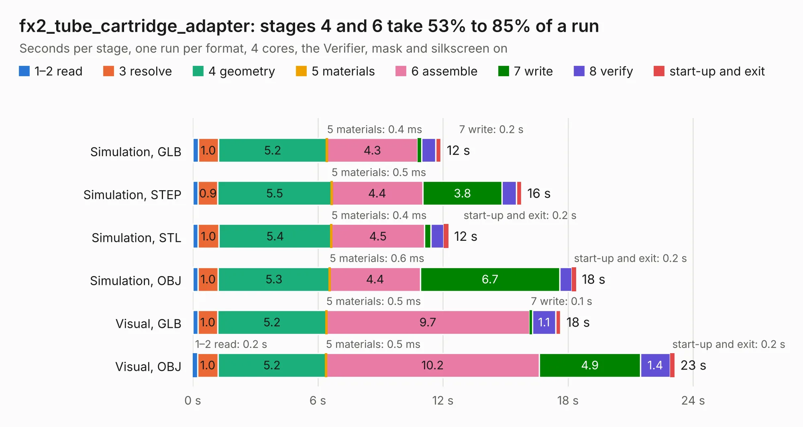

# 1079. fx2_tube_cartridge_adapter

Board 1,079 of the 3,139 of [Corpus Testing](../Corpus-Testing.md), on [Corpus Page 10](../CorpusTestingPages/Corpus-Testing-10.md#1079-fx2_tube_cartridge_adapter).

| Mode and format | 1–2 read | 3 resolve | 4 geometry | 5 materials | 6 assemble | 7 write | 8 verify | start-up and exit | Total |
|---|---:|---:|---:|---:|---:|---:|---:|---:|---:|
| Simulation, GLB | 0.3 | 1.0 | 5.2 | 0.4&nbsp;ms | 4.3 | 0.2 | 0.7 | 0.3 | 11.9 |
| Simulation, STEP | 0.3 | 0.9 | 5.5 | 0.5&nbsp;ms | 4.4 | 3.8 | 0.7 | 0.3 | 15.8 |
| Simulation, STL | 0.3 | 1.0 | 5.4 | 0.4&nbsp;ms | 4.5 | 0.3 | 0.6 | 0.2 | 12.3 |
| Simulation, OBJ | 0.3 | 1.0 | 5.3 | 0.6&nbsp;ms | 4.4 | 6.7 | 0.6 | 0.2 | 18.4 |
| Visual, GLB | 0.2 | 1.0 | 5.2 | 0.5&nbsp;ms | 9.7 | 0.1 | 1.1 | 0.2 | 17.6 |
| Visual, OBJ | 0.2 | 1.0 | 5.2 | 0.5&nbsp;ms | 10.2 | 4.9 | 1.4 | 0.2 | 23.1 |

<table align="center"><tr><td valign="top">

| Board | Repo: [google/myelin-acorn-electron-hardware](https://github.com/google/myelin-acorn-electron-hardware) Board: `fx2_tube_cartridge_adapter.kicad_pcb` |
|---|---|
| Folder | fx2_tube_cartridge_adapter / pcb |
| Complexity | 220&nbsp;/&nbsp;1000 (size&nbsp;165, features&nbsp;55) |
| KESE&nbsp;features | through vias, rounded, trapezoid or chamfered pads, filled zones, curved board outline |
| Tested | 9th November 2026 |
| Copper&nbsp;layers | 2 |
| File&nbsp;format | KiCad 4 (4) |
| Parts,&nbsp;tracks,&nbsp;vias | 24, 825, 55 |
| Triangles,&nbsp;simulation | 1,279,324 in 73 parts |
| Verifier | PASS in all six runs |

</td><td valign="top">

<table>
<tr><th>File type</th><th>File size</th><th>Peak memory used</th></tr>
<tr><th colspan="3" align="left">Simulation</th></tr>
<tr><td>GLB</td><td align="right">44&nbsp;MB</td><td align="right">577&nbsp;MB</td></tr>
<tr><td>STEP</td><td align="right">206&nbsp;MB</td><td align="right">638&nbsp;MB</td></tr>
<tr><td>STL</td><td align="right">64&nbsp;MB</td><td align="right">599&nbsp;MB</td></tr>
<tr><td>OBJ</td><td align="right">130&nbsp;MB</td><td align="right">856&nbsp;MB</td></tr>
<tr><th colspan="3" align="left">Visual</th></tr>
<tr><td>GLB</td><td align="right">33&nbsp;MB</td><td align="right">688&nbsp;MB</td></tr>
<tr><td>OBJ</td><td align="right">100&nbsp;MB</td><td align="right">715&nbsp;MB</td></tr>
</table>

</td></tr></table>

| Previous | Next |
|:---|---:|
| [1078. acorn-electron-expansion](b1078b_myelin-acorn-electron-hardware_acorn-electron-expansion.md) | [1080. master_updateable_megarom](b1080b_myelin-acorn-electron-hardware_master-updateable-megarom.md) |
